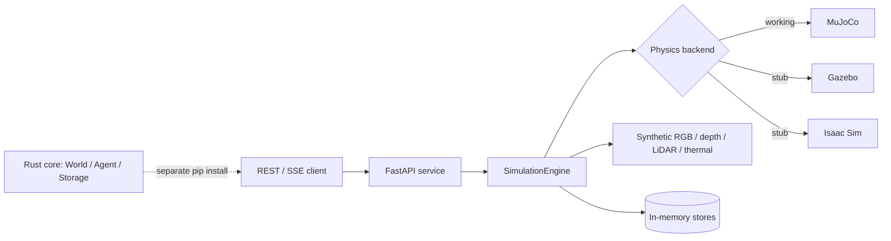

# PyRoboSimulator

**Simulate the fleet. Generate the scenario. Inspect the sensor stream.** An AI-native multi-agent simulator with a pip-installable Rust core, a FastAPI simulation service, synthetic RGB/depth/LiDAR/thermal sensors, and real MuJoCo physics.

[](https://github.com/Mullassery/PyRoboSimulator/actions/workflows/ci-cd.yaml)
[](https://pypi.org/project/pyrobosimulator/)
[](LICENSE)
[](https://www.python.org/)
[](#nvidia-ecosystem)

> **Why it exists:** testing multi-robot behavior needs thousands of cheap, reproducible runs — not one expensive photo-real scene. PyRoboSimulator gives you a fast multi-agent core, a service API for parallel experiments, and pluggable physics: real MuJoCo today, NVIDIA Isaac Sim as an explicit scaffold, not a fake integration.

## Two pieces, one name

| Piece | Install | What you get |
|---|---|---|
| **Rust core** | `pip install pyrobosimulator` | `World`, `Agent`, `AgentType`, `Mission`, `NarrativeEngine`, `ROS2Bridge`, `StorageEngine`; gravity, forward-Euler integration, pairwise collision detection, RocksDB event log. |
| **FastAPI service** | run from `backend/` | `SimulationEngine`, scenario generation, synthetic sensors, REST/SSE API, MuJoCo/Gazebo/Isaac Sim backend interfaces. |

`SimulationEngine` and `ScenarioBuilder` are **not** in the pip package. They live in `backend/`; install that from source.

## 60-second quickstart

```bash
pip install pyrobosimulator
```

```python
from pyrobosimulator import World, Agent, AgentType

world = World("demo")
robot = Agent("robot-1", AgentType.Robot)
robot.set_position(0.0, 0.0, 10.0)
robot.set_mass(1.0)
world.add_agent(robot)

for _ in range(100):          # 1 simulated second at 10 ms
    world.step(0.01)

print(world.get_agent(robot.id()).position())
print("collisions:", world.detect_collisions())
```

Backend service (from source):

```bash
git clone https://github.com/Mullassery/PyRoboSimulator.git
cd PyRoboSimulator/backend
pip install -e ".[dev]"
uvicorn src.main:app --reload
```

```bash
curl -X POST http://localhost:8000/api/v1/simulations \
  -H "Content-Type: application/json" \
  -d '{"scenario": "parking_lot", "num_agents": 50, "duration": 30.0}'
```

## NVIDIA ecosystem

PyRoboSimulator is **NVIDIA-optional today**. The core, tests, and the working MuJoCo backend need no NVIDIA GPU or driver. The NVIDIA seams are deliberately labeled so nobody mistakes a scaffold for an integration.

| Component | Status | What it actually does |
|---|---|---|
| Isaac Sim physics backend | **Real adapter, hardware-unverified** | `backend/src/simulators/isaac_sim_backend.py` uses `backend/src/integrations/isaac_sim_runtime.py` with lazy imports/version fallbacks; `initialize()` fails fast with `EnvironmentError` if Omniverse/Isaac Sim + NVIDIA GPU absent. Requires Omniverse + NVIDIA GPU. |
| Gazebo physics backend | **Scaffold only** | Same fail-fast pattern. Not a working integration. |
| MuJoCo physics backend | **Working** | Loads real MJCF/URDF models, steps real dynamics, extracts body/joint/contact/sensor state. CPU by default. |
| SANA-WM scenario / video provider | **Real adapter, hardware-unverified** | `backend/src/integrations/sana_wm.py` discovers NVlabs/Sana, builds the upstream CLI, runs without shell, writes provenance manifest (hashes/git/model/sha256/synthetic). Requires Python 3.11+, CUDA 12.8/cu128, H100/GB200, weights; not verified here. |
| NVIDIA GPU requirement | **None** | `pip install pyrobosimulator`, the backend, tests, and MuJoCo run CPU-first. |

**The honest headline:** this repo is NVIDIA-optional, not NVIDIA-powered. Isaac Sim is a contract for a future backend; SANA-WM is not wired. The simulator earns its keep today with a real Rust core, a real MuJoCo path, and a service API you can run on a laptop.

## At a glance

| Area | Status |
|---|---|
| Rust core physics (`World.step`, gravity, collision) | **Works**, unit-tested |
| RocksDB event log (`StorageEngine`) | **Works** |
| FastAPI simulation service + REST/SSE | **Works**, alpha |
| MuJoCo physics backend | **Works** (optional `[physics]`) |
| Procedural scenarios (parking lot, warehouse, urban street) | **Works** |
| Synthetic RGB / depth / LiDAR / thermal streams | **Works** — mock/procedural data, not ray-traced |
| Deterministic domain randomization | **Works** for seeded draws; bit-exact cross-machine MuJoCo not verified |
| Gymnasium / PettingZoo adapters | **Available** (`[rl]`) |
| Isaac Sim / Gazebo backends | **Stubs**, fail fast |
| SANA-WM synthetic video | **Not shipped** |
| Published 100K-agent / performance claims | **Unverified** |
| Backend test suite | **Not green** — known pre-existing failures |
| "Production-grade" / certified | **No** — alpha |

## What it is

PyRoboSimulator is two separately-installed pieces under one name:

1. **A pip-installable Rust core** (`pip install pyrobosimulator`) exposing `World`, `Agent`, `AgentType`, `Mission`, `NarrativeEngine`, `ROS2Bridge`, and `StorageEngine`. It provides real multi-agent state, gravity, forward-Euler integration, and pairwise collision detection, plus a RocksDB-backed event log.
2. **A FastAPI backend service** run from source in `backend/`. It provides the simulation loop (`SimulationEngine`), procedural world generation (`ScenarioBuilder`), synthetic RGB/Depth/Lidar/Thermal sensors, a REST API, and the pluggable physics backends (MuJoCo, Gazebo, Isaac Sim).

The two are not interchangeable — read **What it is not** before copying any example.



## Features

- **Multi-agent physics (pip core)** — `World.step(dt)` applies gravity to every agent and integrates; `Agent.apply_force()`, velocity clamping, `World.detect_collisions()` (O(n²) pairwise).
- **RocksDB event log (pip core)** — `StorageEngine` is a real on-disk append-only store keyed by `world_id`.
- **Simulation loop (backend)** — configurable timestep (default 16 ms @ 60 Hz), AABB collision, boundary conditions, deterministic seeding.
- **Synthetic sensors (backend)** — RGB camera, depth, Lidar point clouds, and thermal cameras with per-agent configuration. These are procedurally generated/mock streams, not photorealistic rendering.
- **Real MuJoCo backend** — loads real MJCF/URDF models, steps real dynamics, and extracts body/joint/contact/sensor state.
- **Deterministic visual/domain randomization** — lighting, friction, and mass draws use one generator seeded from `SimulatorConfig.seed` (or a per-world `WorldConfig.seed`); mock camera/Lidar/raycast data follows the same seeded pattern.
- **World generation** — built-in parking-lot, warehouse, and urban-street scenarios; procedural obstacle placement; reproducible seeds.
- **REST API** — simulation CRUD, status, results, and SSE streaming; JWT auth with bcrypt; OpenAPI docs at `/docs`.
- **Agent behavior (backend)** — behavior trees, A*/NavMesh pathfinding with RVO avoidance, multi-layer agent memory, and multi-agent messaging.
- **Narrative + learning (backend)** — Claude-backed NLP→scenario conversion, curriculum learning, and fleet learning.

## Who it's for / Use cases

- **Autonomous-vehicle algorithm testing** — scripted urban scenarios with many agents to exercise collision avoidance.
- **Multi-robot coordination** — warehouse fleets, formation control, and communication testing.
- **Sensor-fusion research** — synchronized synthetic RGB/depth/Lidar/thermal streams per agent.
- **RL / imitation-learning experiments** — procedural environments with deterministic seeds.
- **Service integration** — drive simulations over the REST API instead of embedding the engine.
- **MuJoCo users** — bring real MJCF/URDF models and step real dynamics through the backend.

## What it is not

- **`pip install pyrobosimulator` does not include `SimulationEngine` or `ScenarioBuilder`.** Those live only in the `backend/` service; install from source to use them.
- **`NarrativeEngine.generate_from_events` is not implemented in the Rust core** — it raises `NotImplementedError` by design. Use the Claude-backed path in `backend/src/narratives/narrative_converter.py`.
- **Gazebo backend is not a real integration.** `initialize()` raises `EnvironmentError`. Isaac Sim has a real adapter/runtime with lazy imports and fallbacks, but requires Omniverse + NVIDIA GPU and fails fast if unavailable; only MuJoCo is a working physics backend in typical dev/CI.
- **SANA-WM integration is a real adapter (hardware-unverified).** `backend/src/integrations/sana_wm.py` can invoke the upstream CLI, record provenance, and label outputs as synthetic; inference requires Python 3.11+, CUDA 12.8, H100/GB200, and weights not present here. |
- **Backend database and cache are still in-memory** for simulations/users. The PostgreSQL/Redis integration is partially wired, not fully load-bearing.
- **The published performance benchmarks are not backed by a committed, reproducible benchmark suite** — treat them as unverified historical claims. The `100K+ agents` figure is not reproduced here.
- **Not a certified or production-verified simulator.** Development status is Alpha.
- **Physics determinism is only partially verified.** Seeded RNG makes domain-randomization values and visual metadata reproducible, but bit-exact MuJoCo trajectories across different OSes, CPUs, or MuJoCo versions are not verified.
- **The backend test suite is not green.** At the last full run: ~882 passed / 33 failed / 1 error; the remaining failures are pre-existing and not all related to physics/simulator work.

## Project status

Alpha (Development Status 3), source version **0.12.5**. The Rust core (`World`/`Agent`/`StorageEngine`, real gravity, integration, collision detection, RocksDB storage) and the MuJoCo backend are implemented and unit-tested; Gazebo/Isaac Sim are stubs that fail fast. The backend suite is large (900+ tests) and currently has known pre-existing failures; `mypy` (strict) still reports a large backlog that is not CI-gating, and the frontend has had a TypeScript error sweep but not a full quality audit. See [ROADMAP_HONEST.md](ROADMAP_HONEST.md).

## Installation

```bash
pip install pyrobosimulator
```

This installs only the Rust core (Python 3.10+).

The backend service is run from source:

```bash
git clone https://github.com/Mullassery/PyRoboSimulator.git
cd PyRoboSimulator/backend
pip install -e ".[dev]"
uvicorn src.main:app --reload
```

Add the optional MuJoCo physics backend with `pip install -e ".[physics]"`.

## Gymnasium / PettingZoo adapters

Use the simulator from standard RL loops:

```bash
pip install "pyrobosimulator[rl]"
```

```python
from pyrobosimulator import RobotGymEnv

env = RobotGymEnv(engine, agent_id=0)
obs, info = env.reset(seed=42)
obs, reward, terminated, truncated, info = env.step([goal_x, goal_y])
```

`RobotGymEnv` exposes one agent (action = absolute 2D goal target) and
`RobotParallelEnv` exposes all agents through the PettingZoo `ParallelEnv`
protocol. Physics/step semantics stay in the existing backend; the adapters
only translate observations/actions/rewards.

## Usage

```python
from pyrobosimulator import SimulationEngine

engine = SimulationEngine(num_agents=100, duration=60.0, timestep=0.016)
engine.run()
summary = engine.get_summary()
print(summary["collision_count"], summary["goal_reached_count"])
```

Key backend endpoints: `POST/GET/PUT/DELETE /api/v1/simulations`, `.../{id}/start|stop|status|results|agents|summary|stream` (SSE), plus `GET /health`, `/ready`, `/metrics`. Full list in `backend/docs/`.

## For AI agents

Canonical facts for automated tooling and coding agents:

| Fact | Value |
|---|---|
| Package | `pyrobosimulator` (Rust core only) |
| Python | `>=3.10` |
| Core entry points | `World`, `Agent`, `AgentType`, `StorageEngine`, `RobotGymEnv` |
| Service entry points | `backend/src/main.py:app`, `backend/src/services/simulation_engine.py:SimulationEngine` |
| Core install | `pip install pyrobosimulator` |
| Backend install | `cd backend && pip install -e ".[dev]"` |
| Backend run | `uvicorn src.main:app --reload` |
| Tests | `pytest backend/tests -q` (suite has known failures) |
| Physics extra | `cd backend && pip install -e ".[physics]"` |
| GPU needed? | **No** for core, tests, or MuJoCo |
| Working physics | **MuJoCo only** |
| Isaac Sim / Gazebo | **Stubs** — fail fast |
| SANA-WM | **Not integrated** |
| Version | `0.12.5` |

Agent-friendly docs: [ROADMAP_HONEST.md](ROADMAP_HONEST.md), [backend/README.md](backend/README.md), [VISION.md](VISION.md), [backend/docs/](backend/docs/).

## Documentation

- [backend/README.md](backend/README.md) — backend service setup
- [VISION.md](VISION.md) — product vision
- [ROADMAP_HONEST.md](ROADMAP_HONEST.md) — implemented vs planned, honest caveats
- [backend/docs/DEPLOYMENT.md](backend/docs/DEPLOYMENT.md) — Docker / Kubernetes / local dev
- [backend/docs/SCHEMA.md](backend/docs/SCHEMA.md) — database schema
- [backend/docs/UE5_INTEGRATION.md](backend/docs/UE5_INTEGRATION.md) — rendering integration
- [backend/docs/OSS_COMPLIANCE.md](backend/docs/OSS_COMPLIANCE.md) — dependency license audit
- [examples/](examples/) — example scripts
- [CHANGELOG.md](CHANGELOG.md) — notable changes

## Known issues and deferred work

**Blocked / failed:**
- Ship `SimulationEngine`/`ScenarioBuilder` in the wheel; fix failing backend tests; reproducible benchmark.
- Implement real Isaac Sim / Gazebo backends (currently fail-fast stubs).
- Integrate a SANA-WM scenario provider (not shipped).

**Rejected / deferred:**
- Gazebo/Isaac integration as a near-term deliverable.
- Unverified 100K-agent performance claims.

Full shipped/blocked/rejected detail: [`QUEUE_STATUS.md`](QUEUE_STATUS.md).

## Contributing

See [CONTRIBUTING.md](CONTRIBUTING.md). Bug reports and feature requests: [GitHub Issues](https://github.com/Mullassery/PyRoboSimulator/issues); questions: [GitHub Discussions](https://github.com/Mullassery/PyRoboSimulator/discussions).

## Part of the robotics & autonomy family

PyRoboSimulator is one of six complementary, composable tools in the Mullassery **robotics & autonomy** family. Together they form a single stack: **perceive → map → simulate → learn → debug → coordinate the fleet**.

| Tool | Role | What it does |
|---|---|---|
| [PyRoboVision](https://github.com/Mullassery/PyRoboVision) | Perception | Multi-object tracker (Kalman filter + Hungarian algorithm) and trajectory predictor for robot perception. |
| [PyTerrainMap](https://github.com/Mullassery/PyTerrainMap) | Mapping / SLAM | Fuses multi-robot terrain observations into a spatial-temporal store, with H3 spatial indexing and SLAM. |
| [PyRoboSimulator](https://github.com/Mullassery/PyRoboSimulator) | Simulation | **This project** — world simulator for autonomous systems, with a FastAPI backend. |
| [PyRoboFrames](https://github.com/Mullassery/PyRoboFrames) | Learning data | Rust-backed ML dataloader for robot-learning datasets (native LeRobot format, Apple Silicon hardware video decode). |
| [PyRoboReplay](https://github.com/Mullassery/PyRoboReplay) | Mission forensics | Forensic-debugging and causal-analysis engine for autonomous robot mission replay. |
| [SyncFleet](https://github.com/Mullassery/SyncFleet) | Fleet coordination | Rust + SQLite, peer-to-peer state sync for robotics fleets — mutual-TLS 1.3, version-vector replication, mDNS discovery; conflict resolution on the roadmap. |

Each works standalone, but they're complementary by design. [Browse all projects →](https://github.com/Mullassery?tab=repositories)

## License

Apache License 2.0 — see [LICENSE](LICENSE).
