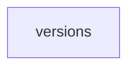

_Generated by CodeAtlas._

## Details

Owns 3 symbols across 3 file(s).

### versions

Owns 2 symbols across 1 file(s).

**Related Classes/Methods:** _None_

**Source Files:**

- `backend/alembic/versions/001_create_initial_schema.py`
  - `backend.alembic.versions.001_create_initial_schema.downgrade`
  - `backend.alembic.versions.001_create_initial_schema.upgrade`
