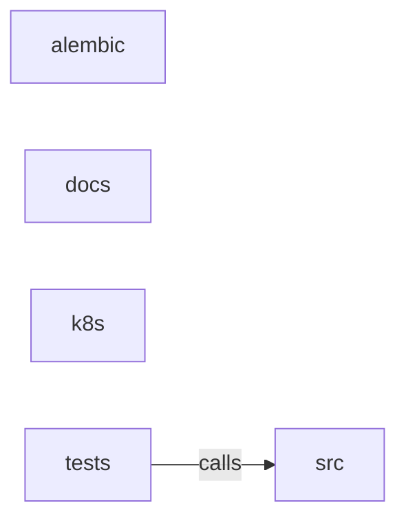

_Generated by CodeAtlas._

## Details

Owns 0 symbols across 5 file(s).

### alembic

Owns 3 symbols across 3 file(s).

**Related Classes/Methods:** _None_

**Source Files:**

- `backend/alembic/env.py`
  - `backend.alembic.env.do_run_migrations`
  - `backend.alembic.env.run_migrations_offline`
  - `backend.alembic.env.run_migrations_online`

### docs

Owns 0 symbols across 4 file(s).

**Related Classes/Methods:** _None_

### k8s

Owns 0 symbols across 5 file(s).

**Related Classes/Methods:** _None_

### src

Owns 5 symbols across 2 file(s).

**Related Classes/Methods:** _None_

**Source Files:**

- `backend/src/main.py`
  - `backend.src.main.health_check`
  - `backend.src.main.lifespan`
  - `backend.src.main.metrics`
  - `backend.src.main.readiness_check`
  - `backend.src.main.value_error_handler`

### tests

Owns 1174 symbols across 46 file(s).

**Related Classes/Methods:** _None_

**Source Files:**

- `backend/tests/conftest.py`
  - `backend.tests.conftest.auth_headers`
  - `backend.tests.conftest.client`
  - `backend.tests.conftest.client.override_get_db`
  - `backend.tests.conftest.event_loop`
  - `backend.tests.conftest.reset_demo_state`
  - `backend.tests.conftest.test_db`
- `backend/tests/test_agent_communication.py`
  - `backend.tests.test_agent_communication.TestCommunicationIntegration`
  - `backend.tests.test_agent_communication.TestCommunicationIntegration.test_message_priority_delivery`
  - `backend.tests.test_agent_communication.TestCommunicationIntegration.test_multi_agent_conversation`
  - `backend.tests.test_agent_communication.TestCommunicationNetwork`
  - `backend.tests.test_agent_communication.TestCommunicationNetwork.test_acknowledge_message`
  - `backend.tests.test_agent_communication.TestCommunicationNetwork.test_broadcast_message`
  - `backend.tests.test_agent_communication.TestCommunicationNetwork.test_broadcast_to_nearby`
  - `backend.tests.test_agent_communication.TestCommunicationNetwork.test_message_loss_on_unregistered`
  - `backend.tests.test_agent_communication.TestCommunicationNetwork.test_network_creation`
  - `backend.tests.test_agent_communication.TestCommunicationNetwork.test_network_statistics`
  - `backend.tests.test_agent_communication.TestCommunicationNetwork.test_query_messages`
  - `backend.tests.test_agent_communication.TestCommunicationNetwork.test_queue_status`
  - `backend.tests.test_agent_communication.TestCommunicationNetwork.test_receive_all_messages`
  - `backend.tests.test_agent_communication.TestCommunicationNetwork.test_receive_message`
  - `backend.tests.test_agent_communication.TestCommunicationNetwork.test_register_agent`
  - `backend.tests.test_agent_communication.TestCommunicationNetwork.test_send_direct_message`
  - `backend.tests.test_agent_communication.TestCommunicationNetwork.test_unregister_agent`
  - `backend.tests.test_agent_communication.TestCoordinationPrimitive`
  - `backend.tests.test_agent_communication.TestCoordinationPrimitive.test_broadcast_to_group`
  - `backend.tests.test_agent_communication.TestCoordinationPrimitive.test_coordination_creation`
  - `backend.tests.test_agent_communication.TestCoordinationPrimitive.test_join_leave`
  - `backend.tests.test_agent_communication.TestLeaderElection`
  - `backend.tests.test_agent_communication.TestLeaderElection.test_election_creation`
  - `backend.tests.test_agent_communication.TestLeaderElection.test_election_term_increment`
  - `backend.tests.test_agent_communication.TestLeaderElection.test_get_leader`
  - `backend.tests.test_agent_communication.TestLeaderElection.test_run_election`
  - `backend.tests.test_agent_communication.TestMessage`
  - `backend.tests.test_agent_communication.TestMessage.test_message_acknowledgment`
  - `backend.tests.test_agent_communication.TestMessage.test_message_creation`
  - `backend.tests.test_agent_communication.TestMessage.test_message_expiration`
  - `backend.tests.test_agent_communication.TestMessage.test_message_not_expired`
  - `backend.tests.test_agent_communication.TestMessageQueue`
  - `backend.tests.test_agent_communication.TestMessageQueue.test_clear_expired`
  - `backend.tests.test_agent_communication.TestMessageQueue.test_dequeue`
  - `backend.tests.test_agent_communication.TestMessageQueue.test_enqueue`
  - `backend.tests.test_agent_communication.TestMessageQueue.test_get_message_by_id`
  - `backend.tests.test_agent_communication.TestMessageQueue.test_peek`
  - `backend.tests.test_agent_communication.TestMessageQueue.test_priority_ordering`
  - `backend.tests.test_agent_communication.TestMessageQueue.test_queue_capacity`
  - `backend.tests.test_agent_communication.TestMessageQueue.test_queue_creation`
- `backend/tests/test_agent_memory.py`
  - `backend.tests.test_agent_memory.TestAgentMemory`
  - `backend.tests.test_agent_memory.TestAgentMemory.test_add_emotional_memory`
  - `backend.tests.test_agent_memory.TestAgentMemory.test_add_episodic_memory`
  - `backend.tests.test_agent_memory.TestAgentMemory.test_add_procedural_memory`
  - `backend.tests.test_agent_memory.TestAgentMemory.test_add_relationship`
  - `backend.tests.test_agent_memory.TestAgentMemory.test_add_semantic_memory`
  - `backend.tests.test_agent_memory.TestAgentMemory.test_forget_old_memories`
  - `backend.tests.test_agent_memory.TestAgentMemory.test_get_overall_emotional_state`
  - `backend.tests.test_agent_memory.TestAgentMemory.test_memory_capacity`
  - `backend.tests.test_agent_memory.TestAgentMemory.test_memory_creation`
  - `backend.tests.test_agent_memory.TestAgentMemory.test_memory_decay_rates`
  - `backend.tests.test_agent_memory.TestAgentMemory.test_memory_stats`
  - `backend.tests.test_agent_memory.TestAgentMemory.test_memory_with_tags`
  - `backend.tests.test_agent_memory.TestAgentMemory.test_multiple_memory_types`
  - `backend.tests.test_agent_memory.TestAgentMemory.test_recall_by_strength`
  - `backend.tests.test_agent_memory.TestAgentMemory.test_recall_by_tag`
  - `backend.tests.test_agent_memory.TestAgentMemory.test_recall_episodic`
  - `backend.tests.test_agent_memory.TestAgentMemory.test_recall_increments_access_count`
  - `backend.tests.test_agent_memory.TestAgentMemory.test_recall_limit`
  - `backend.tests.test_agent_memory.TestAgentMemory.test_relationship_bounds`
  - `backend.tests.test_agent_memory.TestAgentMemory.test_relationship_familiarity`
  - `backend.tests.test_agent_memory.TestAgentMemory.test_relevant_memories`
  - `backend.tests.test_agent_memory.TestAgentMemory.test_update_relationship`
  - `backend.tests.test_agent_memory.TestMemoryEntry`
  - `backend.tests.test_agent_memory.TestMemoryEntry.test_entry_creation`
  - `backend.tests.test_agent_memory.TestMemoryEntry.test_memory_access_count`
  - `backend.tests.test_agent_memory.TestMemoryEntry.test_memory_accessible`
  - `backend.tests.test_agent_memory.TestMemoryEntry.test_memory_decay`
  - `backend.tests.test_agent_memory.TestMemoryEntry.test_memory_strength`
  - `backend.tests.test_agent_memory.TestRelationship`
  - `backend.tests.test_agent_memory.TestRelationship.test_relationship_creation`
  - `backend.tests.test_agent_memory.TestRelationship.test_relationship_neutral`
  - `backend.tests.test_agent_memory.TestRelationship.test_relationship_strength_enemy`
  - `backend.tests.test_agent_memory.TestRelationship.test_relationship_strength_friend`
- `backend/tests/test_analytics_dashboard.py`
  - `backend.tests.test_analytics_dashboard.AnalyticsDashboardApp`
  - `backend.tests.test_analytics_dashboard.AnalyticsDashboardApp.__init__`
  - `backend.tests.test_analytics_dashboard.AnalyticsDashboardApp.get_collector`
  - `backend.tests.test_analytics_dashboard.AnalyticsDashboardApp.print_summary`
  - `backend.tests.test_analytics_dashboard.TestAnalyticsDashboardApp`
  - `backend.tests.test_analytics_dashboard.TestAnalyticsDashboardApp.test_app_initialization`
  - `backend.tests.test_analytics_dashboard.TestAnalyticsDashboardApp.test_app_with_collector`
  - `backend.tests.test_analytics_dashboard.TestAnalyticsDashboardApp.test_get_collector`
  - `backend.tests.test_analytics_dashboard.TestAnalyticsDashboardApp.test_print_summary`
  - `backend.tests.test_analytics_dashboard.TestAnalyticsDashboardIntegration`
  - `backend.tests.test_analytics_dashboard.TestAnalyticsDashboardIntegration.test_complete_analytics_workflow`
  - `backend.tests.test_analytics_dashboard.TestAnalyticsEngine`
  - `backend.tests.test_analytics_dashboard.TestAnalyticsEngine.test_callback_registration`
  - `backend.tests.test_analytics_dashboard.TestAnalyticsEngine.test_callbacks_triggered`
  - `backend.tests.test_analytics_dashboard.TestAnalyticsEngine.test_constraint_violation`
  - `backend.tests.test_analytics_dashboard.TestAnalyticsEngine.test_engine_initialization`
  - `backend.tests.test_analytics_dashboard.TestAnalyticsEngine.test_get_stats`
  - `backend.tests.test_analytics_dashboard.TestAnalyticsEngine.test_record_validation`
  - `backend.tests.test_analytics_dashboard.TestAnalyticsEngine.test_reset`
  - `backend.tests.test_analytics_dashboard.TestAnalyticsEngine.test_start_stop`
  - `backend.tests.test_analytics_dashboard.TestAnalyticsEngine.test_update_narrative`
  - `backend.tests.test_analytics_dashboard.TestAnalyticsEngine.test_update_performance`
  - `backend.tests.test_analytics_dashboard.TestAnalyticsEngine.test_update_sensor`
  - `backend.tests.test_analytics_dashboard.TestAnalyticsEngine.test_update_simulation`
  - `backend.tests.test_analytics_dashboard.TestMetricsCollector`
  - `backend.tests.test_analytics_dashboard.TestMetricsCollector.test_average_velocity`
  - `backend.tests.test_analytics_dashboard.TestMetricsCollector.test_collector_initialization`
  - `backend.tests.test_analytics_dashboard.TestMetricsCollector.test_get_summary`
  - `backend.tests.test_analytics_dashboard.TestMetricsCollector.test_narrative_metrics`
  - `backend.tests.test_analytics_dashboard.TestMetricsCollector.test_record_performance_metrics`
  - `backend.tests.test_analytics_dashboard.TestMetricsCollector.test_record_simulation_metrics`
  - `backend.tests.test_analytics_dashboard.TestMetricsCollector.test_reset`
  - `backend.tests.test_analytics_dashboard.TestMetricsCollector.test_sensor_metrics`
  - `backend.tests.test_analytics_dashboard.TestMetricsCollector.test_validation_metrics`
- `backend/tests/test_api_integration.py`
  - `backend.tests.test_api_integration.TestAuthAPI`
  - `backend.tests.test_api_integration.TestAuthAPI.test_login`
  - `backend.tests.test_api_integration.TestAuthAPI.test_login_wrong_password`
  - `backend.tests.test_api_integration.TestAuthAPI.test_register_duplicate_email`
  - `backend.tests.test_api_integration.TestAuthAPI.test_register_user`
  - `backend.tests.test_api_integration.TestHealthAPI`
  - `backend.tests.test_api_integration.TestHealthAPI.test_health_check`
  - `backend.tests.test_api_integration.TestHealthAPI.test_readiness_check`
  - `backend.tests.test_api_integration.TestResultsAPI`
  - `backend.tests.test_api_integration.TestResultsAPI.test_get_agents`
  - `backend.tests.test_api_integration.TestResultsAPI.test_get_results`
  - `backend.tests.test_api_integration.TestResultsAPI.test_get_summary`
  - `backend.tests.test_api_integration.TestSimulationAPI`
  - `backend.tests.test_api_integration.TestSimulationAPI.test_cannot_start_running_simulation`
  - `backend.tests.test_api_integration.TestSimulationAPI.test_cannot_stop_non_running_simulation`
  - `backend.tests.test_api_integration.TestSimulationAPI.test_full_simulation_workflow`
  - `backend.tests.test_api_integration.TestSimulationAPI.test_invalid_agent_count`
  - `backend.tests.test_api_integration.TestSimulationAPI.test_invalid_duration`
- `backend/tests/test_ari_system.py`
  - `backend.tests.test_ari_system.TestARIDiscoveryEngine`
  - `backend.tests.test_ari_system.TestARIDiscoveryEngine.test_confidence_estimation`
  - `backend.tests.test_ari_system.TestARIDiscoveryEngine.test_elevation_discovery`
  - `backend.tests.test_ari_system.TestARIDiscoveryEngine.test_engine_creation`
  - `backend.tests.test_ari_system.TestARIDiscoveryEngine.test_frame_analysis`
  - `backend.tests.test_ari_system.TestARIDiscoveryEngine.test_frame_processing`
  - `backend.tests.test_ari_system.TestARIDiscoveryEngine.test_openstreetmap_discovery`
  - `backend.tests.test_ari_system.TestARIDiscoveryEngine.test_traffic_discovery`
  - `backend.tests.test_ari_system.TestARIDiscoveryEngine.test_weather_discovery`
  - `backend.tests.test_ari_system.TestARIDiscoveryEngine.test_youtube_discovery`
  - `backend.tests.test_ari_system.TestARIIntegration`
  - `backend.tests.test_ari_system.TestARIIntegration.test_complete_learning_workflow`
  - `backend.tests.test_ari_system.TestARIIntegration.test_incremental_refinement`
  - `backend.tests.test_ari_system.TestARIIntegration.test_multi_region_learning`
  - `backend.tests.test_ari_system.TestARIOrchestrator`
  - `backend.tests.test_ari_system.TestARIOrchestrator.test_custom_config`
  - `backend.tests.test_ari_system.TestARIOrchestrator.test_knowledge_persistence`
  - `backend.tests.test_ari_system.TestARIOrchestrator.test_learn_and_store`
  - `backend.tests.test_ari_system.TestARIOrchestrator.test_learn_region`
  - `backend.tests.test_ari_system.TestARIOrchestrator.test_learning_status`
  - `backend.tests.test_ari_system.TestARIOrchestrator.test_needs_learning_unknown_region`
  - `backend.tests.test_ari_system.TestARIOrchestrator.test_orchestrator_creation`
  - `backend.tests.test_ari_system.TestARIOrchestrator.test_refine_knowledge`
  - `backend.tests.test_ari_system.TestKnowledgeStore`
  - `backend.tests.test_ari_system.TestKnowledgeStore.test_add_and_retrieve`
  - `backend.tests.test_ari_system.TestKnowledgeStore.test_has_knowledge_with_confidence`
  - `backend.tests.test_ari_system.TestKnowledgeStore.test_merge_knowledge`
  - `backend.tests.test_ari_system.TestKnowledgeStore.test_store_creation`
  - `backend.tests.test_ari_system.TestRegionalKnowledge`
  - `backend.tests.test_ari_system.TestRegionalKnowledge.test_confidence_calculation`
  - `backend.tests.test_ari_system.TestRegionalKnowledge.test_knowledge_creation`
  - `backend.tests.test_ari_system.TestRegionalKnowledge.test_knowledge_dict_conversion`
  - `backend.tests.test_ari_system.TestRegionalKnowledge.test_knowledge_serialization`
- `backend/tests/test_auth.py`
  - `backend.tests.test_auth.TestAuthService`
  - `backend.tests.test_auth.TestAuthService.test_create_access_token`
  - `backend.tests.test_auth.TestAuthService.test_decode_token_invalid`
  - `backend.tests.test_auth.TestAuthService.test_decode_token_tampered`
  - `backend.tests.test_auth.TestAuthService.test_decode_token_valid`
  - `backend.tests.test_auth.TestAuthService.test_hash_password`
  - `backend.tests.test_auth.TestAuthService.test_password_hashing_consistency`
  - `backend.tests.test_auth.TestAuthService.test_verify_password_correct`
  - `backend.tests.test_auth.TestAuthService.test_verify_password_incorrect`
- `backend/tests/test_backend_interface.py`
  - `backend.tests.test_backend_interface.TestBackendFactory`
  - `backend.tests.test_backend_interface.TestBackendFactory.test_create_backend`
  - `backend.tests.test_backend_interface.TestBackendFactory.test_create_unregistered_backend_error`
  - `backend.tests.test_backend_interface.TestBackendFactory.test_factory_creation`
  - `backend.tests.test_backend_interface.TestBackendFactory.test_register_backend`
  - `backend.tests.test_backend_interface.TestBackendFactory.test_register_invalid_backend_error`
  - `backend.tests.test_backend_interface.TestBackendFactory.test_register_invalid_backend_error.NotABackend`
  - `backend.tests.test_backend_interface.TestBackendIntegration`
  - `backend.tests.test_backend_interface.TestBackendIntegration.test_full_workflow`
  - `backend.tests.test_backend_interface.TestBackendIntegration.test_multi_backend_switching`
  - `backend.tests.test_backend_interface.TestBackendManager`
  - `backend.tests.test_backend_interface.TestBackendManager.test_double_initialize_error`
  - `backend.tests.test_backend_interface.TestBackendManager.test_get_backend_not_initialized`
  - `backend.tests.test_backend_interface.TestBackendManager.test_initialize_backend`
  - `backend.tests.test_backend_interface.TestBackendManager.test_manager_creation`
  - `backend.tests.test_backend_interface.TestBackendManager.test_shutdown_backend`
  - `backend.tests.test_backend_interface.TestBackendManager.test_switch_backend`
  - `backend.tests.test_backend_interface.TestMockBackendBasics`
  - `backend.tests.test_backend_interface.TestMockBackendBasics.backend`
  - `backend.tests.test_backend_interface.TestMockBackendBasics.test_backend_initialization`
  - `backend.tests.test_backend_interface.TestMockBackendBasics.test_object_spawn_and_state`
  - `backend.tests.test_backend_interface.TestMockBackendBasics.test_pause_resume`
  - `backend.tests.test_backend_interface.TestMockBackendBasics.test_robot_spawn_and_state`
  - `backend.tests.test_backend_interface.TestMockBackendBasics.test_sensor_attachment`
  - `backend.tests.test_backend_interface.TestMockBackendBasics.test_simulation_step`
  - `backend.tests.test_backend_interface.TestMockBackendBasics.test_validation`
  - `backend.tests.test_backend_interface.TestMockBackendBasics.test_world_creation`
  - `backend.tests.test_backend_interface.TestObjectState`
  - `backend.tests.test_backend_interface.TestObjectState.test_object_state_creation`
  - `backend.tests.test_backend_interface.TestRobotConfig`
  - `backend.tests.test_backend_interface.TestRobotConfig.test_basic_robot_config`
  - `backend.tests.test_backend_interface.TestRobotConfig.test_custom_robot_config`
  - `backend.tests.test_backend_interface.TestRobotState`
  - `backend.tests.test_backend_interface.TestRobotState.test_robot_state_creation`
  - `backend.tests.test_backend_interface.TestSensorConfig`
  - `backend.tests.test_backend_interface.TestSensorConfig.test_basic_sensor_config`
  - `backend.tests.test_backend_interface.TestSensorConfig.test_camera_config`
  - `backend.tests.test_backend_interface.TestSensorConfig.test_imu_config`
  - `backend.tests.test_backend_interface.TestSensorConfig.test_lidar_config`
  - `backend.tests.test_backend_interface.TestSimulatorConfig`
  - `backend.tests.test_backend_interface.TestSimulatorConfig.test_basic_config`
  - `backend.tests.test_backend_interface.TestSimulatorConfig.test_custom_config`
- `backend/tests/test_behavior_tree.py`
  - `backend.tests.test_behavior_tree.TestAction`
  - `backend.tests.test_behavior_tree.TestAction.test_action_execution_count`
  - `backend.tests.test_behavior_tree.TestAction.test_action_execution_count.dummy_action`
  - `backend.tests.test_behavior_tree.TestAction.test_action_failure`
  - `backend.tests.test_behavior_tree.TestAction.test_action_failure.fail_action`
  - `backend.tests.test_behavior_tree.TestAction.test_action_running`
  - `backend.tests.test_behavior_tree.TestAction.test_action_running.running_action`
  - `backend.tests.test_behavior_tree.TestAction.test_action_success`
  - `backend.tests.test_behavior_tree.TestAction.test_action_success.success_action`
  - `backend.tests.test_behavior_tree.TestAction.test_action_with_context`
  - `backend.tests.test_behavior_tree.TestAction.test_action_with_context.context_action`
  - `backend.tests.test_behavior_tree.TestBehaviorStatus`
  - `backend.tests.test_behavior_tree.TestBehaviorStatus.test_status_values`
  - `backend.tests.test_behavior_tree.TestBehaviorTree`
  - `backend.tests.test_behavior_tree.TestBehaviorTree.test_tree_complex`
  - `backend.tests.test_behavior_tree.TestBehaviorTree.test_tree_creation`
  - `backend.tests.test_behavior_tree.TestBehaviorTree.test_tree_reset`
  - `backend.tests.test_behavior_tree.TestBehaviorTree.test_tree_tick`
  - `backend.tests.test_behavior_tree.TestBehaviorTreeBuilder`
  - `backend.tests.test_behavior_tree.TestBehaviorTreeBuilder.test_builder_condition`
  - `backend.tests.test_behavior_tree.TestBehaviorTreeBuilder.test_builder_decorators`
  - `backend.tests.test_behavior_tree.TestBehaviorTreeBuilder.test_builder_selector`
  - `backend.tests.test_behavior_tree.TestBehaviorTreeBuilder.test_builder_sequence`
  - `backend.tests.test_behavior_tree.TestBehaviorTreeYAML`
  - `backend.tests.test_behavior_tree.TestBehaviorTreeYAML.test_load_selector`
  - `backend.tests.test_behavior_tree.TestBehaviorTreeYAML.test_load_selector.fail_action`
  - `backend.tests.test_behavior_tree.TestBehaviorTreeYAML.test_load_selector.success_action`
  - `backend.tests.test_behavior_tree.TestBehaviorTreeYAML.test_load_simple_sequence`
  - `backend.tests.test_behavior_tree.TestBehaviorTreeYAML.test_load_simple_sequence.success_action`
  - `backend.tests.test_behavior_tree.TestBehaviorTreeYAML.test_load_with_condition`
  - `backend.tests.test_behavior_tree.TestBehaviorTreeYAML.test_load_with_condition.check_positive`
  - `backend.tests.test_behavior_tree.TestBehaviorTreeYAML.test_load_with_condition.success_action`
  - `backend.tests.test_behavior_tree.TestBehaviorTreeYAML.test_tree_to_dict`
  - `backend.tests.test_behavior_tree.TestCondition`
  - `backend.tests.test_behavior_tree.TestCondition.test_condition_false`
  - `backend.tests.test_behavior_tree.TestCondition.test_condition_true`
  - `backend.tests.test_behavior_tree.TestCondition.test_condition_with_context`
  - `backend.tests.test_behavior_tree.TestInverter`
  - `backend.tests.test_behavior_tree.TestInverter.test_invert_failure_to_success`
  - `backend.tests.test_behavior_tree.TestInverter.test_invert_running_stays_running`
  - `backend.tests.test_behavior_tree.TestInverter.test_invert_success_to_failure`
  - `backend.tests.test_behavior_tree.TestLimiter`
  - `backend.tests.test_behavior_tree.TestLimiter.test_limiter_multiple_executions`
  - `backend.tests.test_behavior_tree.TestLimiter.test_limiter_multiple_executions.count_action`
  - `backend.tests.test_behavior_tree.TestLimiter.test_limiter_single_execution`
  - `backend.tests.test_behavior_tree.TestLimiter.test_limiter_single_execution.count_action`
  - `backend.tests.test_behavior_tree.TestParallel`
  - `backend.tests.test_behavior_tree.TestParallel.test_parallel_all_success`
  - `backend.tests.test_behavior_tree.TestParallel.test_parallel_executes_all`
  - `backend.tests.test_behavior_tree.TestParallel.test_parallel_executes_all.act1`
  - `backend.tests.test_behavior_tree.TestParallel.test_parallel_executes_all.act2`
  - `backend.tests.test_behavior_tree.TestParallel.test_parallel_executes_all.act3`
  - `backend.tests.test_behavior_tree.TestParallel.test_parallel_one_failure_fails`
  - `backend.tests.test_behavior_tree.TestParallel.test_parallel_one_running`
  - `backend.tests.test_behavior_tree.TestRepeater`
  - `backend.tests.test_behavior_tree.TestRepeater.test_repeat_multiple`
  - `backend.tests.test_behavior_tree.TestRepeater.test_repeat_multiple.count_action`
  - `backend.tests.test_behavior_tree.TestRepeater.test_repeat_once`
  - `backend.tests.test_behavior_tree.TestRepeater.test_repeat_once.count_action`
  - `backend.tests.test_behavior_tree.TestRepeater.test_repeat_reset`
  - `backend.tests.test_behavior_tree.TestRepeater.test_repeat_reset.count_action`
  - `backend.tests.test_behavior_tree.TestSelector`
  - `backend.tests.test_behavior_tree.TestSelector.test_selector_all_fail`
  - `backend.tests.test_behavior_tree.TestSelector.test_selector_first_success`
  - `backend.tests.test_behavior_tree.TestSelector.test_selector_stops_at_success`
  - `backend.tests.test_behavior_tree.TestSelector.test_selector_stops_at_success.act1`
  - `backend.tests.test_behavior_tree.TestSelector.test_selector_stops_at_success.act2`
  - `backend.tests.test_behavior_tree.TestSequence`
  - `backend.tests.test_behavior_tree.TestSequence.test_sequence_all_success`
  - `backend.tests.test_behavior_tree.TestSequence.test_sequence_execution_order`
  - `backend.tests.test_behavior_tree.TestSequence.test_sequence_execution_order.action1`
  - `backend.tests.test_behavior_tree.TestSequence.test_sequence_execution_order.action2`
  - `backend.tests.test_behavior_tree.TestSequence.test_sequence_execution_order.action3`
  - `backend.tests.test_behavior_tree.TestSequence.test_sequence_one_fails`
  - `backend.tests.test_behavior_tree.TestSequence.test_sequence_one_running`
- `backend/tests/test_cache.py`
  - `backend.tests.test_cache.TestCacheDecorator`
  - `backend.tests.test_cache.TestCacheDecorator.test_cache_key_generation`
  - `backend.tests.test_cache.TestCacheDecorator.test_cache_manager_methods`
  - `backend.tests.test_cache.TestCacheMetrics`
  - `backend.tests.test_cache.TestCacheMetrics.test_cache_hit_recording`
  - `backend.tests.test_cache.TestCacheMetrics.test_cache_miss_recording`
- `backend/tests/test_camera_modes.py`
  - `backend.tests.test_camera_modes.TestCameraDataConsistency`
  - `backend.tests.test_camera_modes.TestCameraDataConsistency.test_agent_positions_match_meshes`
  - `backend.tests.test_camera_modes.TestCameraDataConsistency.test_obstacle_bounds_for_camera_clipping`
  - `backend.tests.test_camera_modes.TestCameraModeIndependence`
  - `backend.tests.test_camera_modes.TestCameraModeIndependence.test_frame_data_consistent_across_views`
  - `backend.tests.test_camera_modes.TestCameraModeIndependence.test_trajectory_data_for_camera_modes`
  - `backend.tests.test_camera_modes.TestCameraModesDataSupport`
  - `backend.tests.test_camera_modes.TestCameraModesDataSupport.test_camera_modes_with_obstacles`
  - `backend.tests.test_camera_modes.TestCameraModesDataSupport.test_follow_camera_agent_tracking`
  - `backend.tests.test_camera_modes.TestCameraModesDataSupport.test_free_camera_data_available`
  - `backend.tests.test_camera_modes.TestCameraModesDataSupport.test_topdown_camera_data_available`
  - `backend.tests.test_camera_modes.TestCameraModesPerformance`
  - `backend.tests.test_camera_modes.TestCameraModesPerformance.test_frame_creation_with_camera_data`
  - `backend.tests.test_camera_modes.TestCameraModesPerformance.test_serialization_with_all_camera_data`
  - `backend.tests.test_camera_modes.TestCameraModesWithEvents`
  - `backend.tests.test_camera_modes.TestCameraModesWithEvents.test_camera_modes_with_statistics`
  - `backend.tests.test_camera_modes.TestCameraModesWithEvents.test_event_positions_for_camera_modes`
- `backend/tests/test_complete_sensor_pipeline.py`
  - `backend.tests.test_complete_sensor_pipeline.TestCompleteSensorPipeline`
  - `backend.tests.test_complete_sensor_pipeline.TestCompleteSensorPipeline.test_agent_all_sensors_synchronized`
  - `backend.tests.test_complete_sensor_pipeline.TestCompleteSensorPipeline.test_complete_pipeline_performance`
  - `backend.tests.test_complete_sensor_pipeline.TestCompleteSensorPipeline.test_engine_multi_agent_sensors`
  - `backend.tests.test_complete_sensor_pipeline.TestCompleteSensorPipeline.test_multi_frame_pipeline`
  - `backend.tests.test_complete_sensor_pipeline.TestCompleteSensorPipeline.test_sensor_effects_applied`
  - `backend.tests.test_complete_sensor_pipeline.TestCompleteSensorPipeline.test_sensor_fusion_integration`
  - `backend.tests.test_complete_sensor_pipeline.TestCompleteSensorPipeline.test_sensor_range_validation`
- `backend/tests/test_curriculum_multiagent.py`
  - `backend.tests.test_curriculum_multiagent.TestAgentCoordinator`
  - `backend.tests.test_curriculum_multiagent.TestAgentCoordinator.test_coordinator_initialization`
  - `backend.tests.test_curriculum_multiagent.TestAgentCoordinator.test_formation`
  - `backend.tests.test_curriculum_multiagent.TestAgentCoordinator.test_messaging`
  - `backend.tests.test_curriculum_multiagent.TestAgentCoordinator.test_register_agent`
  - `backend.tests.test_curriculum_multiagent.TestAgentCoordinator.test_team_status`
  - `backend.tests.test_curriculum_multiagent.TestAgentCoordinator.test_update_agent_state`
  - `backend.tests.test_curriculum_multiagent.TestCurriculumMultiAgentIntegration`
  - `backend.tests.test_curriculum_multiagent.TestCurriculumMultiAgentIntegration.test_curriculum_with_learner_progression`
  - `backend.tests.test_curriculum_multiagent.TestCurriculumMultiAgentIntegration.test_multiagent_fleet_coordination`
  - `backend.tests.test_curriculum_multiagent.TestCurriculumScenarioGenerator`
  - `backend.tests.test_curriculum_multiagent.TestCurriculumScenarioGenerator.test_generate_delivery_scenario`
  - `backend.tests.test_curriculum_multiagent.TestCurriculumScenarioGenerator.test_generate_inspection_scenario`
  - `backend.tests.test_curriculum_multiagent.TestCurriculumScenarioGenerator.test_generate_navigation_scenario`
  - `backend.tests.test_curriculum_multiagent.TestCurriculumScenarioGenerator.test_progressive_difficulty`
  - `backend.tests.test_curriculum_multiagent.TestDifficultyModel`
  - `backend.tests.test_curriculum_multiagent.TestDifficultyModel.test_analyze_trajectory`
  - `backend.tests.test_curriculum_multiagent.TestDifficultyModel.test_difficulty_factors`
  - `backend.tests.test_curriculum_multiagent.TestDifficultyModel.test_generate_curriculum`
  - `backend.tests.test_curriculum_multiagent.TestDifficultyModel.test_learner_profile`
  - `backend.tests.test_curriculum_multiagent.TestDifficultyModel.test_record_performance`
  - `backend.tests.test_curriculum_multiagent.TestDifficultyModel.test_scale_difficulty`
  - `backend.tests.test_curriculum_multiagent.TestFleetLearningEngine`
  - `backend.tests.test_curriculum_multiagent.TestFleetLearningEngine.test_agent_recommendation`
  - `backend.tests.test_curriculum_multiagent.TestFleetLearningEngine.test_fleet_initialization`
  - `backend.tests.test_curriculum_multiagent.TestFleetLearningEngine.test_identify_patterns`
  - `backend.tests.test_curriculum_multiagent.TestFleetLearningEngine.test_knowledge_transfer`
  - `backend.tests.test_curriculum_multiagent.TestFleetLearningEngine.test_record_experience`
  - `backend.tests.test_curriculum_multiagent.TestFleetLearningEngine.test_team_performance`
- `backend/tests/test_depth_accuracy.py`
  - `backend.tests.test_depth_accuracy.TestDepthMapGeneration`
  - `backend.tests.test_depth_accuracy.TestDepthMapGeneration.test_depth_map_performance`
  - `backend.tests.test_depth_accuracy.TestDepthMapGeneration.test_depth_map_shape`
  - `backend.tests.test_depth_accuracy.TestDepthMapGeneration.test_depth_map_with_custom_range`
  - `backend.tests.test_depth_accuracy.TestDepthMapGeneration.test_depth_map_with_quantization`
  - `backend.tests.test_depth_accuracy.TestDepthMapGeneration.test_engine_depth_capture_all_agents`
  - `backend.tests.test_depth_accuracy.TestDepthQuantization`
  - `backend.tests.test_depth_accuracy.TestDepthQuantization.test_quantize_10cm_step`
  - `backend.tests.test_depth_accuracy.TestDepthQuantization.test_quantize_1mm_step`
  - `backend.tests.test_depth_accuracy.TestDepthQuantization.test_quantize_no_step`
  - `backend.tests.test_depth_accuracy.TestDepthQuantization.test_quantize_preserves_shape`
  - `backend.tests.test_depth_accuracy.TestDepthQuantization.test_quantize_reduces_precision`
  - `backend.tests.test_depth_accuracy.TestDepthRangeClipping`
  - `backend.tests.test_depth_accuracy.TestDepthRangeClipping.test_clip_far_plane`
  - `backend.tests.test_depth_accuracy.TestDepthRangeClipping.test_clip_near_plane`
  - `backend.tests.test_depth_accuracy.TestDepthRangeClipping.test_range_enforcement_with_noise`
  - `backend.tests.test_depth_accuracy.TestDepthSensorNoise`
  - `backend.tests.test_depth_accuracy.TestDepthSensorNoise.test_edge_artifacts_detected`
  - `backend.tests.test_depth_accuracy.TestDepthSensorNoise.test_no_temporal_filter_produces_different_frames`
  - `backend.tests.test_depth_accuracy.TestDepthSensorNoise.test_noise_increases_at_far_ranges`
  - `backend.tests.test_depth_accuracy.TestTemporalFiltering`
  - `backend.tests.test_depth_accuracy.TestTemporalFiltering.test_no_temporal_filter_initially`
  - `backend.tests.test_depth_accuracy.TestTemporalFiltering.test_temporal_filtering_converges`
  - `backend.tests.test_depth_accuracy.TestTemporalFiltering.test_temporal_filtering_smooths_noise`
- `backend/tests/test_depth_sensor.py`
  - `backend.tests.test_depth_sensor.TestDepthIntegration`
  - `backend.tests.test_depth_sensor.TestDepthIntegration.test_depth_data_in_world_frame`
  - `backend.tests.test_depth_sensor.TestDepthIntegration.test_depth_msgpack_serialization`
  - `backend.tests.test_depth_sensor.TestDepthSensor`
  - `backend.tests.test_depth_sensor.TestDepthSensor.test_agent_depth_map_generation`
  - `backend.tests.test_depth_sensor.TestDepthSensor.test_depth_map_is_float32_array`
  - `backend.tests.test_depth_sensor.TestDepthSensor.test_depth_map_range`
  - `backend.tests.test_depth_sensor.TestDepthSensor.test_depth_map_varies_with_position`
  - `backend.tests.test_depth_sensor.TestSimulationEngineDepthCapture`
  - `backend.tests.test_depth_sensor.TestSimulationEngineDepthCapture.engine`
  - `backend.tests.test_depth_sensor.TestSimulationEngineDepthCapture.test_depth_capture_performance`
  - `backend.tests.test_depth_sensor.TestSimulationEngineDepthCapture.test_depth_maps_after_simulation_step`
  - `backend.tests.test_depth_sensor.TestSimulationEngineDepthCapture.test_get_agent_depth_map`
  - `backend.tests.test_depth_sensor.TestSimulationEngineDepthCapture.test_get_agent_depth_map_invalid_id`
  - `backend.tests.test_depth_sensor.TestSimulationEngineDepthCapture.test_get_all_agents_depth_maps`
- `backend/tests/test_environment_expectations.py`
  - `backend.tests.test_environment_expectations.TestEnvironmentExpectationIntegration`
  - `backend.tests.test_environment_expectations.TestEnvironmentExpectationIntegration.test_full_scenario_with_expectations`
  - `backend.tests.test_environment_expectations.TestEnvironmentExpectationIntegration.test_multi_expectation_scenario`
  - `backend.tests.test_environment_expectations.TestEnvironmentProfile`
  - `backend.tests.test_environment_expectations.TestEnvironmentProfile.test_profile_to_dict`
  - `backend.tests.test_environment_expectations.TestEnvironmentProfile.test_urban_road_profile`
  - `backend.tests.test_environment_expectations.TestEnvironmentProfile.test_warehouse_profile`
  - `backend.tests.test_environment_expectations.TestExpectation`
  - `backend.tests.test_environment_expectations.TestExpectation.test_expectation_cascading_effects`
  - `backend.tests.test_environment_expectations.TestExpectation.test_expectation_creation`
  - `backend.tests.test_environment_expectations.TestExpectation.test_expectation_should_apply`
  - `backend.tests.test_environment_expectations.TestExpectationEngine`
  - `backend.tests.test_environment_expectations.TestExpectationEngine.test_add_expectation`
  - `backend.tests.test_environment_expectations.TestExpectationEngine.test_engine_creation`
  - `backend.tests.test_environment_expectations.TestExpectationEngine.test_evaluate_expectation_satisfied`
  - `backend.tests.test_environment_expectations.TestExpectationEngine.test_evaluate_expectation_violated`
  - `backend.tests.test_environment_expectations.TestExpectationEngine.test_get_violation_report`
  - `backend.tests.test_environment_expectations.TestExpectationValidator`
  - `backend.tests.test_environment_expectations.TestExpectationValidator.test_create_validator`
  - `backend.tests.test_environment_expectations.TestExpectationValidator.test_get_validation_report`
  - `backend.tests.test_environment_expectations.TestExpectationValidator.test_validate_robot_action`
  - `backend.tests.test_environment_expectations.TestExpectationValidator.test_validate_robot_action_failure`
  - `backend.tests.test_environment_expectations.TestExpectationViolationSimulator`
  - `backend.tests.test_environment_expectations.TestExpectationViolationSimulator.test_end_violation_early`
  - `backend.tests.test_environment_expectations.TestExpectationViolationSimulator.test_get_active_violations`
  - `backend.tests.test_environment_expectations.TestExpectationViolationSimulator.test_trigger_violation`
  - `backend.tests.test_environment_expectations.TestExpectationViolationSimulator.test_violation_expiration`
  - `backend.tests.test_environment_expectations.TestFleetLearningModule`
  - `backend.tests.test_environment_expectations.TestFleetLearningModule.test_generate_fleet_insights`
  - `backend.tests.test_environment_expectations.TestFleetLearningModule.test_record_failed_expectation`
  - `backend.tests.test_environment_expectations.TestFleetLearningModule.test_record_near_miss`
  - `backend.tests.test_environment_expectations.TestFleetLearningModule.test_record_successful_recovery`
  - `backend.tests.test_environment_expectations.TestGeographicProfile`
  - `backend.tests.test_environment_expectations.TestGeographicProfile.test_north_india_profile`
  - `backend.tests.test_environment_expectations.TestGeographicProfile.test_profile_to_dict`
  - `backend.tests.test_environment_expectations.TestGeographicProfile.test_tokyo_profile`
- `backend/tests/test_environment_filtering.py`
  - `backend.tests.test_environment_filtering.TestEnvironmentFiltering`
  - `backend.tests.test_environment_filtering.TestEnvironmentFiltering.test_frame_includes_all_data_for_filtering`
  - `backend.tests.test_environment_filtering.TestEnvironmentFiltering.test_frame_serialization_preserves_visibility_data`
  - `backend.tests.test_environment_filtering.TestEnvironmentFiltering.test_msgpack_supports_filtered_rendering`
  - `backend.tests.test_environment_filtering.TestEnvironmentFiltering.test_obstacle_visibility_data_in_frame`
  - `backend.tests.test_environment_filtering.TestFilteringDataCompleteness`
  - `backend.tests.test_environment_filtering.TestFilteringDataCompleteness.test_all_layers_have_required_data`
  - `backend.tests.test_environment_filtering.TestFilteringDataCompleteness.test_filtering_works_for_zero_agents_or_obstacles`
  - `backend.tests.test_environment_filtering.TestFilteringDataCompleteness.test_visibility_toggle_requires_no_backend_changes`
  - `backend.tests.test_environment_filtering.TestLayerDataStructures`
  - `backend.tests.test_environment_filtering.TestLayerDataStructures.test_agent_state_for_visibility`
  - `backend.tests.test_environment_filtering.TestLayerDataStructures.test_obstacle_type_for_styled_rendering`
  - `backend.tests.test_environment_filtering.TestLayerDataStructures.test_trajectory_data_for_trail_rendering`
  - `backend.tests.test_environment_filtering.TestPerformanceWithFiltering`
  - `backend.tests.test_environment_filtering.TestPerformanceWithFiltering.test_frame_size_with_full_data`
  - `backend.tests.test_environment_filtering.TestPerformanceWithFiltering.test_multiple_frames_with_filtering_data`
- `backend/tests/test_event_streaming.py`
  - `backend.tests.test_event_streaming.test_capture_frame_reuses_stable_event_id_across_consecutive_frames`
  - `backend.tests.test_event_streaming.test_event_ids_persist_through_simulation_lifetime`
  - `backend.tests.test_event_streaming.test_event_ids_unique_and_monotonic_across_steps`
  - `backend.tests.test_event_streaming.test_goal_reached_event_emitted_exactly_once`
- `backend/tests/test_fusion_latency.py`
  - `backend.tests.test_fusion_latency.TestCoordinateTransforms`
  - `backend.tests.test_fusion_latency.TestCoordinateTransforms.test_same_transform_all_sensors`
  - `backend.tests.test_fusion_latency.TestCoordinateTransforms.test_transformation_matrix_created`
  - `backend.tests.test_fusion_latency.TestCoordinateTransforms.test_translation_in_transform`
  - `backend.tests.test_fusion_latency.TestFusionStatistics`
  - `backend.tests.test_fusion_latency.TestFusionStatistics.test_fusion_stats_collected`
  - `backend.tests.test_fusion_latency.TestFusionStatistics.test_reset_clears_stats`
  - `backend.tests.test_fusion_latency.TestFusionStatistics.test_stats_empty_initially`
  - `backend.tests.test_fusion_latency.TestIntegrationWithAgents`
  - `backend.tests.test_fusion_latency.TestIntegrationWithAgents.test_agent_sensor_fusion`
  - `backend.tests.test_fusion_latency.TestMultiSensorFusion`
  - `backend.tests.test_fusion_latency.TestMultiSensorFusion.test_no_sensors_returns_none`
  - `backend.tests.test_fusion_latency.TestMultiSensorFusion.test_partial_sensor_fusion`
  - `backend.tests.test_fusion_latency.TestMultiSensorFusion.test_single_sensor_fusion`
  - `backend.tests.test_fusion_latency.TestSensorFusionLatency`
  - `backend.tests.test_fusion_latency.TestSensorFusionLatency.test_batch_fusion_performance`
  - `backend.tests.test_fusion_latency.TestSensorFusionLatency.test_fusion_latency_measured`
  - `backend.tests.test_fusion_latency.TestSensorFusionLatency.test_fusion_latency_under_50ms`
  - `backend.tests.test_fusion_latency.TestTimestampSynchronization`
  - `backend.tests.test_fusion_latency.TestTimestampSynchronization.test_out_of_sync_sensors_rejected`
  - `backend.tests.test_fusion_latency.TestTimestampSynchronization.test_synchronized_sensors_fuse`
  - `backend.tests.test_fusion_latency.TestTimestampSynchronization.test_timestamp_averaging`
  - `backend.tests.test_fusion_latency.TestTimestampSynchronization.test_timestamp_deviation_measured`
- `backend/tests/test_health.py`
  - `backend.tests.test_health.test_health_check`
  - `backend.tests.test_health.test_readiness_503_when_database_down`
  - `backend.tests.test_health.test_readiness_ok_when_database_and_cache_are_healthy`
  - `backend.tests.test_health.test_readiness_reports_real_unavailable_cache`
  - `backend.tests.test_health.test_top_level_health_check`
  - `backend.tests.test_health.test_top_level_readiness_matches_api_v1_readiness`
- `backend/tests/test_lidar_rain.py`
  - `backend.tests.test_lidar_rain.TestLidarBeamSpread`
  - `backend.tests.test_lidar_rain.TestLidarBeamSpread.test_beam_spread_adds_angular_noise`
  - `backend.tests.test_lidar_rain.TestLidarBeamSpread.test_no_beam_spread_deterministic`
  - `backend.tests.test_lidar_rain.TestLidarIntegration`
  - `backend.tests.test_lidar_rain.TestLidarIntegration.test_engine_lidar_capture_all_agents`
  - `backend.tests.test_lidar_rain.TestLidarIntegration.test_full_cloud_generation_with_rain_and_jitter`
  - `backend.tests.test_lidar_rain.TestLidarIntegration.test_lidar_performance`
  - `backend.tests.test_lidar_rain.TestLidarMultipath`
  - `backend.tests.test_lidar_rain.TestLidarMultipath.test_multipath_increases_point_count`
  - `backend.tests.test_lidar_rain.TestLidarMultipath.test_multipath_shorter_range`
  - `backend.tests.test_lidar_rain.TestLidarMultipath.test_no_multipath_point_count`
  - `backend.tests.test_lidar_rain.TestLidarRainOcclusion`
  - `backend.tests.test_lidar_rain.TestLidarRainOcclusion.test_no_rain_produces_full_point_cloud`
  - `backend.tests.test_lidar_rain.TestLidarRainOcclusion.test_rain_intensity_gradient`
  - `backend.tests.test_lidar_rain.TestLidarRainOcclusion.test_rain_occlusion_reduces_points`
  - `backend.tests.test_lidar_rain.TestLidarRainOcclusion.test_rain_occlusion_skips_rays`
  - `backend.tests.test_lidar_rain.TestLidarTemporalJitter`
  - `backend.tests.test_lidar_rain.TestLidarTemporalJitter.test_jitter_adds_range_noise`
  - `backend.tests.test_lidar_rain.TestLidarTemporalJitter.test_jitter_proportional_to_range`
  - `backend.tests.test_lidar_rain.TestLidarTemporalJitter.test_no_jitter_deterministic`
- `backend/tests/test_mujoco_backend.py`
  - `backend.tests.test_mujoco_backend.TestContactsAndRaycast`
  - `backend.tests.test_mujoco_backend.TestContactsAndRaycast.test_get_contacts_empty_before_impact`
  - `backend.tests.test_mujoco_backend.TestContactsAndRaycast.test_raycast_hits_ground`
  - `backend.tests.test_mujoco_backend.TestContactsAndRaycast.test_raycast_misses_when_nothing_ahead`
  - `backend.tests.test_mujoco_backend.TestDomainRandomization`
  - `backend.tests.test_mujoco_backend.TestDomainRandomization.test_randomize_friction_within_range`
  - `backend.tests.test_mujoco_backend.TestDomainRandomization.test_randomize_mass_within_range`
  - `backend.tests.test_mujoco_backend.TestFullWorkflow`
  - `backend.tests.test_mujoco_backend.TestFullWorkflow.test_multi_body_simulation_workflow`
  - `backend.tests.test_mujoco_backend.TestFullWorkflow.test_spawn_after_stepping_preserves_existing_state`
  - `backend.tests.test_mujoco_backend.TestJointControl`
  - `backend.tests.test_mujoco_backend.TestJointControl.test_apply_joint_force_changes_dynamics`
  - `backend.tests.test_mujoco_backend.TestJointControl.test_get_joint_state_unknown_joint_raises`
  - `backend.tests.test_mujoco_backend.TestJointControl.test_position_servo_converges_toward_target`
  - `backend.tests.test_mujoco_backend.TestLifecycle`
  - `backend.tests.test_mujoco_backend.TestLifecycle.test_get_simulator_type`
  - `backend.tests.test_mujoco_backend.TestLifecycle.test_initialize_sets_running`
  - `backend.tests.test_mujoco_backend.TestLifecycle.test_requires_mujoco_package_error_is_clear`
  - `backend.tests.test_mujoco_backend.TestLifecycle.test_validate_configuration_rejects_bad_timestep`
  - `backend.tests.test_mujoco_backend.TestObjects`
  - `backend.tests.test_mujoco_backend.TestObjects.test_set_object_pose`
  - `backend.tests.test_mujoco_backend.TestObjects.test_spawn_and_remove_object`
  - `backend.tests.test_mujoco_backend.TestObjects.test_static_object_does_not_fall`
  - `backend.tests.test_mujoco_backend.TestPhysicsCorrectness`
  - `backend.tests.test_mujoco_backend.TestPhysicsCorrectness.test_body_comes_to_rest_on_ground`
  - `backend.tests.test_mujoco_backend.TestPhysicsCorrectness.test_contact_forces_balance_weight_at_rest`
  - `backend.tests.test_mujoco_backend.TestPhysicsCorrectness.test_fixed_base_robot_does_not_move`
  - `backend.tests.test_mujoco_backend.TestPhysicsCorrectness.test_free_fall_is_mass_independent`
  - `backend.tests.test_mujoco_backend.TestPhysicsCorrectness.test_free_fall_matches_kinematics`
  - `backend.tests.test_mujoco_backend.TestPhysicsCorrectness.test_reset_zeroes_time_and_state`
  - `backend.tests.test_mujoco_backend.TestPhysicsCorrectness.test_set_gravity_changes_fall_rate`
  - `backend.tests.test_mujoco_backend.TestRealModelLoading`
  - `backend.tests.test_mujoco_backend.TestRealModelLoading.test_load_real_mjcf_pendulum`
  - `backend.tests.test_mujoco_backend.TestRealModelLoading.test_load_real_urdf`
  - `backend.tests.test_mujoco_backend.TestRealModelLoading.test_spawn_duplicate_name_raises`
  - `backend.tests.test_mujoco_backend.TestRealModelLoading.test_spawn_with_missing_model_path_raises`
  - `backend.tests.test_mujoco_backend.TestSensors`
  - `backend.tests.test_mujoco_backend.TestSensors.robot_with_sensors`
  - `backend.tests.test_mujoco_backend.TestSensors.test_camera_image_real_render`
  - `backend.tests.test_mujoco_backend.TestSensors.test_imu_reports_gravity_reaction_at_rest`
  - `backend.tests.test_mujoco_backend.TestSensors.test_lidar_scan_detects_ground`
  - `backend.tests.test_mujoco_backend.TestWorldManagement`
  - `backend.tests.test_mujoco_backend.TestWorldManagement.test_create_world_returns_name`
  - `backend.tests.test_mujoco_backend.TestWorldManagement.test_get_world_info_reflects_real_model`
  - `backend.tests.test_mujoco_backend.TestWorldManagement.test_load_world_missing_file_raises`
  - `backend.tests.test_mujoco_backend.TestWorldManagement.test_save_and_load_world_round_trip`
  - `backend.tests.test_mujoco_backend.backend`
  - `backend.tests.test_mujoco_backend.make_free_robot`
- `backend/tests/test_narrative_engine.py`
  - `backend.tests.test_narrative_engine.TestAgentBehaviorInterpreter`
  - `backend.tests.test_narrative_engine.TestAgentBehaviorInterpreter.test_behavior_plan_creation`
  - `backend.tests.test_narrative_engine.TestAgentBehaviorInterpreter.test_behavior_plan_progression`
  - `backend.tests.test_narrative_engine.TestAgentBehaviorInterpreter.test_behavior_primitive_creation`
  - `backend.tests.test_narrative_engine.TestAgentBehaviorInterpreter.test_interpret_action_real_api`
  - `backend.tests.test_narrative_engine.TestAgentBehaviorInterpreter.test_interpreter_initialization`
  - `backend.tests.test_narrative_engine.TestNarrativeConverter`
  - `backend.tests.test_narrative_engine.TestNarrativeConverter.test_extract_metadata_fallback`
  - `backend.tests.test_narrative_engine.TestNarrativeConverter.test_extract_metadata_parsing`
  - `backend.tests.test_narrative_engine.TestNarrativeConverter.test_parse_narrative_real_api`
  - `backend.tests.test_narrative_engine.TestNarrativeDefinitions`
  - `backend.tests.test_narrative_engine.TestNarrativeDefinitions.test_execution_context_creation`
  - `backend.tests.test_narrative_engine.TestNarrativeDefinitions.test_narrative_constraint_creation`
  - `backend.tests.test_narrative_engine.TestNarrativeDefinitions.test_narrative_creation`
  - `backend.tests.test_narrative_engine.TestNarrativeDefinitions.test_narrative_entity_creation`
  - `backend.tests.test_narrative_engine.TestNarrativeDefinitions.test_narrative_event_creation`
  - `backend.tests.test_narrative_engine.TestNarrativeDefinitions.test_narrative_goal_creation`
  - `backend.tests.test_narrative_engine.TestNarrativeDefinitions.test_narrative_sequence_creation`
  - `backend.tests.test_narrative_engine.TestNarrativeExecutor`
  - `backend.tests.test_narrative_engine.TestNarrativeExecutor.test_executor_initialization`
  - `backend.tests.test_narrative_engine.TestNarrativeExecutor.test_finish_execution`
  - `backend.tests.test_narrative_engine.TestNarrativeExecutor.test_pause_resume_execution`
  - `backend.tests.test_narrative_engine.TestNarrativeExecutor.test_start_execution`
  - `backend.tests.test_narrative_engine.TestNarrativeIntegration`
  - `backend.tests.test_narrative_engine.TestNarrativeIntegration.test_complete_narrative_workflow`
  - `backend.tests.test_narrative_engine.TestNarrativeValidator`
  - `backend.tests.test_narrative_engine.TestNarrativeValidator.test_feasibility_scoring`
  - `backend.tests.test_narrative_engine.TestNarrativeValidator.test_sensor_coverage_scoring`
  - `backend.tests.test_narrative_engine.TestNarrativeValidator.test_validate_empty_narrative`
  - `backend.tests.test_narrative_engine.TestNarrativeValidator.test_validate_valid_narrative`
  - `backend.tests.test_narrative_engine.TestNarrativeValidator.test_validator_initialization`
  - `backend.tests.test_narrative_engine.TestStoryBranchingEngine`
  - `backend.tests.test_narrative_engine.TestStoryBranchingEngine.test_branch_path_creation`
  - `backend.tests.test_narrative_engine.TestStoryBranchingEngine.test_branch_statistics`
  - `backend.tests.test_narrative_engine.TestStoryBranchingEngine.test_condition_evaluation`
  - `backend.tests.test_narrative_engine.TestStoryBranchingEngine.test_decision_history`
  - `backend.tests.test_narrative_engine.TestStoryBranchingEngine.test_engine_initialization`
  - `backend.tests.test_narrative_engine.TestStoryBranchingEngine.test_probabilistic_branch_selection`
  - `backend.tests.test_narrative_engine.TestStoryBranchingEngine.test_register_condition`
- `backend/tests/test_obstacles.py`
  - `backend.tests.test_obstacles.TestObstacleFrameStreaming`
  - `backend.tests.test_obstacles.TestObstacleFrameStreaming.test_empty_obstacles_list`
  - `backend.tests.test_obstacles.TestObstacleFrameStreaming.test_none_obstacles`
  - `backend.tests.test_obstacles.TestObstacleFrameStreaming.test_obstacle_msgpack_serialization`
  - `backend.tests.test_obstacles.TestObstacleFrameStreaming.test_obstacle_serialization`
  - `backend.tests.test_obstacles.TestObstacleFrameStreaming.test_obstacles_in_world_frame`
  - `backend.tests.test_obstacles.TestObstacleGeneration`
  - `backend.tests.test_obstacles.TestObstacleGeneration.test_get_obstacles_method`
  - `backend.tests.test_obstacles.TestObstacleGeneration.test_no_obstacles`
  - `backend.tests.test_obstacles.TestObstacleGeneration.test_obstacle_ids_unique`
  - `backend.tests.test_obstacles.TestObstacleGeneration.test_obstacle_positions_in_bounds`
  - `backend.tests.test_obstacles.TestObstacleGeneration.test_obstacle_properties`
  - `backend.tests.test_obstacles.TestObstacleGeneration.test_obstacle_sizes_reasonable`
  - `backend.tests.test_obstacles.TestObstacleGeneration.test_obstacles_spawned`
  - `backend.tests.test_obstacles.TestObstacleIntegration`
  - `backend.tests.test_obstacles.TestObstacleIntegration.test_large_number_of_obstacles`
  - `backend.tests.test_obstacles.TestObstacleIntegration.test_obstacles_persist_across_steps`
  - `backend.tests.test_obstacles.TestObstacleIntegration.test_visualization_streamer_includes_obstacles`
  - `backend.tests.test_obstacles.TestObstacleTypes`
  - `backend.tests.test_obstacles.TestObstacleTypes.test_obstacle_to_dict`
  - `backend.tests.test_obstacles.TestObstacleTypes.test_obstacle_type_wall`
- `backend/tests/test_pathfinding.py`
  - `backend.tests.test_pathfinding.TestAStarPathfinder`
  - `backend.tests.test_pathfinding.TestAStarPathfinder.test_no_path`
  - `backend.tests.test_pathfinding.TestAStarPathfinder.test_path_caching`
  - `backend.tests.test_pathfinding.TestAStarPathfinder.test_pathfinder_creation`
  - `backend.tests.test_pathfinding.TestAStarPathfinder.test_simple_path`
  - `backend.tests.test_pathfinding.TestAStarPathfinder.test_statistics`
  - `backend.tests.test_pathfinding.TestNavigationMesh`
  - `backend.tests.test_pathfinding.TestNavigationMesh.test_add_obstacle`
  - `backend.tests.test_pathfinding.TestNavigationMesh.test_add_polygon`
  - `backend.tests.test_pathfinding.TestNavigationMesh.test_find_polygon_at`
  - `backend.tests.test_pathfinding.TestNavigationMesh.test_find_polygon_not_found`
  - `backend.tests.test_pathfinding.TestNavigationMesh.test_get_nearest_polygon`
  - `backend.tests.test_pathfinding.TestNavigationMesh.test_mesh_creation`
  - `backend.tests.test_pathfinding.TestNavigationMesh.test_multiple_polygons`
  - `backend.tests.test_pathfinding.TestNavigationMesh.test_point_in_polygon`
  - `backend.tests.test_pathfinding.TestNavigationMesh.test_polygon_center`
  - `backend.tests.test_pathfinding.TestPathfindingCache`
  - `backend.tests.test_pathfinding.TestPathfindingCache.test_cache_capacity`
  - `backend.tests.test_pathfinding.TestPathfindingCache.test_cache_clear`
  - `backend.tests.test_pathfinding.TestPathfindingCache.test_cache_creation`
  - `backend.tests.test_pathfinding.TestPathfindingCache.test_cache_hit_rate`
  - `backend.tests.test_pathfinding.TestPathfindingCache.test_cache_miss`
  - `backend.tests.test_pathfinding.TestPathfindingCache.test_cache_set_get`
  - `backend.tests.test_pathfinding.TestPathfindingIntegration`
  - `backend.tests.test_pathfinding.TestPathfindingIntegration.test_full_pathfinding_scenario`
  - `backend.tests.test_pathfinding.TestPathfindingIntegration.test_pathfinding_with_avoidance`
  - `backend.tests.test_pathfinding.TestPathfindingIntegration.test_performance_many_paths`
  - `backend.tests.test_pathfinding.TestRVOAvoidance`
  - `backend.tests.test_pathfinding.TestRVOAvoidance.test_avoidance_creation`
  - `backend.tests.test_pathfinding.TestRVOAvoidance.test_max_speed_respected`
  - `backend.tests.test_pathfinding.TestRVOAvoidance.test_moving_neighbor`
  - `backend.tests.test_pathfinding.TestRVOAvoidance.test_multiple_neighbors`
  - `backend.tests.test_pathfinding.TestRVOAvoidance.test_no_neighbors`
  - `backend.tests.test_pathfinding.TestRVOAvoidance.test_static_neighbor`
  - `backend.tests.test_pathfinding.TestRVOAvoidance.test_too_close_neighbor`
  - `backend.tests.test_pathfinding.TestVector2`
  - `backend.tests.test_pathfinding.TestVector2.test_vector_creation`
  - `backend.tests.test_pathfinding.TestVector2.test_vector_distance`
  - `backend.tests.test_pathfinding.TestVector2.test_vector_equality`
  - `backend.tests.test_pathfinding.TestVector2.test_vector_hashable`
  - `backend.tests.test_pathfinding.TestVector2.test_vector_heuristic`
  - `backend.tests.test_pathfinding.TestVector2.test_vector_inequality`
- `backend/tests/test_performance.py`
  - `backend.tests.test_performance.TestAPIPerformance`
  - `backend.tests.test_performance.TestAPIPerformance.test_concurrent_simulation_creation`
  - `backend.tests.test_performance.TestAPIPerformance.test_concurrent_simulation_creation.create_sim`
  - `backend.tests.test_performance.TestAPIPerformance.test_list_simulations_performance`
  - `backend.tests.test_performance.TestAPIPerformance.test_list_simulations_performance.list_sims`
  - `backend.tests.test_performance.TestAPIPerformance.test_pagination_performance`
  - `backend.tests.test_performance.TestDatabasePerformance`
  - `backend.tests.test_performance.TestDatabasePerformance.test_agent_physics_performance`
  - `backend.tests.test_performance.TestDatabasePerformance.test_agent_physics_performance.update_physics`
  - `backend.tests.test_performance.TestDatabasePerformance.test_collision_detection_performance`
  - `backend.tests.test_performance.TestDatabasePerformance.test_collision_detection_performance.check_collision`
  - `backend.tests.test_performance.TestDatabasePerformance.test_scenario_generation_performance`
  - `backend.tests.test_performance.TestDatabasePerformance.test_scenario_generation_performance.generate_random`
  - `backend.tests.test_performance.TestDatabasePerformance.test_vector_math_performance`
  - `backend.tests.test_performance.TestDatabasePerformance.test_vector_math_performance.vector_ops`
  - `backend.tests.test_performance.TestSimulationEnginePerformance`
  - `backend.tests.test_performance.TestSimulationEnginePerformance.test_collision_detection_scaling`
  - `backend.tests.test_performance.TestSimulationEnginePerformance.test_large_simulation_throughput`
  - `backend.tests.test_performance.TestSimulationEnginePerformance.test_small_simulation_performance`
  - `backend.tests.test_performance.TestSimulationEnginePerformance.test_small_simulation_performance.run_sim`
- `backend/tests/test_realtoism_engine.py`
  - `backend.tests.test_realtoism_engine.TestExecutionLogConverter`
  - `backend.tests.test_realtoism_engine.TestExecutionLogConverter.test_compute_difficulty`
  - `backend.tests.test_realtoism_engine.TestExecutionLogConverter.test_converter_initialization`
  - `backend.tests.test_realtoism_engine.TestExecutionLogConverter.test_infer_narrative_type`
  - `backend.tests.test_realtoism_engine.TestExecutionLogConverter.test_infer_sensor_suite`
  - `backend.tests.test_realtoism_engine.TestRealToSimIntegration`
  - `backend.tests.test_realtoism_engine.TestRealToSimIntegration.test_complete_realtoism_workflow`
  - `backend.tests.test_realtoism_engine.TestRosBagParser`
  - `backend.tests.test_realtoism_engine.TestRosBagParser.test_mock_parse_creates_data`
  - `backend.tests.test_realtoism_engine.TestRosBagParser.test_parser_initialization`
  - `backend.tests.test_realtoism_engine.TestRosBagParser.test_ros_gps_creation`
  - `backend.tests.test_realtoism_engine.TestRosBagParser.test_ros_image_creation`
  - `backend.tests.test_realtoism_engine.TestRosBagParser.test_ros_imu_creation`
  - `backend.tests.test_realtoism_engine.TestRosBagParser.test_ros_point_cloud_creation`
  - `backend.tests.test_realtoism_engine.TestRosBagParser.test_ros_pose_creation`
  - `backend.tests.test_realtoism_engine.TestSensorReplayEngine`
  - `backend.tests.test_realtoism_engine.TestSensorReplayEngine.test_pause_resume_replay`
  - `backend.tests.test_realtoism_engine.TestSensorReplayEngine.test_playback_speed`
  - `backend.tests.test_realtoism_engine.TestSensorReplayEngine.test_register_callback`
  - `backend.tests.test_realtoism_engine.TestSensorReplayEngine.test_replay_initialization`
  - `backend.tests.test_realtoism_engine.TestSensorReplayEngine.test_seek_to_time`
  - `backend.tests.test_realtoism_engine.TestSensorReplayEngine.test_sensor_summary`
  - `backend.tests.test_realtoism_engine.TestSensorReplayEngine.test_start_stop_replay`
  - `backend.tests.test_realtoism_engine.TestSimRealValidator`
  - `backend.tests.test_realtoism_engine.TestSimRealValidator.test_compare_metric_absolute`
  - `backend.tests.test_realtoism_engine.TestSimRealValidator.test_compare_metric_percentage`
  - `backend.tests.test_realtoism_engine.TestSimRealValidator.test_sensor_data_correlation`
  - `backend.tests.test_realtoism_engine.TestSimRealValidator.test_validate_divergent_execution`
  - `backend.tests.test_realtoism_engine.TestSimRealValidator.test_validate_matching_execution`
  - `backend.tests.test_realtoism_engine.TestSimRealValidator.test_validator_initialization`
  - `backend.tests.test_realtoism_engine.TestTrajectoryExtractor`
  - `backend.tests.test_realtoism_engine.TestTrajectoryExtractor.test_compute_velocity_moving`
  - `backend.tests.test_realtoism_engine.TestTrajectoryExtractor.test_compute_velocity_stationary`
  - `backend.tests.test_realtoism_engine.TestTrajectoryExtractor.test_extract_simple_trajectory`
  - `backend.tests.test_realtoism_engine.TestTrajectoryExtractor.test_extractor_initialization`
  - `backend.tests.test_realtoism_engine.TestTrajectoryExtractor.test_trajectory_metrics`
- `backend/tests/test_rgb_artifacts.py`
  - `backend.tests.test_rgb_artifacts.TestColorGrading`
  - `backend.tests.test_rgb_artifacts.TestColorGrading.test_color_grading_daylight`
  - `backend.tests.test_rgb_artifacts.TestColorGrading.test_color_grading_night`
  - `backend.tests.test_rgb_artifacts.TestColorGrading.test_color_grading_none`
  - `backend.tests.test_rgb_artifacts.TestColorGrading.test_color_grading_preserves_range`
  - `backend.tests.test_rgb_artifacts.TestColorGrading.test_color_grading_thermal_tint`
  - `backend.tests.test_rgb_artifacts.TestGaussianNoise`
  - `backend.tests.test_rgb_artifacts.TestGaussianNoise.test_gaussian_noise_increases_with_iso`
  - `backend.tests.test_rgb_artifacts.TestGaussianNoise.test_gaussian_noise_preserves_dtype`
  - `backend.tests.test_rgb_artifacts.TestGaussianNoise.test_gaussian_noise_sigma_zero`
  - `backend.tests.test_rgb_artifacts.TestGaussianNoise.test_gaussian_noise_within_bounds`
  - `backend.tests.test_rgb_artifacts.TestLensDistortion`
  - `backend.tests.test_rgb_artifacts.TestLensDistortion.test_radial_distortion_barrel`
  - `backend.tests.test_rgb_artifacts.TestLensDistortion.test_radial_distortion_pincushion`
  - `backend.tests.test_rgb_artifacts.TestLensDistortion.test_radial_distortion_preserves_dtype`
  - `backend.tests.test_rgb_artifacts.TestLensDistortion.test_radial_distortion_zero_coefficients`
  - `backend.tests.test_rgb_artifacts.TestMotionBlur`
  - `backend.tests.test_rgb_artifacts.TestMotionBlur.test_motion_blur_increases_with_speed`
  - `backend.tests.test_rgb_artifacts.TestMotionBlur.test_motion_blur_low_speed`
  - `backend.tests.test_rgb_artifacts.TestMotionBlur.test_motion_blur_preserves_shape`
  - `backend.tests.test_rgb_artifacts.TestMotionBlur.test_motion_blur_respects_max_kernel`
  - `backend.tests.test_rgb_artifacts.TestMotionBlur.test_motion_blur_zero_speed`
  - `backend.tests.test_rgb_artifacts.TestRGBSensorEffectsIntegration`
  - `backend.tests.test_rgb_artifacts.TestRGBSensorEffectsIntegration.test_agent_rgb_frame_with_iso_100`
  - `backend.tests.test_rgb_artifacts.TestRGBSensorEffectsIntegration.test_agent_rgb_frame_with_iso_3200`
  - `backend.tests.test_rgb_artifacts.TestRGBSensorEffectsIntegration.test_agent_rgb_frame_with_motion_blur`
  - `backend.tests.test_rgb_artifacts.TestRGBSensorEffectsIntegration.test_engine_rgb_capture_all_agents_with_effects`
  - `backend.tests.test_rgb_artifacts.TestRGBSensorEffectsIntegration.test_rgb_frames_different_color_grading`
  - `backend.tests.test_rgb_artifacts.TestRGBSensorEffectsIntegration.test_rgb_frames_different_iso_settings`
  - `backend.tests.test_rgb_artifacts.TestRGBSensorEffectsIntegration.test_rgb_sensor_performance_under_100ms`
- `backend/tests/test_rgb_sensor.py`
  - `backend.tests.test_rgb_sensor.TestRGBFrameIntegration`
  - `backend.tests.test_rgb_sensor.TestRGBFrameIntegration.test_rgb_data_in_world_frame`
  - `backend.tests.test_rgb_sensor.TestRGBFrameIntegration.test_rgb_msgpack_serialization`
  - `backend.tests.test_rgb_sensor.TestRGBSensor`
  - `backend.tests.test_rgb_sensor.TestRGBSensor.test_agent_rgb_frame_generation`
  - `backend.tests.test_rgb_sensor.TestRGBSensor.test_rgb_color_by_state_collision`
  - `backend.tests.test_rgb_sensor.TestRGBSensor.test_rgb_color_by_state_goal_reached`
  - `backend.tests.test_rgb_sensor.TestRGBSensor.test_rgb_color_by_state_idle`
  - `backend.tests.test_rgb_sensor.TestRGBSensor.test_rgb_color_by_state_moving`
  - `backend.tests.test_rgb_sensor.TestRGBSensor.test_rgb_frame_count_increments`
  - `backend.tests.test_rgb_sensor.TestRGBSensor.test_rgb_frame_is_valid_jpeg`
  - `backend.tests.test_rgb_sensor.TestRGBSensor.test_rgb_frames_are_different`
  - `backend.tests.test_rgb_sensor.TestSimulationEngineRGBCapture`
  - `backend.tests.test_rgb_sensor.TestSimulationEngineRGBCapture.engine`
  - `backend.tests.test_rgb_sensor.TestSimulationEngineRGBCapture.test_agent_state_updates_before_rgb_capture`
  - `backend.tests.test_rgb_sensor.TestSimulationEngineRGBCapture.test_get_agent_rgb_frame`
  - `backend.tests.test_rgb_sensor.TestSimulationEngineRGBCapture.test_get_agent_rgb_frame_invalid_id`
  - `backend.tests.test_rgb_sensor.TestSimulationEngineRGBCapture.test_get_all_agents_rgb_frames`
  - `backend.tests.test_rgb_sensor.TestSimulationEngineRGBCapture.test_rgb_capture_performance`
  - `backend.tests.test_rgb_sensor.TestSimulationEngineRGBCapture.test_rgb_frames_after_simulation_step`
- `backend/tests/test_scenario_generation.py`
  - `backend.tests.test_scenario_generation.TestAdvancedScenarioGenerator`
  - `backend.tests.test_scenario_generation.TestAdvancedScenarioGenerator.test_create_curriculum_lesson`
  - `backend.tests.test_scenario_generation.TestAdvancedScenarioGenerator.test_curriculum_lesson_storage`
  - `backend.tests.test_scenario_generation.TestAdvancedScenarioGenerator.test_empty_statistics`
  - `backend.tests.test_scenario_generation.TestAdvancedScenarioGenerator.test_generate_scenario_batch`
  - `backend.tests.test_scenario_generation.TestAdvancedScenarioGenerator.test_generate_scenario_batch_with_custom_distribution`
  - `backend.tests.test_scenario_generation.TestAdvancedScenarioGenerator.test_generate_scenarios_for_lesson`
  - `backend.tests.test_scenario_generation.TestAdvancedScenarioGenerator.test_generate_scenarios_for_nonexistent_lesson`
  - `backend.tests.test_scenario_generation.TestAdvancedScenarioGenerator.test_generator_creation`
  - `backend.tests.test_scenario_generation.TestAdvancedScenarioGenerator.test_get_scenario_statistics`
  - `backend.tests.test_scenario_generation.TestAdvancedScenarioGenerator.test_multiple_lessons_scenario_generation`
  - `backend.tests.test_scenario_generation.TestAdvancedScenarioGenerator.test_rare_events_distribution`
  - `backend.tests.test_scenario_generation.TestAdvancedScenarioGenerator.test_scenario_counter_increment`
  - `backend.tests.test_scenario_generation.TestAdvancedScenarioGenerator.test_scenario_difficulty_classification`
  - `backend.tests.test_scenario_generation.TestAdvancedScenarioGenerator.test_scenario_expectations_count`
  - `backend.tests.test_scenario_generation.TestAdvancedScenarioGenerator.test_scenario_time_and_density`
  - `backend.tests.test_scenario_generation.TestAdvancedScenarioGenerator.test_scenario_validation_checkpoints`
  - `backend.tests.test_scenario_generation.TestAdvancedScenarioGenerator.test_scenario_violations_by_class`
  - `backend.tests.test_scenario_generation.TestAdvancedScenarioGenerator.test_scenario_weather_selection`
  - `backend.tests.test_scenario_generation.TestAdvancedScenarioGenerator.test_sensor_degradation`
  - `backend.tests.test_scenario_generation.TestDifficultyLevel`
  - `backend.tests.test_scenario_generation.TestDifficultyLevel.test_difficulty_ordering`
  - `backend.tests.test_scenario_generation.TestDifficultyLevel.test_difficulty_values`
  - `backend.tests.test_scenario_generation.TestGeneratedScenario`
  - `backend.tests.test_scenario_generation.TestGeneratedScenario.test_scenario_creation`
  - `backend.tests.test_scenario_generation.TestGeneratedScenario.test_scenario_with_violations`
  - `backend.tests.test_scenario_generation.TestScenarioClass`
  - `backend.tests.test_scenario_generation.TestScenarioClass.test_scenario_classes`
- `backend/tests/test_scenario_generator.py`
  - `backend.tests.test_scenario_generator.TestObstacle`
  - `backend.tests.test_scenario_generator.TestObstacle.test_obstacle_creation`
  - `backend.tests.test_scenario_generator.TestObstacle.test_obstacle_to_dict`
  - `backend.tests.test_scenario_generator.TestScenarioBuilder`
  - `backend.tests.test_scenario_generator.TestScenarioBuilder.test_parking_lot_scenario`
  - `backend.tests.test_scenario_generator.TestScenarioBuilder.test_random_world_scenario`
  - `backend.tests.test_scenario_generator.TestScenarioBuilder.test_random_world_spawn_capacity`
  - `backend.tests.test_scenario_generator.TestScenarioBuilder.test_scenario_serialization_roundtrip`
  - `backend.tests.test_scenario_generator.TestScenarioBuilder.test_urban_street_scenario`
  - `backend.tests.test_scenario_generator.TestScenarioBuilder.test_warehouse_scenario`
  - `backend.tests.test_scenario_generator.TestSpawnZone`
  - `backend.tests.test_scenario_generator.TestSpawnZone.test_spawn_zone_creation`
  - `backend.tests.test_scenario_generator.TestSpawnZone.test_spawn_zone_sampling`
  - `backend.tests.test_scenario_generator.TestSpawnZone.test_spawn_zone_to_dict`
  - `backend.tests.test_scenario_generator.TestWorldConfig`
  - `backend.tests.test_scenario_generator.TestWorldConfig.test_add_obstacle`
  - `backend.tests.test_scenario_generator.TestWorldConfig.test_add_spawn_zone`
  - `backend.tests.test_scenario_generator.TestWorldConfig.test_get_spawn_capacity`
  - `backend.tests.test_scenario_generator.TestWorldConfig.test_world_config_creation`
  - `backend.tests.test_scenario_generator.TestWorldConfig.test_world_config_from_dict`
  - `backend.tests.test_scenario_generator.TestWorldConfig.test_world_config_to_dict`
- `backend/tests/test_sensor_configuration.py`
  - `backend.tests.test_sensor_configuration.TestSensorAwareSimulationEngine`
  - `backend.tests.test_sensor_configuration.TestSensorAwareSimulationEngine.test_can_generate_data`
  - `backend.tests.test_sensor_configuration.TestSensorAwareSimulationEngine.test_engine_creation`
  - `backend.tests.test_sensor_configuration.TestSensorAwareSimulationEngine.test_initialization_status`
  - `backend.tests.test_sensor_configuration.TestSensorAwareSimulationEngine.test_initialization_with_config`
  - `backend.tests.test_sensor_configuration.TestSensorAwareSimulationEngine.test_initialization_without_config`
  - `backend.tests.test_sensor_configuration.TestSensorAwareSimulationEngine.test_simulation_profile`
  - `backend.tests.test_sensor_configuration.TestSensorAwarenessConstraint`
  - `backend.tests.test_sensor_configuration.TestSensorAwarenessConstraint.test_compute_optimization_profile`
  - `backend.tests.test_sensor_configuration.TestSensorAwarenessConstraint.test_constraint_creation`
  - `backend.tests.test_sensor_configuration.TestSensorAwarenessConstraint.test_data_generation_modules`
  - `backend.tests.test_sensor_configuration.TestSensorAwarenessConstraint.test_data_type_capability`
  - `backend.tests.test_sensor_configuration.TestSensorAwarenessConstraint.test_rendering_modules`
  - `backend.tests.test_sensor_configuration.TestSensorAwarenessIntegration`
  - `backend.tests.test_sensor_configuration.TestSensorAwarenessIntegration.test_complete_sensor_configuration_workflow`
  - `backend.tests.test_sensor_configuration.TestSensorAwarenessIntegration.test_multiplatform_configuration`
  - `backend.tests.test_sensor_configuration.TestSensorConfigurationManager`
  - `backend.tests.test_sensor_configuration.TestSensorConfigurationManager.test_configuration_summary`
  - `backend.tests.test_sensor_configuration.TestSensorConfigurationManager.test_create_empty_suite`
  - `backend.tests.test_sensor_configuration.TestSensorConfigurationManager.test_create_standard_suite_aerial`
  - `backend.tests.test_sensor_configuration.TestSensorConfigurationManager.test_create_standard_suite_mobile`
  - `backend.tests.test_sensor_configuration.TestSensorConfigurationManager.test_manager_creation`
  - `backend.tests.test_sensor_configuration.TestSensorConfigurationManager.test_register_and_retrieve_suite`
  - `backend.tests.test_sensor_configuration.TestSensorConfigurationManager.test_validate_suite`
  - `backend.tests.test_sensor_configuration.TestSensorDefinitions`
  - `backend.tests.test_sensor_configuration.TestSensorDefinitions.test_sensor_category_enum`
  - `backend.tests.test_sensor_configuration.TestSensorDefinitions.test_sensor_registry`
  - `backend.tests.test_sensor_configuration.TestSensorDefinitions.test_sensor_spec_creation`
  - `backend.tests.test_sensor_configuration.TestSensorDefinitions.test_sensor_spec_serialization`
  - `backend.tests.test_sensor_configuration.TestSensorDefinitions.test_sensor_type_enum`
  - `backend.tests.test_sensor_configuration.TestSensorSuite`
  - `backend.tests.test_sensor_configuration.TestSensorSuite.test_add_sensor`
  - `backend.tests.test_sensor_configuration.TestSensorSuite.test_empty_suite_creation`
  - `backend.tests.test_sensor_configuration.TestSensorSuite.test_get_sensors_by_type`
  - `backend.tests.test_sensor_configuration.TestSensorSuite.test_has_sensor_category`
  - `backend.tests.test_sensor_configuration.TestSensorSuite.test_remove_sensor`
  - `backend.tests.test_sensor_configuration.TestSensorSuite.test_suite_to_dict`
- `backend/tests/test_sensor_noise.py`
  - `backend.tests.test_sensor_noise.TestDepthSensorNoise`
  - `backend.tests.test_sensor_noise.TestDepthSensorNoise.test_apply_noise`
  - `backend.tests.test_sensor_noise.TestDepthSensorNoise.test_depth_noise_systematic_bias`
  - `backend.tests.test_sensor_noise.TestDepthSensorNoise.test_depth_non_negative`
  - `backend.tests.test_sensor_noise.TestDepthSensorNoise.test_initialization`
  - `backend.tests.test_sensor_noise.TestGaussianNoiseGenerator`
  - `backend.tests.test_sensor_noise.TestGaussianNoiseGenerator.test_apply_noise`
  - `backend.tests.test_sensor_noise.TestGaussianNoiseGenerator.test_apply_noise_with_clipping`
  - `backend.tests.test_sensor_noise.TestGaussianNoiseGenerator.test_generate_correct_shape`
  - `backend.tests.test_sensor_noise.TestGaussianNoiseGenerator.test_generate_statistics`
  - `backend.tests.test_sensor_noise.TestGaussianNoiseGenerator.test_initialization`
  - `backend.tests.test_sensor_noise.TestLensDistortionModel`
  - `backend.tests.test_sensor_noise.TestLensDistortionModel.test_apply_distortion_barrel`
  - `backend.tests.test_sensor_noise.TestLensDistortionModel.test_apply_distortion_pincushion`
  - `backend.tests.test_sensor_noise.TestLensDistortionModel.test_distortion_changes_image`
  - `backend.tests.test_sensor_noise.TestLensDistortionModel.test_initialization`
  - `backend.tests.test_sensor_noise.TestLidarSimulator`
  - `backend.tests.test_sensor_noise.TestLidarSimulator.test_add_noise`
  - `backend.tests.test_sensor_noise.TestLidarSimulator.test_initialization`
  - `backend.tests.test_sensor_noise.TestLidarSimulator.test_multipath_error`
  - `backend.tests.test_sensor_noise.TestLidarSimulator.test_rain_effect_point_loss`
  - `backend.tests.test_sensor_noise.TestLidarSimulator.test_rain_heavy_effect`
  - `backend.tests.test_sensor_noise.TestLidarSimulator.test_rain_no_effect_zero_intensity`
  - `backend.tests.test_sensor_noise.TestSensorNoiseFactory`
  - `backend.tests.test_sensor_noise.TestSensorNoiseFactory.test_get_depth_noise_model`
  - `backend.tests.test_sensor_noise.TestSensorNoiseFactory.test_get_lens_distortion_model`
  - `backend.tests.test_sensor_noise.TestSensorNoiseFactory.test_get_lidar_simulator`
  - `backend.tests.test_sensor_noise.TestSensorNoiseFactory.test_get_rgb_noise_generator`
  - `backend.tests.test_sensor_noise.TestSensorNoiseFactory.test_get_thermal_model`
  - `backend.tests.test_sensor_noise.TestSensorNoiseIntegration`
  - `backend.tests.test_sensor_noise.TestSensorNoiseIntegration.test_depth_with_systematic_error`
  - `backend.tests.test_sensor_noise.TestSensorNoiseIntegration.test_lidar_in_rain`
  - `backend.tests.test_sensor_noise.TestSensorNoiseIntegration.test_rgb_with_distortion`
  - `backend.tests.test_sensor_noise.TestSensorNoiseIntegration.test_thermal_scene`
  - `backend.tests.test_sensor_noise.TestThermalEmissivityModel`
  - `backend.tests.test_sensor_noise.TestThermalEmissivityModel.test_add_noise`
  - `backend.tests.test_sensor_noise.TestThermalEmissivityModel.test_apparent_temperature`
  - `backend.tests.test_sensor_noise.TestThermalEmissivityModel.test_apparent_temperature_high_emissivity`
  - `backend.tests.test_sensor_noise.TestThermalEmissivityModel.test_apparent_temperature_low_emissivity`
  - `backend.tests.test_sensor_noise.TestThermalEmissivityModel.test_get_emissivity`
  - `backend.tests.test_sensor_noise.TestThermalEmissivityModel.test_get_emissivity_default`
  - `backend.tests.test_sensor_noise.TestThermalEmissivityModel.test_initialization`
- `backend/tests/test_sensor_recording.py`
  - `backend.tests.test_sensor_recording.TestRecordingConfig`
  - `backend.tests.test_sensor_recording.TestRecordingConfig.test_custom_config`
  - `backend.tests.test_sensor_recording.TestRecordingConfig.test_default_config`
  - `backend.tests.test_sensor_recording.TestRingBuffer`
  - `backend.tests.test_sensor_recording.TestRingBuffer.test_add_frame`
  - `backend.tests.test_sensor_recording.TestRingBuffer.test_buffer_creation`
  - `backend.tests.test_sensor_recording.TestRingBuffer.test_buffer_wrapping`
  - `backend.tests.test_sensor_recording.TestRingBuffer.test_clear_buffer`
  - `backend.tests.test_sensor_recording.TestRingBuffer.test_get_frame`
  - `backend.tests.test_sensor_recording.TestRingBuffer.test_get_frames_by_agent`
  - `backend.tests.test_sensor_recording.TestRingBuffer.test_get_frames_by_timestamp`
  - `backend.tests.test_sensor_recording.TestSensorFrame`
  - `backend.tests.test_sensor_recording.TestSensorFrame.test_frame_creation`
  - `backend.tests.test_sensor_recording.TestSensorFrame.test_frame_metadata`
  - `backend.tests.test_sensor_recording.TestSensorFrame.test_frame_serialization`
  - `backend.tests.test_sensor_recording.TestSensorRecordingService`
  - `backend.tests.test_sensor_recording.TestSensorRecordingService.test_add_frame_depth`
  - `backend.tests.test_sensor_recording.TestSensorRecordingService.test_add_frame_lidar`
  - `backend.tests.test_sensor_recording.TestSensorRecordingService.test_add_frame_rgb`
  - `backend.tests.test_sensor_recording.TestSensorRecordingService.test_add_frame_thermal`
  - `backend.tests.test_sensor_recording.TestSensorRecordingService.test_cleanup_old_recordings`
  - `backend.tests.test_sensor_recording.TestSensorRecordingService.test_estimate_size`
  - `backend.tests.test_sensor_recording.TestSensorRecordingService.test_flush_recording`
  - `backend.tests.test_sensor_recording.TestSensorRecordingService.test_metadata_in_frame`
  - `backend.tests.test_sensor_recording.TestSensorRecordingService.test_multiple_agents`
  - `backend.tests.test_sensor_recording.TestSensorRecordingService.test_query_frames`
  - `backend.tests.test_sensor_recording.TestSensorRecordingService.test_recording_without_active_flag`
  - `backend.tests.test_sensor_recording.TestSensorRecordingService.test_ring_buffer_size_limit`
  - `backend.tests.test_sensor_recording.TestSensorRecordingService.test_service_creation`
  - `backend.tests.test_sensor_recording.TestSensorRecordingService.test_start_stop_recording`
  - `backend.tests.test_sensor_recording.TestSensorRecordingService.test_statistics`
- `backend/tests/test_simulation_engine.py`
  - `backend.tests.test_simulation_engine.TestAgent`
  - `backend.tests.test_simulation_engine.TestAgent.test_agent_boundary_clamping`
  - `backend.tests.test_simulation_engine.TestAgent.test_agent_collision_detection`
  - `backend.tests.test_simulation_engine.TestAgent.test_agent_creation`
  - `backend.tests.test_simulation_engine.TestAgent.test_agent_goal_reached`
  - `backend.tests.test_simulation_engine.TestAgent.test_agent_move_towards_goal`
  - `backend.tests.test_simulation_engine.TestAgent.test_agent_no_collision_when_far`
  - `backend.tests.test_simulation_engine.TestAgent.test_agent_physics_update`
  - `backend.tests.test_simulation_engine.TestAgent.test_agent_velocity_clamping`
  - `backend.tests.test_simulation_engine.TestSimulationEngine`
  - `backend.tests.test_simulation_engine.TestSimulationEngine.test_agent_physics_update_throughput`
  - `backend.tests.test_simulation_engine.TestSimulationEngine.test_agent_physics_update_throughput.update`
  - `backend.tests.test_simulation_engine.TestSimulationEngine.test_agent_state_retrieval`
  - `backend.tests.test_simulation_engine.TestSimulationEngine.test_collision_detection_throughput`
  - `backend.tests.test_simulation_engine.TestSimulationEngine.test_collision_detection_throughput.check_collisions`
  - `backend.tests.test_simulation_engine.TestSimulationEngine.test_engine_collision_detection`
  - `backend.tests.test_simulation_engine.TestSimulationEngine.test_engine_initialization`
  - `backend.tests.test_simulation_engine.TestSimulationEngine.test_engine_performance_1k_agents`
  - `backend.tests.test_simulation_engine.TestSimulationEngine.test_engine_performance_1k_agents.run_simulation`
  - `backend.tests.test_simulation_engine.TestSimulationEngine.test_engine_produces_events`
  - `backend.tests.test_simulation_engine.TestSimulationEngine.test_engine_run_to_completion`
  - `backend.tests.test_simulation_engine.TestSimulationEngine.test_engine_step`
  - `backend.tests.test_simulation_engine.TestSimulationEngine.test_engine_summary_statistics`
  - `backend.tests.test_simulation_engine.TestVector3`
  - `backend.tests.test_simulation_engine.TestVector3.test_vector_addition`
  - `backend.tests.test_simulation_engine.TestVector3.test_vector_distance`
  - `backend.tests.test_simulation_engine.TestVector3.test_vector_magnitude`
  - `backend.tests.test_simulation_engine.TestVector3.test_vector_multiplication`
  - `backend.tests.test_simulation_engine.TestVector3.test_vector_normalize`
- `backend/tests/test_simulations.py`
  - `backend.tests.test_simulations.test_create_simulation`
  - `backend.tests.test_simulations.test_create_simulation_invalid_agents`
  - `backend.tests.test_simulations.test_create_simulation_rejects_invalid_token`
  - `backend.tests.test_simulations.test_create_simulation_requires_authentication`
  - `backend.tests.test_simulations.test_created_simulation_is_owned_by_the_real_authenticated_user`
  - `backend.tests.test_simulations.test_delete_simulation`
  - `backend.tests.test_simulations.test_delete_simulation_owned_by_another_user_is_not_found`
  - `backend.tests.test_simulations.test_get_simulation`
  - `backend.tests.test_simulations.test_get_simulation_owned_by_another_user_is_not_found`
  - `backend.tests.test_simulations.test_list_simulations`
  - `backend.tests.test_simulations.test_list_simulations_requires_authentication`
  - `backend.tests.test_simulations.test_start_simulation`
  - `backend.tests.test_simulations.test_stop_simulation`
- `backend/tests/test_state_synchronization.py`
  - `backend.tests.test_state_synchronization.TestConflictResolver`
  - `backend.tests.test_state_synchronization.TestConflictResolver.test_backend_wins`
  - `backend.tests.test_state_synchronization.TestConflictResolver.test_conflict_counter`
  - `backend.tests.test_state_synchronization.TestConflictResolver.test_custom_resolver`
  - `backend.tests.test_state_synchronization.TestConflictResolver.test_custom_resolver.custom`
  - `backend.tests.test_state_synchronization.TestConflictResolver.test_last_write_wins_backend`
  - `backend.tests.test_state_synchronization.TestConflictResolver.test_last_write_wins_ue5`
  - `backend.tests.test_state_synchronization.TestConflictResolver.test_ue5_wins`
  - `backend.tests.test_state_synchronization.TestStateSnapshot`
  - `backend.tests.test_state_synchronization.TestStateSnapshot.test_snapshot_creation`
  - `backend.tests.test_state_synchronization.TestStateSnapshot.test_snapshot_to_dict`
  - `backend.tests.test_state_synchronization.TestStateSyncMessage`
  - `backend.tests.test_state_synchronization.TestStateSyncMessage.test_message_creation`
  - `backend.tests.test_state_synchronization.TestStateSyncMessage.test_message_to_dict`
  - `backend.tests.test_state_synchronization.TestStateSynchronizationService`
  - `backend.tests.test_state_synchronization.TestStateSynchronizationService.test_acknowledge_message`
  - `backend.tests.test_state_synchronization.TestStateSynchronizationService.test_acknowledge_nonexistent_message`
  - `backend.tests.test_state_synchronization.TestStateSynchronizationService.test_add_validation_rule`
  - `backend.tests.test_state_synchronization.TestStateSynchronizationService.test_clear_pending_messages`
  - `backend.tests.test_state_synchronization.TestStateSynchronizationService.test_create_sync_message`
  - `backend.tests.test_state_synchronization.TestStateSynchronizationService.test_detect_conflicts`
  - `backend.tests.test_state_synchronization.TestStateSynchronizationService.test_get_history_with_limit`
  - `backend.tests.test_state_synchronization.TestStateSynchronizationService.test_get_pending_messages`
  - `backend.tests.test_state_synchronization.TestStateSynchronizationService.test_get_state_hash`
  - `backend.tests.test_state_synchronization.TestStateSynchronizationService.test_history_trimming`
  - `backend.tests.test_state_synchronization.TestStateSynchronizationService.test_rollback`
  - `backend.tests.test_state_synchronization.TestStateSynchronizationService.test_sequence_number_increment`
  - `backend.tests.test_state_synchronization.TestStateSynchronizationService.test_service_creation`
  - `backend.tests.test_state_synchronization.TestStateSynchronizationService.test_state_history`
  - `backend.tests.test_state_synchronization.TestStateSynchronizationService.test_synchronize_no_conflicts`
  - `backend.tests.test_state_synchronization.TestStateSynchronizationService.test_synchronize_with_conflicts`
  - `backend.tests.test_state_synchronization.TestStateSynchronizationService.test_telemetry_integration`
  - `backend.tests.test_state_synchronization.TestStateSynchronizationService.test_update_backend_state`
  - `backend.tests.test_state_synchronization.TestStateSynchronizationService.test_update_ue5_state`
  - `backend.tests.test_state_synchronization.TestStateSynchronizationService.test_validation_failure_backend`
  - `backend.tests.test_state_synchronization.TestStateSynchronizationService.test_validation_failure_ue5`
  - `backend.tests.test_state_synchronization.TestStateSynchronizationService.test_verify_state_integrity`
  - `backend.tests.test_state_synchronization.TestStateValidator`
  - `backend.tests.test_state_synchronization.TestStateValidator.test_add_and_validate_rule`
  - `backend.tests.test_state_synchronization.TestStateValidator.test_missing_field`
  - `backend.tests.test_state_synchronization.TestStateValidator.test_validation_failure`
  - `backend.tests.test_state_synchronization.TestSyncTelemetry`
  - `backend.tests.test_state_synchronization.TestSyncTelemetry.test_get_statistics`
  - `backend.tests.test_state_synchronization.TestSyncTelemetry.test_record_latency`
  - `backend.tests.test_state_synchronization.TestSyncTelemetry.test_telemetry_creation`
- `backend/tests/test_statistics.py`
  - `backend.tests.test_statistics.TestAgentStateDistribution`
  - `backend.tests.test_statistics.TestAgentStateDistribution.test_initialization`
  - `backend.tests.test_statistics.TestAgentStateDistribution.test_total_calculation`
  - `backend.tests.test_statistics.TestEventRates`
  - `backend.tests.test_statistics.TestEventRates.test_initialization`
  - `backend.tests.test_statistics.TestStatisticsAggregator`
  - `backend.tests.test_statistics.TestStatisticsAggregator.test_add_stats`
  - `backend.tests.test_statistics.TestStatisticsAggregator.test_average_active_agents`
  - `backend.tests.test_statistics.TestStatisticsAggregator.test_average_fps`
  - `backend.tests.test_statistics.TestStatisticsAggregator.test_get_history`
  - `backend.tests.test_statistics.TestStatisticsAggregator.test_initialization`
  - `backend.tests.test_statistics.TestStatisticsAggregator.test_max_history_limit`
  - `backend.tests.test_statistics.TestStatisticsAggregator.test_trending_data_agents`
  - `backend.tests.test_statistics.TestStatisticsAggregator.test_trending_data_collisions`
  - `backend.tests.test_statistics.TestStatisticsAggregator.test_trending_data_fps`
  - `backend.tests.test_statistics.TestStatisticsCalculator`
  - `backend.tests.test_statistics.TestStatisticsCalculator.test_event_pruning`
  - `backend.tests.test_statistics.TestStatisticsCalculator.test_event_rates_calculation`
  - `backend.tests.test_statistics.TestStatisticsCalculator.test_fps_calculation`
  - `backend.tests.test_statistics.TestStatisticsCalculator.test_get_statistics_with_agents`
  - `backend.tests.test_statistics.TestStatisticsCalculator.test_get_statistics_with_no_agents`
  - `backend.tests.test_statistics.TestStatisticsCalculator.test_initialization`
  - `backend.tests.test_statistics.TestStatisticsCalculator.test_record_collision`
  - `backend.tests.test_statistics.TestStatisticsCalculator.test_record_goal_reached`
  - `backend.tests.test_statistics.TestStatisticsCalculator.test_state_change_tracking`
  - `backend.tests.test_statistics.TestStatisticsCalculator.test_to_dict_serialization`
  - `backend.tests.test_statistics.TestStatisticsCalculator.test_update_agent_state`
  - `backend.tests.test_statistics.TestStatisticsCalculator.test_uptime_calculation`
  - `backend.tests.test_statistics.TestStatisticsIntegration`
  - `backend.tests.test_statistics.TestStatisticsIntegration.test_full_workflow`
- `backend/tests/test_thermal_accuracy.py`
  - `backend.tests.test_thermal_accuracy.TestThermalCalibration`
  - `backend.tests.test_thermal_accuracy.TestThermalCalibration.test_calibration_offset_variation`
  - `backend.tests.test_thermal_accuracy.TestThermalCalibration.test_zero_calibration_error_consistency`
  - `backend.tests.test_thermal_accuracy.TestThermalIntegration`
  - `backend.tests.test_thermal_accuracy.TestThermalIntegration.test_full_thermal_generation_with_custom_range`
  - `backend.tests.test_thermal_accuracy.TestThermalIntegration.test_thermal_material_ordering`
  - `backend.tests.test_thermal_accuracy.TestThermalIntegration.test_thermal_performance`
  - `backend.tests.test_thermal_accuracy.TestThermalIntegration.test_thermal_sensor_accuracy`
  - `backend.tests.test_thermal_accuracy.TestThermalMaterialEmissivity`
  - `backend.tests.test_thermal_accuracy.TestThermalMaterialEmissivity.test_emissivity_spatial_variation`
  - `backend.tests.test_thermal_accuracy.TestThermalMaterialEmissivity.test_thermal_image_shape`
  - `backend.tests.test_thermal_accuracy.TestThermalMaterialEmissivity.test_thermal_range_clipping`
  - `backend.tests.test_thermal_accuracy.TestThermalNoise`
  - `backend.tests.test_thermal_accuracy.TestThermalNoise.test_thermal_noise_magnitude`
  - `backend.tests.test_thermal_accuracy.TestThermalViewFactor`
  - `backend.tests.test_thermal_accuracy.TestThermalViewFactor.test_view_factor_center_brightest`
  - `backend.tests.test_thermal_accuracy.TestThermalViewFactor.test_view_factor_symmetry`
- `backend/tests/test_thermal_sensor.py`
  - `backend.tests.test_thermal_sensor.TestSimulationEngineThermalCapture`
  - `backend.tests.test_thermal_sensor.TestSimulationEngineThermalCapture.engine`
  - `backend.tests.test_thermal_sensor.TestSimulationEngineThermalCapture.test_get_agent_thermal_image`
  - `backend.tests.test_thermal_sensor.TestSimulationEngineThermalCapture.test_get_agent_thermal_image_invalid_id`
  - `backend.tests.test_thermal_sensor.TestSimulationEngineThermalCapture.test_get_all_agents_thermal_images`
  - `backend.tests.test_thermal_sensor.TestSimulationEngineThermalCapture.test_thermal_capture_performance`
  - `backend.tests.test_thermal_sensor.TestSimulationEngineThermalCapture.test_thermal_images_after_simulation_step`
  - `backend.tests.test_thermal_sensor.TestThermalIntegration`
  - `backend.tests.test_thermal_sensor.TestThermalIntegration.test_all_sensors_together`
  - `backend.tests.test_thermal_sensor.TestThermalIntegration.test_thermal_data_in_world_frame`
  - `backend.tests.test_thermal_sensor.TestThermalIntegration.test_thermal_msgpack_serialization`
  - `backend.tests.test_thermal_sensor.TestThermalSensor`
  - `backend.tests.test_thermal_sensor.TestThermalSensor.test_agent_thermal_image_generation`
  - `backend.tests.test_thermal_sensor.TestThermalSensor.test_thermal_image_is_float32_array`
  - `backend.tests.test_thermal_sensor.TestThermalSensor.test_thermal_image_resolution`
  - `backend.tests.test_thermal_sensor.TestThermalSensor.test_thermal_image_varies_with_position`
  - `backend.tests.test_thermal_sensor.TestThermalSensor.test_thermal_temperature_range`
- `backend/tests/test_trajectories.py`
  - `backend.tests.test_trajectories.TestAgentTrajectory`
  - `backend.tests.test_trajectories.TestAgentTrajectory.test_agent_trajectory_initialized`
  - `backend.tests.test_trajectories.TestAgentTrajectory.test_all_trajectories_max_points_limit`
  - `backend.tests.test_trajectories.TestAgentTrajectory.test_get_agent_trajectory`
  - `backend.tests.test_trajectories.TestAgentTrajectory.test_get_agent_trajectory_invalid_id`
  - `backend.tests.test_trajectories.TestAgentTrajectory.test_get_all_agent_trajectories`
  - `backend.tests.test_trajectories.TestAgentTrajectory.test_trajectory_accumulates`
  - `backend.tests.test_trajectories.TestAgentTrajectory.test_trajectory_contains_xy_positions`
  - `backend.tests.test_trajectories.TestAgentTrajectory.test_trajectory_max_points_limit`
  - `backend.tests.test_trajectories.TestAgentTrajectory.test_trajectory_recorded_after_step`
  - `backend.tests.test_trajectories.TestTrajectoryFrameStreaming`
  - `backend.tests.test_trajectories.TestTrajectoryFrameStreaming.test_agent_frame_serialization_with_trajectory`
  - `backend.tests.test_trajectories.TestTrajectoryFrameStreaming.test_agent_frame_serialization_without_trajectory`
  - `backend.tests.test_trajectories.TestTrajectoryFrameStreaming.test_agent_frame_trajectory_optional`
  - `backend.tests.test_trajectories.TestTrajectoryFrameStreaming.test_agent_frame_with_trajectory`
  - `backend.tests.test_trajectories.TestTrajectoryFrameStreaming.test_world_frame_with_trajectories`
  - `backend.tests.test_trajectories.TestTrajectoryPerformance`
  - `backend.tests.test_trajectories.TestTrajectoryPerformance.test_large_trajectory_retrieval`
  - `backend.tests.test_trajectories.TestTrajectoryPerformance.test_trajectory_recording_overhead`
  - `backend.tests.test_trajectories.TestVisualizationStreamerTrajectories`
  - `backend.tests.test_trajectories.TestVisualizationStreamerTrajectories.test_streamer_includes_trajectories`
  - `backend.tests.test_trajectories.TestVisualizationStreamerTrajectories.test_trajectory_max_points_in_streamer`
  - `backend.tests.test_trajectories.TestVisualizationStreamerTrajectories.test_trajectory_msgpack_serialization`
- `backend/tests/test_unavailable_backends.py`
  - `backend.tests.test_unavailable_backends.TestGazeboBackendHonesty`
  - `backend.tests.test_unavailable_backends.TestGazeboBackendHonesty.test_backend_is_not_running_after_failed_initialize`
  - `backend.tests.test_unavailable_backends.TestGazeboBackendHonesty.test_initialize_raises_environment_error`
  - `backend.tests.test_unavailable_backends.TestGazeboBackendHonesty.test_last_error_explains_the_real_gap`
  - `backend.tests.test_unavailable_backends.TestIsaacSimBackendHonesty`
  - `backend.tests.test_unavailable_backends.TestIsaacSimBackendHonesty.test_backend_is_not_running_after_failed_initialize`
  - `backend.tests.test_unavailable_backends.TestIsaacSimBackendHonesty.test_initialize_raises_environment_error`
  - `backend.tests.test_unavailable_backends.TestIsaacSimBackendHonesty.test_last_error_explains_the_real_gap`
- `backend/tests/test_validation_and_reporting.py`
  - `backend.tests.test_validation_and_reporting.TestComprehensiveReportGenerator`
  - `backend.tests.test_validation_and_reporting.TestComprehensiveReportGenerator.test_generate_dashboard_data`
  - `backend.tests.test_validation_and_reporting.TestComprehensiveReportGenerator.test_generate_detailed_report`
  - `backend.tests.test_validation_and_reporting.TestComprehensiveReportGenerator.test_generate_executive_summary`
  - `backend.tests.test_validation_and_reporting.TestComprehensiveReportGenerator.test_generator_creation`
  - `backend.tests.test_validation_and_reporting.TestPerformanceMetric`
  - `backend.tests.test_validation_and_reporting.TestPerformanceMetric.test_metric_creation`
  - `backend.tests.test_validation_and_reporting.TestPerformanceMetricsCollector`
  - `backend.tests.test_validation_and_reporting.TestPerformanceMetricsCollector.test_collector_creation`
  - `backend.tests.test_validation_and_reporting.TestPerformanceMetricsCollector.test_get_all_metrics`
  - `backend.tests.test_validation_and_reporting.TestPerformanceMetricsCollector.test_get_metric_statistics`
  - `backend.tests.test_validation_and_reporting.TestPerformanceMetricsCollector.test_get_metric_statistics_empty`
  - `backend.tests.test_validation_and_reporting.TestPerformanceMetricsCollector.test_record_metric`
  - `backend.tests.test_validation_and_reporting.TestPerformanceMetricsCollector.test_record_multiple_metrics`
  - `backend.tests.test_validation_and_reporting.TestRootCauseAnalyzer`
  - `backend.tests.test_validation_and_reporting.TestRootCauseAnalyzer.test_analyze_collision_violation`
  - `backend.tests.test_validation_and_reporting.TestRootCauseAnalyzer.test_analyze_gps_violation`
  - `backend.tests.test_validation_and_reporting.TestRootCauseAnalyzer.test_analyze_multiple_violations`
  - `backend.tests.test_validation_and_reporting.TestRootCauseAnalyzer.test_analyze_with_event_history`
  - `backend.tests.test_validation_and_reporting.TestRootCauseAnalyzer.test_analyzer_creation`
  - `backend.tests.test_validation_and_reporting.TestRootCauseAnalyzer.test_get_root_cause_report`
  - `backend.tests.test_validation_and_reporting.TestRootCauseAnalyzer.test_get_root_cause_report_empty`
  - `backend.tests.test_validation_and_reporting.TestValidationAndReportingIntegration`
  - `backend.tests.test_validation_and_reporting.TestValidationAndReportingIntegration.test_full_validation_pipeline`
  - `backend.tests.test_validation_and_reporting.TestValidationAndReportingIntegration.test_performance_tracking_and_reporting`
  - `backend.tests.test_validation_and_reporting.TestValidationFramework`
  - `backend.tests.test_validation_and_reporting.TestValidationFramework.test_framework_creation`
  - `backend.tests.test_validation_and_reporting.TestValidationFramework.test_get_validation_report`
  - `backend.tests.test_validation_and_reporting.TestValidationFramework.test_get_validation_report_empty`
  - `backend.tests.test_validation_and_reporting.TestValidationFramework.test_validate_efficiency_good`
  - `backend.tests.test_validation_and_reporting.TestValidationFramework.test_validate_efficiency_poor_path`
  - `backend.tests.test_validation_and_reporting.TestValidationFramework.test_validate_mission_completion_failed`
  - `backend.tests.test_validation_and_reporting.TestValidationFramework.test_validate_mission_completion_passed`
  - `backend.tests.test_validation_and_reporting.TestValidationFramework.test_validate_mission_completion_within_tolerance`
  - `backend.tests.test_validation_and_reporting.TestValidationFramework.test_validate_robustness_good`
  - `backend.tests.test_validation_and_reporting.TestValidationFramework.test_validate_robustness_no_failures`
  - `backend.tests.test_validation_and_reporting.TestValidationFramework.test_validate_robustness_poor`
  - `backend.tests.test_validation_and_reporting.TestValidationFramework.test_validate_safety_perfect`
  - `backend.tests.test_validation_and_reporting.TestValidationFramework.test_validate_safety_with_collisions`
  - `backend.tests.test_validation_and_reporting.TestValidationFramework.test_validate_safety_with_near_misses`
  - `backend.tests.test_validation_and_reporting.TestViolationDetector`
  - `backend.tests.test_validation_and_reporting.TestViolationDetector.test_detect_multiple_violations`
  - `backend.tests.test_validation_and_reporting.TestViolationDetector.test_detect_violation`
  - `backend.tests.test_validation_and_reporting.TestViolationDetector.test_detector_creation`
  - `backend.tests.test_validation_and_reporting.TestViolationDetector.test_get_violation_summary`
  - `backend.tests.test_validation_and_reporting.TestViolationDetector.test_get_violation_summary_empty`
- `backend/tests/test_world_streaming.py`
  - `backend.tests.test_world_streaming.TestMesh`
  - `backend.tests.test_world_streaming.TestMesh.test_mesh_creation`
  - `backend.tests.test_world_streaming.TestMesh.test_mesh_memory_size`
  - `backend.tests.test_world_streaming.TestMesh.test_mesh_to_dict`
  - `backend.tests.test_world_streaming.TestObstacle`
  - `backend.tests.test_world_streaming.TestObstacle.test_box_obstacle_creation`
  - `backend.tests.test_world_streaming.TestObstacle.test_obstacle_bounds`
  - `backend.tests.test_world_streaming.TestObstacle.test_obstacle_to_dict`
  - `backend.tests.test_world_streaming.TestVector3`
  - `backend.tests.test_world_streaming.TestVector3.test_vector3_binary_serialization`
  - `backend.tests.test_world_streaming.TestVector3.test_vector3_creation`
  - `backend.tests.test_world_streaming.TestVector3.test_vector3_to_dict`
  - `backend.tests.test_world_streaming.TestWorldChunk`
  - `backend.tests.test_world_streaming.TestWorldChunk.test_chunk_bounds`
  - `backend.tests.test_world_streaming.TestWorldChunk.test_chunk_creation`
  - `backend.tests.test_world_streaming.TestWorldChunk.test_chunk_to_dict`
  - `backend.tests.test_world_streaming.TestWorldStreamingService`
  - `backend.tests.test_world_streaming.TestWorldStreamingService.test_1000_obstacles`
  - `backend.tests.test_world_streaming.TestWorldStreamingService.test_add_dynamic_object`
  - `backend.tests.test_world_streaming.TestWorldStreamingService.test_add_obstacle_spans_chunks`
  - `backend.tests.test_world_streaming.TestWorldStreamingService.test_add_obstacle_to_chunk`
  - `backend.tests.test_world_streaming.TestWorldStreamingService.test_all_chunks_json`
  - `backend.tests.test_world_streaming.TestWorldStreamingService.test_binary_streaming`
  - `backend.tests.test_world_streaming.TestWorldStreamingService.test_chunk_caching`
  - `backend.tests.test_world_streaming.TestWorldStreamingService.test_chunk_lod`
  - `backend.tests.test_world_streaming.TestWorldStreamingService.test_create_box_obstacle`
  - `backend.tests.test_world_streaming.TestWorldStreamingService.test_create_mesh_obstacle`
  - `backend.tests.test_world_streaming.TestWorldStreamingService.test_get_chunk_invalid`
  - `backend.tests.test_world_streaming.TestWorldStreamingService.test_get_chunk_json`
  - `backend.tests.test_world_streaming.TestWorldStreamingService.test_get_chunk_valid`
  - `backend.tests.test_world_streaming.TestWorldStreamingService.test_get_chunks_for_position`
  - `backend.tests.test_world_streaming.TestWorldStreamingService.test_obstacle_id_increment`
  - `backend.tests.test_world_streaming.TestWorldStreamingService.test_service_creation`
  - `backend.tests.test_world_streaming.TestWorldStreamingService.test_statistics`
  - `backend.tests.test_world_streaming.TestWorldStreamingService.test_update_dynamic_object`
  - `backend.tests.test_world_streaming.TestWorldStreamingService.test_world_bounds`
