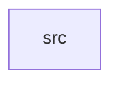

_Generated by CodeAtlas._

## Details

Owns 0 symbols across 7 file(s).

### src

Owns 16 symbols across 4 file(s).

**Related Classes/Methods:** _None_

**Source Files:**

- `frontend/src/App.tsx`
  - `frontend.src.App.Agent`
  - `frontend.src.App.App`
  - `frontend.src.App.Event`
  - `frontend.src.App.Obstacle`
  - `frontend.src.App.SensorData`
  - `frontend.src.App.WorldFrame`
  - `frontend.src.App.animate`
  - `frontend.src.App.getAgentColor`
  - `frontend.src.App.handleCameraChange`
  - `frontend.src.App.handleCanvasClick`
  - `frontend.src.App.handleKeyDown`
  - `frontend.src.App.handleKeyUp`
  - `frontend.src.App.handlePlayPause`
  - `frontend.src.App.handleResize`
  - `frontend.src.App.handleSpeedChange`
  - `frontend.src.App.updateFreeCamera`
