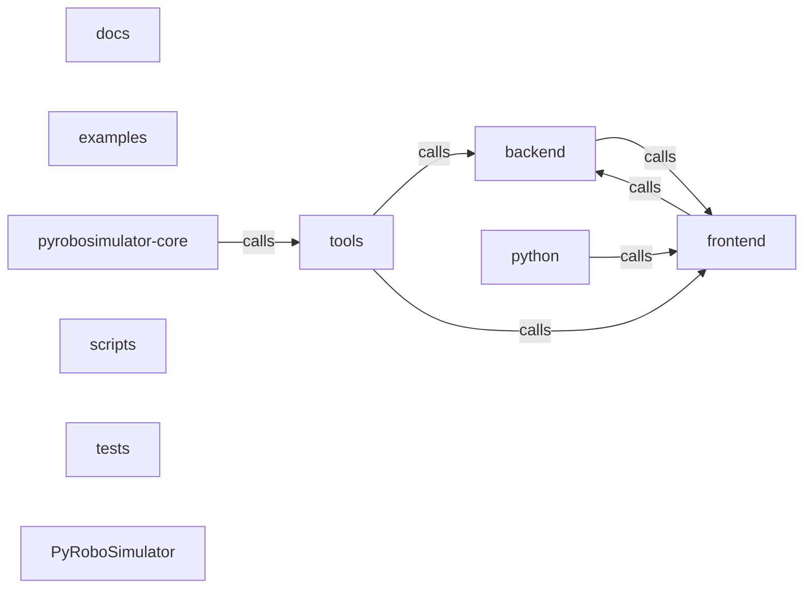

_Generated by CodeAtlas._

## Details

Architecture map of PyRoboSimulator.

### backend

Owns 0 symbols across 5 file(s).

**Related Classes/Methods:** _None_

### docs

Owns 0 symbols across 0 file(s).

**Related Classes/Methods:** _None_

### examples

Owns 0 symbols across 3 file(s).

**Related Classes/Methods:** _None_

### frontend

Owns 0 symbols across 7 file(s).

**Related Classes/Methods:** _None_

### pyrobosimulator-core

Owns 0 symbols across 1 file(s).

**Related Classes/Methods:** _None_

### python

Owns 0 symbols across 0 file(s).

**Related Classes/Methods:** _None_

### scripts

Owns 0 symbols across 2 file(s).

**Related Classes/Methods:** _None_

### tests

Owns 5 symbols across 1 file(s).

**Related Classes/Methods:** _None_

**Source Files:**

- `tests/test_codeatlas_adapter.py`
  - `tests.test_codeatlas_adapter._run`
  - `tests.test_codeatlas_adapter.test_check_reports_the_embedded_engine_available`
  - `tests.test_codeatlas_adapter.test_diagnose_summarises_the_architecture_map`
  - `tests.test_codeatlas_adapter.test_explain_reports_an_unknown_node_as_an_error`
  - `tests.test_codeatlas_adapter.test_god_nodes_are_ranked_by_degree`

### tools

Owns 0 symbols across 0 file(s).

**Related Classes/Methods:** _None_

### PyRoboSimulator

Owns 0 symbols across 15 file(s).

**Related Classes/Methods:** _None_
