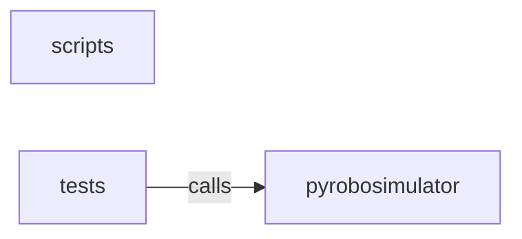

_Generated by CodeAtlas._

## Details

Owns 43 symbols across 8 file(s).

### scripts

Owns 1 symbols across 2 file(s).

**Related Classes/Methods:** _None_

**Source Files:**

- `python/pyrobosimulator/scripts/post_install.py`
  - `python.pyrobosimulator.scripts.post_install.post_install`

### tests

Owns 51 symbols across 3 file(s).

**Related Classes/Methods:** _None_

**Source Files:**

- `python/pyrobosimulator/tests/test_api.py`
  - `python.pyrobosimulator.tests.test_api.TestGenerateWorld`
  - `python.pyrobosimulator.tests.test_api.TestGenerateWorld.test_generate_world_endpoint_exists`
  - `python.pyrobosimulator.tests.test_api.TestGenerateWorld.test_generate_world_request_validation`
  - `python.pyrobosimulator.tests.test_api.TestGetWorld`
  - `python.pyrobosimulator.tests.test_api.TestGetWorld.test_get_loaded_world`
  - `python.pyrobosimulator.tests.test_api.TestGetWorld.test_get_nonexistent_world`
  - `python.pyrobosimulator.tests.test_api.TestHealthAndRoot`
  - `python.pyrobosimulator.tests.test_api.TestHealthAndRoot.test_health_check`
  - `python.pyrobosimulator.tests.test_api.TestHealthAndRoot.test_root`
  - `python.pyrobosimulator.tests.test_api.TestLoadWorld`
  - `python.pyrobosimulator.tests.test_api.TestLoadWorld.test_load_world`
  - `python.pyrobosimulator.tests.test_api.TestLoadWorld.test_load_world_auto_generates_id`
  - `python.pyrobosimulator.tests.test_api.TestLoadWorld.test_load_world_with_objects`
  - `python.pyrobosimulator.tests.test_api.TestSensorData`
  - `python.pyrobosimulator.tests.test_api.TestSensorData.test_get_depth_sensor`
  - `python.pyrobosimulator.tests.test_api.TestSensorData.test_get_lidar_sensor`
  - `python.pyrobosimulator.tests.test_api.TestSensorData.test_get_rgb_sensor`
  - `python.pyrobosimulator.tests.test_api.TestSensorData.test_get_thermal_sensor`
  - `python.pyrobosimulator.tests.test_api.TestSensorData.test_invalid_sensor_type`
  - `python.pyrobosimulator.tests.test_api.TestSensorData.test_sensor_nonexistent_world`
  - `python.pyrobosimulator.tests.test_api.TestSensorData.test_sensor_with_frame_number`
  - `python.pyrobosimulator.tests.test_api.client`
- `python/pyrobosimulator/tests/test_schemas.py`
  - `python.pyrobosimulator.tests.test_schemas.TestCameraConfig`
  - `python.pyrobosimulator.tests.test_schemas.TestCameraConfig.test_camera_setup`
  - `python.pyrobosimulator.tests.test_schemas.TestLightingConfig`
  - `python.pyrobosimulator.tests.test_schemas.TestLightingConfig.test_default_lighting`
  - `python.pyrobosimulator.tests.test_schemas.TestLightingConfig.test_sunset_lighting`
  - `python.pyrobosimulator.tests.test_schemas.TestMaterialDefinition`
  - `python.pyrobosimulator.tests.test_schemas.TestMaterialDefinition.test_material_creation_with_defaults`
  - `python.pyrobosimulator.tests.test_schemas.TestMaterialDefinition.test_material_custom_properties`
  - `python.pyrobosimulator.tests.test_schemas.TestMaterialDefinition.test_material_validates_ranges`
  - `python.pyrobosimulator.tests.test_schemas.TestObjectDefinition`
  - `python.pyrobosimulator.tests.test_schemas.TestObjectDefinition.test_object_creation`
  - `python.pyrobosimulator.tests.test_schemas.TestObjectDefinition.test_object_with_rotation`
  - `python.pyrobosimulator.tests.test_schemas.TestRenderingConfig`
  - `python.pyrobosimulator.tests.test_schemas.TestRenderingConfig.test_cinematic_profile`
  - `python.pyrobosimulator.tests.test_schemas.TestRenderingConfig.test_edge_profile`
  - `python.pyrobosimulator.tests.test_schemas.TestSensorConfig`
  - `python.pyrobosimulator.tests.test_schemas.TestSensorConfig.test_all_sensors_enabled`
  - `python.pyrobosimulator.tests.test_schemas.TestSensorConfig.test_lidar_configuration`
  - `python.pyrobosimulator.tests.test_schemas.TestTimeOfDayConfig`
  - `python.pyrobosimulator.tests.test_schemas.TestTimeOfDayConfig.test_midday`
  - `python.pyrobosimulator.tests.test_schemas.TestTimeOfDayConfig.test_sunrise`
  - `python.pyrobosimulator.tests.test_schemas.TestWeatherConfig`
  - `python.pyrobosimulator.tests.test_schemas.TestWeatherConfig.test_clear_weather`
  - `python.pyrobosimulator.tests.test_schemas.TestWeatherConfig.test_rainy_weather`
  - `python.pyrobosimulator.tests.test_schemas.TestWorldSpec`
  - `python.pyrobosimulator.tests.test_schemas.TestWorldSpec.test_minimal_world`
  - `python.pyrobosimulator.tests.test_schemas.TestWorldSpec.test_parking_lot_world`
  - `python.pyrobosimulator.tests.test_schemas.TestWorldSpec.test_world_serialization`
  - `python.pyrobosimulator.tests.test_schemas.TestWorldSpec.test_world_with_objects`
