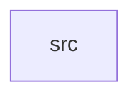

_Generated by CodeAtlas._

## Details

Owns 0 symbols across 1 file(s).

### src

Owns 80 symbols across 7 file(s).

**Related Classes/Methods:** _None_

**Source Files:**

- `pyrobosimulator-core/src/agent.rs`
  - `pyrobosimulator-core.src.agent.Agent`
  - `pyrobosimulator-core.src.agent.Agent.agent_type`
  - `pyrobosimulator-core.src.agent.Agent.apply_force`
  - `pyrobosimulator-core.src.agent.Agent.collides_with`
  - `pyrobosimulator-core.src.agent.Agent.distance_to`
  - `pyrobosimulator-core.src.agent.Agent.id`
  - `pyrobosimulator-core.src.agent.Agent.name`
  - `pyrobosimulator-core.src.agent.Agent.new`
  - `pyrobosimulator-core.src.agent.Agent.position`
  - `pyrobosimulator-core.src.agent.Agent.set_collision_radius`
  - `pyrobosimulator-core.src.agent.Agent.set_mass`
  - `pyrobosimulator-core.src.agent.Agent.set_max_velocity`
  - `pyrobosimulator-core.src.agent.Agent.set_position`
  - `pyrobosimulator-core.src.agent.Agent.set_velocity`
  - `pyrobosimulator-core.src.agent.Agent.step`
  - `pyrobosimulator-core.src.agent.Agent.velocity`
  - `pyrobosimulator-core.src.agent.AgentType`
  - `pyrobosimulator-core.src.agent.tests.acceleration_resets_every_step_forces_are_not_permanent`
  - `pyrobosimulator-core.src.agent.tests.collision_detection_uses_real_positions_and_radii`
  - `pyrobosimulator-core.src.agent.tests.constant_acceleration_matches_closed_form_free_fall`
  - `pyrobosimulator-core.src.agent.tests.constant_velocity_moves_position_by_real_kinematics`
  - `pyrobosimulator-core.src.agent.tests.velocity_is_clamped_to_max_velocity`
  - `pyrobosimulator-core.src.agent.tests.velocity_is_stored_and_readable_not_a_dead_field`
- `pyrobosimulator-core/src/lib.rs`
  - `pyrobosimulator-core.src.lib._core`
- `pyrobosimulator-core/src/mission.rs`
  - `pyrobosimulator-core.src.mission.Mission`
  - `pyrobosimulator-core.src.mission.Mission.add_objective`
  - `pyrobosimulator-core.src.mission.Mission.id`
  - `pyrobosimulator-core.src.mission.Mission.name`
  - `pyrobosimulator-core.src.mission.Mission.new`
- `pyrobosimulator-core/src/narrative.rs`
  - `pyrobosimulator-core.src.narrative.NarrativeEngine`
  - `pyrobosimulator-core.src.narrative.NarrativeEngine.generate_from_events`
  - `pyrobosimulator-core.src.narrative.NarrativeEngine.new`
- `pyrobosimulator-core/src/ros2.rs`
  - `pyrobosimulator-core.src.ros2.ROS2Bridge`
  - `pyrobosimulator-core.src.ros2.ROS2Bridge.export_world`
  - `pyrobosimulator-core.src.ros2.ROS2Bridge.new`
  - `pyrobosimulator-core.src.ros2.agent_to_sdf_model`
  - `pyrobosimulator-core.src.ros2.export_world_to_sdf`
  - `pyrobosimulator-core.src.ros2.geometry_for_agent_type`
  - `pyrobosimulator-core.src.ros2.quat_to_euler`
  - `pyrobosimulator-core.src.ros2.tests.agent_names_are_xml_escaped`
  - `pyrobosimulator-core.src.ros2.tests.agents_become_real_models_with_correct_positions`
  - `pyrobosimulator-core.src.ros2.tests.empty_world_produces_valid_sdf_with_no_models`
  - `pyrobosimulator-core.src.ros2.tests.organization_agents_are_static`
  - `pyrobosimulator-core.src.ros2.tests.quat_90deg_yaw_round_trips`
  - `pyrobosimulator-core.src.ros2.tests.quat_identity_maps_to_zero_euler`
  - `pyrobosimulator-core.src.ros2.tests.remove_agent_excludes_it_from_export`
  - `pyrobosimulator-core.src.ros2.tests.robot_geometry_differs_from_human_geometry`
  - `pyrobosimulator-core.src.ros2.xml_escape`
- `pyrobosimulator-core/src/storage.rs`
  - `pyrobosimulator-core.src.storage.StorageEngine`
  - `pyrobosimulator-core.src.storage.StorageEngine.event_key`
  - `pyrobosimulator-core.src.storage.StorageEngine.load_world_history`
  - `pyrobosimulator-core.src.storage.StorageEngine.new`
  - `pyrobosimulator-core.src.storage.StorageEngine.save_event`
  - `pyrobosimulator-core.src.storage.tests.events_actually_persist_to_disk_across_a_reopen`
  - `pyrobosimulator-core.src.storage.tests.load_world_history_for_unknown_world_is_empty_not_an_error`
  - `pyrobosimulator-core.src.storage.tests.load_world_history_is_scoped_to_one_world_id`
  - `pyrobosimulator-core.src.storage.tests.save_and_load_round_trips_real_events_in_order`
  - `pyrobosimulator-core.src.storage.tests.temp_db_path`
- `pyrobosimulator-core/src/world.rs`
  - `pyrobosimulator-core.src.world.World`
  - `pyrobosimulator-core.src.world.World.add_agent`
  - `pyrobosimulator-core.src.world.World.agent_count`
  - `pyrobosimulator-core.src.world.World.agents`
  - `pyrobosimulator-core.src.world.World.creation_time`
  - `pyrobosimulator-core.src.world.World.detect_collisions`
  - `pyrobosimulator-core.src.world.World.fidelity`
  - `pyrobosimulator-core.src.world.World.get_agent`
  - `pyrobosimulator-core.src.world.World.gravity`
  - `pyrobosimulator-core.src.world.World.id`
  - `pyrobosimulator-core.src.world.World.name`
  - `pyrobosimulator-core.src.world.World.new`
  - `pyrobosimulator-core.src.world.World.remove_agent`
  - `pyrobosimulator-core.src.world.World.set_fidelity`
  - `pyrobosimulator-core.src.world.World.set_gravity`
  - `pyrobosimulator-core.src.world.World.step`
  - `pyrobosimulator-core.src.world.WorldConfig`
  - `pyrobosimulator-core.src.world.WorldMetadata`
  - `pyrobosimulator-core.src.world.tests.detect_collisions_finds_real_overlapping_agents_only`
  - `pyrobosimulator-core.src.world.tests.get_agent_reflects_real_state_after_add`
  - `pyrobosimulator-core.src.world.tests.world_step_applies_real_gravity_to_every_agent`
  - `pyrobosimulator-core.src.world.tests.world_step_with_zero_gravity_leaves_a_resting_agent_in_place`
