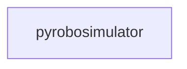

_Generated by CodeAtlas._

## Details

Owns 0 symbols across 0 file(s).

### pyrobosimulator

Owns 43 symbols across 8 file(s).

**Related Classes/Methods:** _None_

**Source Files:**

- `python/pyrobosimulator/api.py`
  - `python.pyrobosimulator.api.GenerateWorldRequest`
  - `python.pyrobosimulator.api.GenerateWorldResponse`
  - `python.pyrobosimulator.api.LoadWorldRequest`
  - `python.pyrobosimulator.api.LoadWorldResponse`
  - `python.pyrobosimulator.api.SensorDataResponse`
  - `python.pyrobosimulator.api.create_app`
  - `python.pyrobosimulator.api.create_app.generate_world`
  - `python.pyrobosimulator.api.create_app.get_sensor_data`
  - `python.pyrobosimulator.api.create_app.get_world`
  - `python.pyrobosimulator.api.create_app.health_check`
  - `python.pyrobosimulator.api.create_app.load_world`
  - `python.pyrobosimulator.api.create_app.root`
- `python/pyrobosimulator/cli.py`
  - `python.pyrobosimulator.cli.main`
- `python/pyrobosimulator/cli_dashboard.py`
  - `python.pyrobosimulator.cli_dashboard.DashboardMetrics`
  - `python.pyrobosimulator.cli_dashboard.PyRoboSimulatorDashboard`
  - `python.pyrobosimulator.cli_dashboard.PyRoboSimulatorDashboard.__init__`
  - `python.pyrobosimulator.cli_dashboard.PyRoboSimulatorDashboard.export_json`
  - `python.pyrobosimulator.cli_dashboard.PyRoboSimulatorDashboard.get_mock_metrics`
  - `python.pyrobosimulator.cli_dashboard.PyRoboSimulatorDashboard.run_dashboard`
  - `python.pyrobosimulator.cli_dashboard.RichDashboard`
  - `python.pyrobosimulator.cli_dashboard.RichDashboard.__init__`
  - `python.pyrobosimulator.cli_dashboard.RichDashboard.render`
  - `python.pyrobosimulator.cli_dashboard.SimpleDashboard`
  - `python.pyrobosimulator.cli_dashboard.SimpleDashboard.__init__`
  - `python.pyrobosimulator.cli_dashboard.SimpleDashboard.render`
  - `python.pyrobosimulator.cli_dashboard.get_dashboard_impl`
- `python/pyrobosimulator/demo.py`
  - `python.pyrobosimulator.demo.demo_parking_lot_world`
- `python/pyrobosimulator/schemas.py`
  - `python.pyrobosimulator.schemas.CameraConfig`
  - `python.pyrobosimulator.schemas.LightingConfig`
  - `python.pyrobosimulator.schemas.MaterialDefinition`
  - `python.pyrobosimulator.schemas.MaterialType`
  - `python.pyrobosimulator.schemas.ObjectDefinition`
  - `python.pyrobosimulator.schemas.RenderingConfig`
  - `python.pyrobosimulator.schemas.RenderingProfile`
  - `python.pyrobosimulator.schemas.SensorConfig`
  - `python.pyrobosimulator.schemas.TimeOfDayConfig`
  - `python.pyrobosimulator.schemas.WeatherConfig`
  - `python.pyrobosimulator.schemas.WorldSpec`
- `python/pyrobosimulator/world_gen.py`
  - `python.pyrobosimulator.world_gen.WorldGenerator`
  - `python.pyrobosimulator.world_gen.WorldGenerator.__init__`
  - `python.pyrobosimulator.world_gen.WorldGenerator._build_system_prompt`
  - `python.pyrobosimulator.world_gen.WorldGenerator._extract_json_from_response`
  - `python.pyrobosimulator.world_gen.WorldGenerator.generate`
