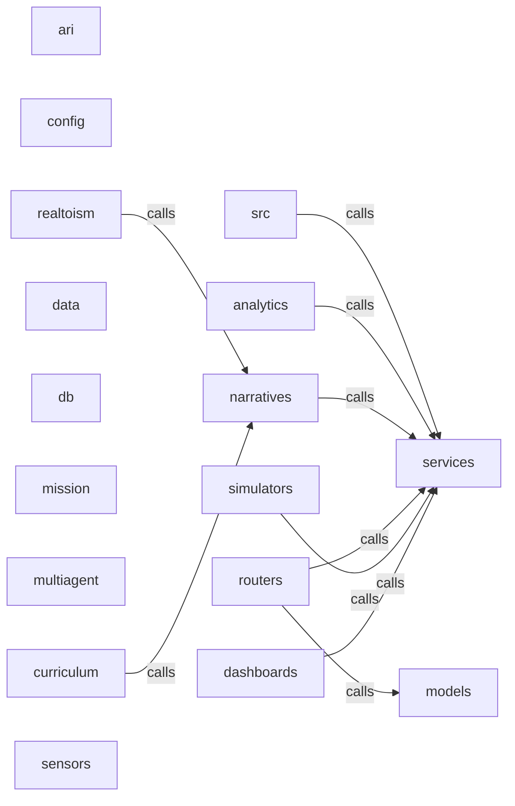

_Generated by CodeAtlas._

## Details

Owns 5 symbols across 2 file(s).

### analytics

Owns 73 symbols across 4 file(s).

**Related Classes/Methods:** _None_

**Source Files:**

- `backend/src/analytics/analytics_engine.py`
  - `backend.src.analytics.analytics_engine.AnalyticsEngine`
  - `backend.src.analytics.analytics_engine.AnalyticsEngine.__init__`
  - `backend.src.analytics.analytics_engine.AnalyticsEngine.get_collector`
  - `backend.src.analytics.analytics_engine.AnalyticsEngine.get_stats`
  - `backend.src.analytics.analytics_engine.AnalyticsEngine.get_summary`
  - `backend.src.analytics.analytics_engine.AnalyticsEngine.record_constraint_violation`
  - `backend.src.analytics.analytics_engine.AnalyticsEngine.record_validation`
  - `backend.src.analytics.analytics_engine.AnalyticsEngine.register_callback`
  - `backend.src.analytics.analytics_engine.AnalyticsEngine.reset`
  - `backend.src.analytics.analytics_engine.AnalyticsEngine.start`
  - `backend.src.analytics.analytics_engine.AnalyticsEngine.stop`
  - `backend.src.analytics.analytics_engine.AnalyticsEngine.update_narrative`
  - `backend.src.analytics.analytics_engine.AnalyticsEngine.update_performance`
  - `backend.src.analytics.analytics_engine.AnalyticsEngine.update_sensor`
  - `backend.src.analytics.analytics_engine.AnalyticsEngine.update_simulation`
- `backend/src/analytics/cli_dashboard.py`
  - `backend.src.analytics.cli_dashboard.AnalyticsDashboardApp`
  - `backend.src.analytics.cli_dashboard.AnalyticsDashboardApp.__init__`
  - `backend.src.analytics.cli_dashboard.AnalyticsDashboardApp.get_collector`
  - `backend.src.analytics.cli_dashboard.AnalyticsDashboardApp.print_summary`
  - `backend.src.analytics.cli_dashboard.AnalyticsDashboardApp.run`
  - `backend.src.analytics.cli_dashboard.AnalyticsDashboardApp.run.DashboardApp`
  - `backend.src.analytics.cli_dashboard.AnalyticsDashboardApp.run.DashboardApp.on_mount`
  - `backend.src.analytics.cli_dashboard.ControlPanel`
  - `backend.src.analytics.cli_dashboard.ControlPanel.render`
  - `backend.src.analytics.cli_dashboard.MetricsPanel`
  - `backend.src.analytics.cli_dashboard.MetricsPanel.__init__`
  - `backend.src.analytics.cli_dashboard.MetricsPanel.render`
  - `backend.src.analytics.cli_dashboard.NarrativePanel`
  - `backend.src.analytics.cli_dashboard.NarrativePanel.__init__`
  - `backend.src.analytics.cli_dashboard.NarrativePanel.render`
  - `backend.src.analytics.cli_dashboard.PerformancePanel`
  - `backend.src.analytics.cli_dashboard.PerformancePanel.__init__`
  - `backend.src.analytics.cli_dashboard.PerformancePanel.render`
  - `backend.src.analytics.cli_dashboard.ProgressPanel`
  - `backend.src.analytics.cli_dashboard.ProgressPanel.__init__`
  - `backend.src.analytics.cli_dashboard.ProgressPanel.render`
  - `backend.src.analytics.cli_dashboard.ProgressPanel.render.bar`
  - `backend.src.analytics.cli_dashboard.SensorPanel`
  - `backend.src.analytics.cli_dashboard.SensorPanel.__init__`
  - `backend.src.analytics.cli_dashboard.SensorPanel.render`
  - `backend.src.analytics.cli_dashboard.SimulationDashboard`
  - `backend.src.analytics.cli_dashboard.SimulationDashboard.__init__`
  - `backend.src.analytics.cli_dashboard.SimulationDashboard.action_play_pause`
  - `backend.src.analytics.cli_dashboard.SimulationDashboard.action_quit`
  - `backend.src.analytics.cli_dashboard.SimulationDashboard.action_reset`
  - `backend.src.analytics.cli_dashboard.SimulationDashboard.action_stop`
  - `backend.src.analytics.cli_dashboard.SimulationDashboard.compose`
  - `backend.src.analytics.cli_dashboard.ValidationPanel`
  - `backend.src.analytics.cli_dashboard.ValidationPanel.__init__`
  - `backend.src.analytics.cli_dashboard.ValidationPanel.render`
- `backend/src/analytics/metrics_collector.py`
  - `backend.src.analytics.metrics_collector.MetricsCollector`
  - `backend.src.analytics.metrics_collector.MetricsCollector.__init__`
  - `backend.src.analytics.metrics_collector.MetricsCollector.get_average_acceleration`
  - `backend.src.analytics.metrics_collector.MetricsCollector.get_average_velocity`
  - `backend.src.analytics.metrics_collector.MetricsCollector.get_latest_performance_metrics`
  - `backend.src.analytics.metrics_collector.MetricsCollector.get_latest_simulation_metrics`
  - `backend.src.analytics.metrics_collector.MetricsCollector.get_max_velocity`
  - `backend.src.analytics.metrics_collector.MetricsCollector.get_narrative_metrics`
  - `backend.src.analytics.metrics_collector.MetricsCollector.get_sensor_metrics`
  - `backend.src.analytics.metrics_collector.MetricsCollector.get_simulation_history`
  - `backend.src.analytics.metrics_collector.MetricsCollector.get_summary`
  - `backend.src.analytics.metrics_collector.MetricsCollector.get_validation_metrics`
  - `backend.src.analytics.metrics_collector.MetricsCollector.record_performance_metrics`
  - `backend.src.analytics.metrics_collector.MetricsCollector.record_simulation_metrics`
  - `backend.src.analytics.metrics_collector.MetricsCollector.reset`
  - `backend.src.analytics.metrics_collector.MetricsCollector.set_narrative_metrics`
  - `backend.src.analytics.metrics_collector.MetricsCollector.set_sensor_metrics`
  - `backend.src.analytics.metrics_collector.MetricsCollector.set_validation_metrics`
  - `backend.src.analytics.metrics_collector.NarrativeMetrics`
  - `backend.src.analytics.metrics_collector.PerformanceMetrics`
  - `backend.src.analytics.metrics_collector.SensorMetrics`
  - `backend.src.analytics.metrics_collector.SimulationMetrics`
  - `backend.src.analytics.metrics_collector.ValidationMetrics`

### ari

Owns 50 symbols across 4 file(s).

**Related Classes/Methods:** _None_

**Source Files:**

- `backend/src/ari/ari_discovery.py`
  - `backend.src.ari.ari_discovery.ARIDiscoveryEngine`
  - `backend.src.ari.ari_discovery.ARIDiscoveryEngine.__init__`
  - `backend.src.ari.ari_discovery.ARIDiscoveryEngine.analyze_frame_batch`
  - `backend.src.ari.ari_discovery.ARIDiscoveryEngine.discover_elevation_data`
  - `backend.src.ari.ari_discovery.ARIDiscoveryEngine.discover_openstreetmap_data`
  - `backend.src.ari.ari_discovery.ARIDiscoveryEngine.discover_traffic_patterns`
  - `backend.src.ari.ari_discovery.ARIDiscoveryEngine.discover_weather_patterns`
  - `backend.src.ari.ari_discovery.ARIDiscoveryEngine.discover_youtube_videos`
  - `backend.src.ari.ari_discovery.ARIDiscoveryEngine.estimate_confidence`
  - `backend.src.ari.ari_discovery.ARIDiscoveryEngine.get_discovery_status`
  - `backend.src.ari.ari_discovery.ARIDiscoveryEngine.process_youtube_frames`
  - `backend.src.ari.ari_discovery.ARIDiscoveryEngine.should_learn_region`
  - `backend.src.ari.ari_discovery.DiscoveredAsset`
  - `backend.src.ari.ari_discovery.DiscoveryQuery`
  - `backend.src.ari.ari_discovery.DiscoverySource`
  - `backend.src.ari.ari_discovery.LearningPhase`
- `backend/src/ari/ari_orchestrator.py`
  - `backend.src.ari.ari_orchestrator.ARIConfig`
  - `backend.src.ari.ari_orchestrator.ARIOrchestrator`
  - `backend.src.ari.ari_orchestrator.ARIOrchestrator.__init__`
  - `backend.src.ari.ari_orchestrator.ARIOrchestrator.get_knowledge_store`
  - `backend.src.ari.ari_orchestrator.ARIOrchestrator.get_learning_status`
  - `backend.src.ari.ari_orchestrator.ARIOrchestrator.learn_region`
  - `backend.src.ari.ari_orchestrator.ARIOrchestrator.load_knowledge`
  - `backend.src.ari.ari_orchestrator.ARIOrchestrator.needs_learning`
  - `backend.src.ari.ari_orchestrator.ARIOrchestrator.refine_knowledge`
  - `backend.src.ari.ari_orchestrator.ARIOrchestrator.save_knowledge`
- `backend/src/ari/regional_knowledge.py`
  - `backend.src.ari.regional_knowledge.EnvironmentType`
  - `backend.src.ari.regional_knowledge.InfrastructureCharacteristics`
  - `backend.src.ari.regional_knowledge.KnowledgeStore`
  - `backend.src.ari.regional_knowledge.KnowledgeStore.__init__`
  - `backend.src.ari.regional_knowledge.KnowledgeStore.add_or_update`
  - `backend.src.ari.regional_knowledge.KnowledgeStore.get`
  - `backend.src.ari.regional_knowledge.KnowledgeStore.get_all`
  - `backend.src.ari.regional_knowledge.KnowledgeStore.has_knowledge`
  - `backend.src.ari.regional_knowledge.KnowledgeStore.list_regions`
  - `backend.src.ari.regional_knowledge.KnowledgeStore.load_from_json`
  - `backend.src.ari.regional_knowledge.KnowledgeStore.merge_knowledge`
  - `backend.src.ari.regional_knowledge.KnowledgeStore.save_to_json`
  - `backend.src.ari.regional_knowledge.PedestrianCharacteristics`
  - `backend.src.ari.regional_knowledge.RegionalKnowledge`
  - `backend.src.ari.regional_knowledge.RegionalKnowledge.from_dict`
  - `backend.src.ari.regional_knowledge.RegionalKnowledge.get_confidence_score`
  - `backend.src.ari.regional_knowledge.RegionalKnowledge.to_dict`
  - `backend.src.ari.regional_knowledge.RegionalKnowledge.to_json`
  - `backend.src.ari.regional_knowledge.RoadCharacteristics`
  - `backend.src.ari.regional_knowledge.RoadType`
  - `backend.src.ari.regional_knowledge.TerrainCharacteristics`
  - `backend.src.ari.regional_knowledge.VehicleDistribution`
  - `backend.src.ari.regional_knowledge.VehicleType`
  - `backend.src.ari.regional_knowledge.WeatherCharacteristics`

### config

Owns 3 symbols across 2 file(s).

**Related Classes/Methods:** _None_

**Source Files:**

- `backend/src/config/settings.py`
  - `backend.src.config.settings.Settings`
  - `backend.src.config.settings.Settings.Config`
  - `backend.src.config.settings.Settings._reject_weak_secret_key`

### curriculum

Owns 23 symbols across 3 file(s).

**Related Classes/Methods:** _None_

**Source Files:**

- `backend/src/curriculum/curriculum_generator.py`
  - `backend.src.curriculum.curriculum_generator.CurriculumScenarioGenerator`
  - `backend.src.curriculum.curriculum_generator.CurriculumScenarioGenerator.__init__`
  - `backend.src.curriculum.curriculum_generator.CurriculumScenarioGenerator._generate_delivery_scenario`
  - `backend.src.curriculum.curriculum_generator.CurriculumScenarioGenerator._generate_inspection_scenario`
  - `backend.src.curriculum.curriculum_generator.CurriculumScenarioGenerator._generate_navigation_scenario`
  - `backend.src.curriculum.curriculum_generator.CurriculumScenarioGenerator.generate_curriculum_scenarios`
  - `backend.src.curriculum.curriculum_generator.CurriculumScenarioGenerator.generate_scenario`
- `backend/src/curriculum/difficulty_model.py`
  - `backend.src.curriculum.difficulty_model.CurriculumLesson`
  - `backend.src.curriculum.difficulty_model.CurriculumPlan`
  - `backend.src.curriculum.difficulty_model.DifficultyFactors`
  - `backend.src.curriculum.difficulty_model.DifficultyFactors.overall_difficulty`
  - `backend.src.curriculum.difficulty_model.DifficultyLevel`
  - `backend.src.curriculum.difficulty_model.DifficultyModel`
  - `backend.src.curriculum.difficulty_model.DifficultyModel.__init__`
  - `backend.src.curriculum.difficulty_model.DifficultyModel.analyze_trajectory_difficulty`
  - `backend.src.curriculum.difficulty_model.DifficultyModel.generate_curriculum`
  - `backend.src.curriculum.difficulty_model.DifficultyModel.get_difficulty_level_name`
  - `backend.src.curriculum.difficulty_model.DifficultyModel.get_learner_profile`
  - `backend.src.curriculum.difficulty_model.DifficultyModel.get_next_difficulty`
  - `backend.src.curriculum.difficulty_model.DifficultyModel.record_lesson_performance`
  - `backend.src.curriculum.difficulty_model.DifficultyModel.scale_difficulty`
  - `backend.src.curriculum.difficulty_model.LearnerProfile`
  - `backend.src.curriculum.difficulty_model.LearnerProfile.get_recommended_difficulty`

### dashboards

Owns 24 symbols across 2 file(s).

**Related Classes/Methods:** _None_

**Source Files:**

- `backend/src/dashboards/cli_dashboard.py`
  - `backend.src.dashboards.cli_dashboard.EventRatesWidget`
  - `backend.src.dashboards.cli_dashboard.EventRatesWidget.__init__`
  - `backend.src.dashboards.cli_dashboard.EventRatesWidget.render`
  - `backend.src.dashboards.cli_dashboard.EventRatesWidget.update_rates`
  - `backend.src.dashboards.cli_dashboard.PerformanceWidget`
  - `backend.src.dashboards.cli_dashboard.PerformanceWidget.__init__`
  - `backend.src.dashboards.cli_dashboard.PerformanceWidget.render`
  - `backend.src.dashboards.cli_dashboard.PerformanceWidget.update_performance`
  - `backend.src.dashboards.cli_dashboard.SimulationDashboard`
  - `backend.src.dashboards.cli_dashboard.SimulationDashboard.__init__`
  - `backend.src.dashboards.cli_dashboard.SimulationDashboard.compose`
  - `backend.src.dashboards.cli_dashboard.SimulationDashboard.on_mount`
  - `backend.src.dashboards.cli_dashboard.SimulationDashboard.set_calculator`
  - `backend.src.dashboards.cli_dashboard.SimulationDashboard.update_display`
  - `backend.src.dashboards.cli_dashboard.StatMetric`
  - `backend.src.dashboards.cli_dashboard.StatMetric.__init__`
  - `backend.src.dashboards.cli_dashboard.StatMetric.render`
  - `backend.src.dashboards.cli_dashboard.StatMetric.update_value`
  - `backend.src.dashboards.cli_dashboard.StateDistributionWidget`
  - `backend.src.dashboards.cli_dashboard.StateDistributionWidget.__init__`
  - `backend.src.dashboards.cli_dashboard.StateDistributionWidget.render`
  - `backend.src.dashboards.cli_dashboard.StateDistributionWidget.update_distribution`
  - `backend.src.dashboards.cli_dashboard.create_dashboard`
  - `backend.src.dashboards.cli_dashboard.simulate`

### data

Owns 16 symbols across 2 file(s).

**Related Classes/Methods:** _None_

**Source Files:**

- `backend/src/data/synthetic_data_generator.py`
  - `backend.src.data.synthetic_data_generator.AnnotatedFrame`
  - `backend.src.data.synthetic_data_generator.Dataset`
  - `backend.src.data.synthetic_data_generator.DatasetFormat`
  - `backend.src.data.synthetic_data_generator.KeypointDetector`
  - `backend.src.data.synthetic_data_generator.KeypointDetector.detect`
  - `backend.src.data.synthetic_data_generator.ObjectDetector`
  - `backend.src.data.synthetic_data_generator.ObjectDetector.detect`
  - `backend.src.data.synthetic_data_generator.SegmentationModel`
  - `backend.src.data.synthetic_data_generator.SegmentationModel.segment`
  - `backend.src.data.synthetic_data_generator.SyntheticDatasetGenerator`
  - `backend.src.data.synthetic_data_generator.SyntheticDatasetGenerator.__init__`
  - `backend.src.data.synthetic_data_generator.SyntheticDatasetGenerator.export_coco`
  - `backend.src.data.synthetic_data_generator.SyntheticDatasetGenerator.export_tfrecord`
  - `backend.src.data.synthetic_data_generator.SyntheticDatasetGenerator.export_yolo`
  - `backend.src.data.synthetic_data_generator.SyntheticDatasetGenerator.generate_dataset`
  - `backend.src.data.synthetic_data_generator.SyntheticDatasetGenerator.get_dataset_statistics`

### db

Owns 14 symbols across 3 file(s).

**Related Classes/Methods:** _None_

**Source Files:**

- `backend/src/db/models.py`
  - `backend.src.db.models.Agent`
  - `backend.src.db.models.Agent.__repr__`
  - `backend.src.db.models.Base`
  - `backend.src.db.models.Event`
  - `backend.src.db.models.Event.__repr__`
  - `backend.src.db.models.Scenario`
  - `backend.src.db.models.Scenario.__repr__`
  - `backend.src.db.models.Simulation`
  - `backend.src.db.models.Simulation.__repr__`
  - `backend.src.db.models.User`
  - `backend.src.db.models.User.__repr__`
- `backend/src/db/session.py`
  - `backend.src.db.session.close_db`
  - `backend.src.db.session.get_db`
  - `backend.src.db.session.init_db`

### mission

Owns 27 symbols across 2 file(s).

**Related Classes/Methods:** _None_

**Source Files:**

- `backend/src/mission/mission_framework.py`
  - `backend.src.mission.mission_framework.Constraint`
  - `backend.src.mission.mission_framework.MissionExecutor`
  - `backend.src.mission.mission_framework.MissionExecutor.__init__`
  - `backend.src.mission.mission_framework.MissionExecutor._execute_generic`
  - `backend.src.mission.mission_framework.MissionExecutor._execute_inspect`
  - `backend.src.mission.mission_framework.MissionExecutor._execute_navigate`
  - `backend.src.mission.mission_framework.MissionExecutor._execute_pick`
  - `backend.src.mission.mission_framework.MissionExecutor._execute_place`
  - `backend.src.mission.mission_framework.MissionExecutor._execute_task`
  - `backend.src.mission.mission_framework.MissionExecutor.abort`
  - `backend.src.mission.mission_framework.MissionExecutor.execute_plan`
  - `backend.src.mission.mission_framework.MissionExecutor.get_execution_log`
  - `backend.src.mission.mission_framework.MissionExecutor.get_status`
  - `backend.src.mission.mission_framework.MissionExecutor.pause`
  - `backend.src.mission.mission_framework.MissionExecutor.resume`
  - `backend.src.mission.mission_framework.MissionPlan`
  - `backend.src.mission.mission_framework.MissionPlan.get_completed_count`
  - `backend.src.mission.mission_framework.MissionPlan.get_next_ready_task`
  - `backend.src.mission.mission_framework.MissionPlan.get_task`
  - `backend.src.mission.mission_framework.MissionPlanner`
  - `backend.src.mission.mission_framework.MissionPlanner.__init__`
  - `backend.src.mission.mission_framework.MissionPlanner._generate_tasks_from_nl`
  - `backend.src.mission.mission_framework.MissionPlanner.plan_from_natural_language`
  - `backend.src.mission.mission_framework.MissionPlanner.plan_from_spec`
  - `backend.src.mission.mission_framework.MissionStatus`
  - `backend.src.mission.mission_framework.Task`
  - `backend.src.mission.mission_framework.TaskStatus`

### models

Owns 38 symbols across 6 file(s).

**Related Classes/Methods:** _None_

**Source Files:**

- `backend/src/models/agents.py`
  - `backend.src.models.agents.Agent`
  - `backend.src.models.agents.Agent.Config`
  - `backend.src.models.agents.Agent.to_state`
  - `backend.src.models.agents.AgentCreate`
  - `backend.src.models.agents.AgentResponse`
  - `backend.src.models.agents.AgentResponse.Config`
  - `backend.src.models.agents.AgentState`
  - `backend.src.models.agents.AgentType`
  - `backend.src.models.agents.Vector3`
- `backend/src/models/events.py`
  - `backend.src.models.events.Event`
  - `backend.src.models.events.Event.Config`
  - `backend.src.models.events.EventBatch`
  - `backend.src.models.events.EventCreate`
  - `backend.src.models.events.EventResponse`
  - `backend.src.models.events.EventResponse.Config`
  - `backend.src.models.events.EventType`
  - `backend.src.models.events.SimulationSummary`
- `backend/src/models/scenarios.py`
  - `backend.src.models.scenarios.Scenario`
  - `backend.src.models.scenarios.Scenario.Config`
  - `backend.src.models.scenarios.ScenarioCreate`
  - `backend.src.models.scenarios.ScenarioResponse`
  - `backend.src.models.scenarios.ScenarioResponse.Config`
  - `backend.src.models.scenarios.ScenarioUpdate`
  - `backend.src.models.scenarios.WorldConfig`
- `backend/src/models/simulations.py`
  - `backend.src.models.simulations.Simulation`
  - `backend.src.models.simulations.Simulation.Config`
  - `backend.src.models.simulations.SimulationCreate`
  - `backend.src.models.simulations.SimulationListResponse`
  - `backend.src.models.simulations.SimulationResponse`
  - `backend.src.models.simulations.SimulationResponse.Config`
  - `backend.src.models.simulations.SimulationStatus`
  - `backend.src.models.simulations.SimulationUpdate`
- `backend/src/models/users.py`
  - `backend.src.models.users.User`
  - `backend.src.models.users.User.Config`
  - `backend.src.models.users.UserCreate`
  - `backend.src.models.users.UserLogin`
  - `backend.src.models.users.UserResponse`
  - `backend.src.models.users.UserResponse.Config`

### multiagent

Owns 31 symbols across 3 file(s).

**Related Classes/Methods:** _None_

**Source Files:**

- `backend/src/multiagent/agent_coordinator.py`
  - `backend.src.multiagent.agent_coordinator.AgentCommunicationType`
  - `backend.src.multiagent.agent_coordinator.AgentCoordinator`
  - `backend.src.multiagent.agent_coordinator.AgentCoordinator.__init__`
  - `backend.src.multiagent.agent_coordinator.AgentCoordinator.broadcast_message`
  - `backend.src.multiagent.agent_coordinator.AgentCoordinator.compute_formation_positions`
  - `backend.src.multiagent.agent_coordinator.AgentCoordinator.get_agent_count`
  - `backend.src.multiagent.agent_coordinator.AgentCoordinator.get_agent_state`
  - `backend.src.multiagent.agent_coordinator.AgentCoordinator.get_collective_knowledge`
  - `backend.src.multiagent.agent_coordinator.AgentCoordinator.get_team_status`
  - `backend.src.multiagent.agent_coordinator.AgentCoordinator.process_messages`
  - `backend.src.multiagent.agent_coordinator.AgentCoordinator.record_failed_action`
  - `backend.src.multiagent.agent_coordinator.AgentCoordinator.record_successful_path`
  - `backend.src.multiagent.agent_coordinator.AgentCoordinator.register_agent`
  - `backend.src.multiagent.agent_coordinator.AgentCoordinator.reset`
  - `backend.src.multiagent.agent_coordinator.AgentCoordinator.send_message`
  - `backend.src.multiagent.agent_coordinator.AgentCoordinator.set_formation`
  - `backend.src.multiagent.agent_coordinator.AgentCoordinator.update_agent_state`
  - `backend.src.multiagent.agent_coordinator.AgentMessage`
  - `backend.src.multiagent.agent_coordinator.AgentState`
  - `backend.src.multiagent.agent_coordinator.CollectiveKnowledge`
  - `backend.src.multiagent.agent_coordinator.FormationType`
- `backend/src/multiagent/fleet_learning.py`
  - `backend.src.multiagent.fleet_learning.ExperienceRecord`
  - `backend.src.multiagent.fleet_learning.FleetLearningEngine`
  - `backend.src.multiagent.fleet_learning.FleetLearningEngine.__init__`
  - `backend.src.multiagent.fleet_learning.FleetLearningEngine.get_agent_recommendation`
  - `backend.src.multiagent.fleet_learning.FleetLearningEngine.get_team_performance`
  - `backend.src.multiagent.fleet_learning.FleetLearningEngine.identify_patterns`
  - `backend.src.multiagent.fleet_learning.FleetLearningEngine.record_experience`
  - `backend.src.multiagent.fleet_learning.FleetLearningEngine.reset`
  - `backend.src.multiagent.fleet_learning.FleetLearningEngine.transfer_knowledge_to_agent`
  - `backend.src.multiagent.fleet_learning.LearningPattern`

### narratives

Owns 103 symbols across 7 file(s).

**Related Classes/Methods:** _None_

**Source Files:**

- `backend/src/narratives/agent_interpreter.py`
  - `backend.src.narratives.agent_interpreter.AgentBehaviorInterpreter`
  - `backend.src.narratives.agent_interpreter.AgentBehaviorInterpreter.__init__`
  - `backend.src.narratives.agent_interpreter.AgentBehaviorInterpreter._classify_action`
  - `backend.src.narratives.agent_interpreter.AgentBehaviorInterpreter._decompose_to_primitives`
  - `backend.src.narratives.agent_interpreter.AgentBehaviorInterpreter._extract_parameters`
  - `backend.src.narratives.agent_interpreter.AgentBehaviorInterpreter.interpret_action`
  - `backend.src.narratives.agent_interpreter.AgentBehaviorType`
  - `backend.src.narratives.agent_interpreter.BehaviorPlan`
  - `backend.src.narratives.agent_interpreter.BehaviorPlan.__init__`
  - `backend.src.narratives.agent_interpreter.BehaviorPlan.add_primitive`
  - `backend.src.narratives.agent_interpreter.BehaviorPlan.advance`
  - `backend.src.narratives.agent_interpreter.BehaviorPlan.get_current_primitive`
  - `backend.src.narratives.agent_interpreter.BehaviorPlan.is_complete`
  - `backend.src.narratives.agent_interpreter.BehaviorPlan.to_dict`
  - `backend.src.narratives.agent_interpreter.BehaviorPrimitive`
  - `backend.src.narratives.agent_interpreter.BehaviorPrimitive.__init__`
  - `backend.src.narratives.agent_interpreter.BehaviorPrimitive.to_dict`
- `backend/src/narratives/narrative_converter.py`
  - `backend.src.narratives.narrative_converter.NarrativeConverter`
  - `backend.src.narratives.narrative_converter.NarrativeConverter.__init__`
  - `backend.src.narratives.narrative_converter.NarrativeConverter._extract_constraints`
  - `backend.src.narratives.narrative_converter.NarrativeConverter._extract_entities`
  - `backend.src.narratives.narrative_converter.NarrativeConverter._extract_goals`
  - `backend.src.narratives.narrative_converter.NarrativeConverter._extract_metadata`
  - `backend.src.narratives.narrative_converter.NarrativeConverter._extract_sequences`
  - `backend.src.narratives.narrative_converter.NarrativeConverter.parse_narrative`
- `backend/src/narratives/narrative_definitions.py`
  - `backend.src.narratives.narrative_definitions.AgentRole`
  - `backend.src.narratives.narrative_definitions.Narrative`
  - `backend.src.narratives.narrative_definitions.Narrative.add_constraint`
  - `backend.src.narratives.narrative_definitions.Narrative.add_entity`
  - `backend.src.narratives.narrative_definitions.Narrative.add_goal`
  - `backend.src.narratives.narrative_definitions.Narrative.add_sequence`
  - `backend.src.narratives.narrative_definitions.Narrative.to_dict`
  - `backend.src.narratives.narrative_definitions.NarrativeBranch`
  - `backend.src.narratives.narrative_definitions.NarrativeBranchPoint`
  - `backend.src.narratives.narrative_definitions.NarrativeConstraint`
  - `backend.src.narratives.narrative_definitions.NarrativeEntity`
  - `backend.src.narratives.narrative_definitions.NarrativeEvent`
  - `backend.src.narratives.narrative_definitions.NarrativeEventType`
  - `backend.src.narratives.narrative_definitions.NarrativeExecutionContext`
  - `backend.src.narratives.narrative_definitions.NarrativeExecutionContext.record_decision`
  - `backend.src.narratives.narrative_definitions.NarrativeExecutionContext.record_violation`
  - `backend.src.narratives.narrative_definitions.NarrativeExecutionContext.update_entity_state`
  - `backend.src.narratives.narrative_definitions.NarrativeExecutionContext.update_goal_progress`
  - `backend.src.narratives.narrative_definitions.NarrativeGoal`
  - `backend.src.narratives.narrative_definitions.NarrativeSequence`
  - `backend.src.narratives.narrative_definitions.NarrativeSequence.add_branch`
  - `backend.src.narratives.narrative_definitions.NarrativeSequence.add_constraint`
  - `backend.src.narratives.narrative_definitions.NarrativeSequence.add_event`
  - `backend.src.narratives.narrative_definitions.NarrativeType`
- `backend/src/narratives/narrative_executor.py`
  - `backend.src.narratives.narrative_executor.NarrativeExecutor`
  - `backend.src.narratives.narrative_executor.NarrativeExecutor.__init__`
  - `backend.src.narratives.narrative_executor.NarrativeExecutor._check_constraints`
  - `backend.src.narratives.narrative_executor.NarrativeExecutor._compute_goal_progress`
  - `backend.src.narratives.narrative_executor.NarrativeExecutor._evaluate_constraint`
  - `backend.src.narratives.narrative_executor.NarrativeExecutor._execute_event_effects`
  - `backend.src.narratives.narrative_executor.NarrativeExecutor._on_constraint_violated`
  - `backend.src.narratives.narrative_executor.NarrativeExecutor._on_sequence_completed`
  - `backend.src.narratives.narrative_executor.NarrativeExecutor._process_sequence`
  - `backend.src.narratives.narrative_executor.NarrativeExecutor._trigger_event`
  - `backend.src.narratives.narrative_executor.NarrativeExecutor._update_goal_progress`
  - `backend.src.narratives.narrative_executor.NarrativeExecutor.finish_execution`
  - `backend.src.narratives.narrative_executor.NarrativeExecutor.get_context`
  - `backend.src.narratives.narrative_executor.NarrativeExecutor.pause_execution`
  - `backend.src.narratives.narrative_executor.NarrativeExecutor.register_callback`
  - `backend.src.narratives.narrative_executor.NarrativeExecutor.resume_execution`
  - `backend.src.narratives.narrative_executor.NarrativeExecutor.start_execution`
  - `backend.src.narratives.narrative_executor.NarrativeExecutor.update`
- `backend/src/narratives/narrative_validator.py`
  - `backend.src.narratives.narrative_validator.NarrativeValidator`
  - `backend.src.narratives.narrative_validator.NarrativeValidator.__init__`
  - `backend.src.narratives.narrative_validator.NarrativeValidator._compute_constraint_satisfaction_score`
  - `backend.src.narratives.narrative_validator.NarrativeValidator._compute_feasibility_score`
  - `backend.src.narratives.narrative_validator.NarrativeValidator._compute_sensor_coverage_score`
  - `backend.src.narratives.narrative_validator.NarrativeValidator._register_default_rules`
  - `backend.src.narratives.narrative_validator.NarrativeValidator._validate_constraints`
  - `backend.src.narratives.narrative_validator.NarrativeValidator._validate_entities`
  - `backend.src.narratives.narrative_validator.NarrativeValidator._validate_entity_references`
  - `backend.src.narratives.narrative_validator.NarrativeValidator._validate_events`
  - `backend.src.narratives.narrative_validator.NarrativeValidator._validate_goals`
  - `backend.src.narratives.narrative_validator.NarrativeValidator._validate_timeline`
  - `backend.src.narratives.narrative_validator.NarrativeValidator.validate`
  - `backend.src.narratives.narrative_validator.ValidationError`
  - `backend.src.narratives.narrative_validator.ValidationResult`
- `backend/src/narratives/story_branching_engine.py`
  - `backend.src.narratives.story_branching_engine.BranchCondition`
  - `backend.src.narratives.story_branching_engine.BranchCondition.__init__`
  - `backend.src.narratives.story_branching_engine.BranchCondition.evaluate`
  - `backend.src.narratives.story_branching_engine.BranchPath`
  - `backend.src.narratives.story_branching_engine.BranchPath.__init__`
  - `backend.src.narratives.story_branching_engine.BranchingDecision`
  - `backend.src.narratives.story_branching_engine.BranchingDecision.__init__`
  - `backend.src.narratives.story_branching_engine.BranchingDecision.to_dict`
  - `backend.src.narratives.story_branching_engine.StoryBranchingEngine`
  - `backend.src.narratives.story_branching_engine.StoryBranchingEngine.__init__`
  - `backend.src.narratives.story_branching_engine.StoryBranchingEngine._evaluate_agent_driven_branch`
  - `backend.src.narratives.story_branching_engine.StoryBranchingEngine._evaluate_conditional_branch`
  - `backend.src.narratives.story_branching_engine.StoryBranchingEngine._evaluate_probabilistic_branch`
  - `backend.src.narratives.story_branching_engine.StoryBranchingEngine.add_branch_point`
  - `backend.src.narratives.story_branching_engine.StoryBranchingEngine.create_conditional_paths`
  - `backend.src.narratives.story_branching_engine.StoryBranchingEngine.create_probabilistic_paths`
  - `backend.src.narratives.story_branching_engine.StoryBranchingEngine.evaluate_branch`
  - `backend.src.narratives.story_branching_engine.StoryBranchingEngine.get_branch_statistics`
  - `backend.src.narratives.story_branching_engine.StoryBranchingEngine.get_decision_history`
  - `backend.src.narratives.story_branching_engine.StoryBranchingEngine.register_condition`
  - `backend.src.narratives.story_branching_engine.StoryBranchingEngine.reset_decisions`

### realtoism

Owns 73 symbols across 6 file(s).

**Related Classes/Methods:** _None_

**Source Files:**

- `backend/src/realtoism/execution_log_converter.py`
  - `backend.src.realtoism.execution_log_converter.ExecutionLogConverter`
  - `backend.src.realtoism.execution_log_converter.ExecutionLogConverter.__init__`
  - `backend.src.realtoism.execution_log_converter.ExecutionLogConverter._compute_difficulty`
  - `backend.src.realtoism.execution_log_converter.ExecutionLogConverter._create_constraints_from_metrics`
  - `backend.src.realtoism.execution_log_converter.ExecutionLogConverter._create_narrative_from_execution`
  - `backend.src.realtoism.execution_log_converter.ExecutionLogConverter._create_sequence_from_segments`
  - `backend.src.realtoism.execution_log_converter.ExecutionLogConverter._infer_narrative_type`
  - `backend.src.realtoism.execution_log_converter.ExecutionLogConverter._infer_sensor_suite`
  - `backend.src.realtoism.execution_log_converter.ExecutionLogConverter.convert_rosbag_to_narrative`
- `backend/src/realtoism/rosbag_parser.py`
  - `backend.src.realtoism.rosbag_parser.RosBagMetadata`
  - `backend.src.realtoism.rosbag_parser.RosBagParser`
  - `backend.src.realtoism.rosbag_parser.RosBagParser.__init__`
  - `backend.src.realtoism.rosbag_parser.RosBagParser._mock_parse`
  - `backend.src.realtoism.rosbag_parser.RosBagParser._parse_generic_message`
  - `backend.src.realtoism.rosbag_parser.RosBagParser._parse_gps_message`
  - `backend.src.realtoism.rosbag_parser.RosBagParser._parse_image_message`
  - `backend.src.realtoism.rosbag_parser.RosBagParser._parse_imu_message`
  - `backend.src.realtoism.rosbag_parser.RosBagParser._parse_pointcloud_message`
  - `backend.src.realtoism.rosbag_parser.RosBagParser._parse_pose_message`
  - `backend.src.realtoism.rosbag_parser.RosBagParser.get_gps_data`
  - `backend.src.realtoism.rosbag_parser.RosBagParser.get_images`
  - `backend.src.realtoism.rosbag_parser.RosBagParser.get_imu_data`
  - `backend.src.realtoism.rosbag_parser.RosBagParser.get_messages`
  - `backend.src.realtoism.rosbag_parser.RosBagParser.get_metadata`
  - `backend.src.realtoism.rosbag_parser.RosBagParser.get_point_clouds`
  - `backend.src.realtoism.rosbag_parser.RosBagParser.get_poses`
  - `backend.src.realtoism.rosbag_parser.RosBagParser.parse_rosbag`
  - `backend.src.realtoism.rosbag_parser.RosGps`
  - `backend.src.realtoism.rosbag_parser.RosImage`
  - `backend.src.realtoism.rosbag_parser.RosImu`
  - `backend.src.realtoism.rosbag_parser.RosMessage`
  - `backend.src.realtoism.rosbag_parser.RosPointCloud`
  - `backend.src.realtoism.rosbag_parser.RosPose`
- `backend/src/realtoism/sensor_replay_engine.py`
  - `backend.src.realtoism.sensor_replay_engine.SensorReplayEngine`
  - `backend.src.realtoism.sensor_replay_engine.SensorReplayEngine.__init__`
  - `backend.src.realtoism.sensor_replay_engine.SensorReplayEngine._get_current_gps_data`
  - `backend.src.realtoism.sensor_replay_engine.SensorReplayEngine._get_current_images`
  - `backend.src.realtoism.sensor_replay_engine.SensorReplayEngine._get_current_imu_data`
  - `backend.src.realtoism.sensor_replay_engine.SensorReplayEngine._get_current_point_clouds`
  - `backend.src.realtoism.sensor_replay_engine.SensorReplayEngine.get_duration`
  - `backend.src.realtoism.sensor_replay_engine.SensorReplayEngine.get_progress`
  - `backend.src.realtoism.sensor_replay_engine.SensorReplayEngine.get_sensor_summary`
  - `backend.src.realtoism.sensor_replay_engine.SensorReplayEngine.get_state`
  - `backend.src.realtoism.sensor_replay_engine.SensorReplayEngine.pause_replay`
  - `backend.src.realtoism.sensor_replay_engine.SensorReplayEngine.register_callback`
  - `backend.src.realtoism.sensor_replay_engine.SensorReplayEngine.resume_replay`
  - `backend.src.realtoism.sensor_replay_engine.SensorReplayEngine.seek_to_time`
  - `backend.src.realtoism.sensor_replay_engine.SensorReplayEngine.set_playback_speed`
  - `backend.src.realtoism.sensor_replay_engine.SensorReplayEngine.start_replay`
  - `backend.src.realtoism.sensor_replay_engine.SensorReplayEngine.stop_replay`
  - `backend.src.realtoism.sensor_replay_engine.SensorReplayEngine.update`
  - `backend.src.realtoism.sensor_replay_engine.SensorReplayState`
  - `backend.src.realtoism.sensor_replay_engine.SensorReplayState.__post_init__`
- `backend/src/realtoism/simreal_validator.py`
  - `backend.src.realtoism.simreal_validator.ExecutionMetrics`
  - `backend.src.realtoism.simreal_validator.SimRealValidator`
  - `backend.src.realtoism.simreal_validator.SimRealValidator.__init__`
  - `backend.src.realtoism.simreal_validator.SimRealValidator._compare_metric`
  - `backend.src.realtoism.simreal_validator.SimRealValidator._generate_recommendations`
  - `backend.src.realtoism.simreal_validator.SimRealValidator.validate_execution`
  - `backend.src.realtoism.simreal_validator.SimRealValidator.validate_sensor_data`
  - `backend.src.realtoism.simreal_validator.ValidationMetric`
  - `backend.src.realtoism.simreal_validator.ValidationResult`
- `backend/src/realtoism/trajectory_extractor.py`
  - `backend.src.realtoism.trajectory_extractor.TrajectoryExtractor`
  - `backend.src.realtoism.trajectory_extractor.TrajectoryExtractor.__init__`
  - `backend.src.realtoism.trajectory_extractor.TrajectoryExtractor._compute_metrics`
  - `backend.src.realtoism.trajectory_extractor.TrajectoryExtractor._compute_velocities`
  - `backend.src.realtoism.trajectory_extractor.TrajectoryExtractor._create_segment`
  - `backend.src.realtoism.trajectory_extractor.TrajectoryExtractor._detect_waypoints`
  - `backend.src.realtoism.trajectory_extractor.TrajectoryExtractor._segment_trajectory`
  - `backend.src.realtoism.trajectory_extractor.TrajectoryExtractor.extract_trajectory`
  - `backend.src.realtoism.trajectory_extractor.TrajectoryMetrics`
  - `backend.src.realtoism.trajectory_extractor.TrajectorySegment`
  - `backend.src.realtoism.trajectory_extractor.Waypoint`

### routers

Owns 26 symbols across 6 file(s).

**Related Classes/Methods:** _None_

**Source Files:**

- `backend/src/routers/auth.py`
  - `backend.src.routers.auth.LoginRequest`
  - `backend.src.routers.auth.Token`
  - `backend.src.routers.auth.login`
  - `backend.src.routers.auth.logout`
  - `backend.src.routers.auth.register`
- `backend/src/routers/health.py`
  - `backend.src.routers.health.health`
  - `backend.src.routers.health.readiness`
- `backend/src/routers/results.py`
  - `backend.src.routers.results.get_agents`
  - `backend.src.routers.results.get_results`
  - `backend.src.routers.results.get_summary`
  - `backend.src.routers.results.stream_results`
  - `backend.src.routers.results.stream_results.event_generator`
- `backend/src/routers/simulations.py`
  - `backend.src.routers.simulations._get_owned_simulation`
  - `backend.src.routers.simulations.create_simulation`
  - `backend.src.routers.simulations.delete_simulation`
  - `backend.src.routers.simulations.get_simulation`
  - `backend.src.routers.simulations.get_simulation_status`
  - `backend.src.routers.simulations.list_simulations`
  - `backend.src.routers.simulations.start_simulation`
  - `backend.src.routers.simulations.stop_simulation`
  - `backend.src.routers.simulations.update_simulation`
- `backend/src/routers/visualization.py`
  - `backend.src.routers.visualization.broadcast_frame`
  - `backend.src.routers.visualization.get_connected_clients_count`
  - `backend.src.routers.visualization.get_simulation_state`
  - `backend.src.routers.visualization.handle_control_command`
  - `backend.src.routers.visualization.websocket_stream`

### sensors

Owns 107 symbols across 6 file(s).

**Related Classes/Methods:** _None_

**Source Files:**

- `backend/src/sensors/noise_models.py`
  - `backend.src.sensors.noise_models.DepthSensorNoise`
  - `backend.src.sensors.noise_models.DepthSensorNoise.__init__`
  - `backend.src.sensors.noise_models.DepthSensorNoise.apply`
  - `backend.src.sensors.noise_models.GaussianNoiseGenerator`
  - `backend.src.sensors.noise_models.GaussianNoiseGenerator.__init__`
  - `backend.src.sensors.noise_models.GaussianNoiseGenerator.apply`
  - `backend.src.sensors.noise_models.GaussianNoiseGenerator.generate`
  - `backend.src.sensors.noise_models.LensDistortionModel`
  - `backend.src.sensors.noise_models.LensDistortionModel.__init__`
  - `backend.src.sensors.noise_models.LensDistortionModel.apply`
  - `backend.src.sensors.noise_models.LidarSimulator`
  - `backend.src.sensors.noise_models.LidarSimulator.__init__`
  - `backend.src.sensors.noise_models.LidarSimulator.add_noise`
  - `backend.src.sensors.noise_models.LidarSimulator.apply_multipath_error`
  - `backend.src.sensors.noise_models.LidarSimulator.apply_rain_effect`
  - `backend.src.sensors.noise_models.NoiseParameters`
  - `backend.src.sensors.noise_models.SensorNoiseFactory`
  - `backend.src.sensors.noise_models.SensorNoiseFactory.get_depth_noise_model`
  - `backend.src.sensors.noise_models.SensorNoiseFactory.get_lens_distortion_model`
  - `backend.src.sensors.noise_models.SensorNoiseFactory.get_lidar_simulator`
  - `backend.src.sensors.noise_models.SensorNoiseFactory.get_rgb_noise_generator`
  - `backend.src.sensors.noise_models.SensorNoiseFactory.get_thermal_model`
  - `backend.src.sensors.noise_models.ThermalEmissivityModel`
  - `backend.src.sensors.noise_models.ThermalEmissivityModel.__init__`
  - `backend.src.sensors.noise_models.ThermalEmissivityModel.add_noise`
  - `backend.src.sensors.noise_models.ThermalEmissivityModel.apparent_temperature`
  - `backend.src.sensors.noise_models.ThermalEmissivityModel.get_emissivity`
- `backend/src/sensors/robot_knowledge_base.py`
  - `backend.src.sensors.robot_knowledge_base.AutomaticRobotDiscovery`
  - `backend.src.sensors.robot_knowledge_base.AutomaticRobotDiscovery.__init__`
  - `backend.src.sensors.robot_knowledge_base.AutomaticRobotDiscovery.approve_and_store_profile`
  - `backend.src.sensors.robot_knowledge_base.AutomaticRobotDiscovery.discover_by_model_name`
  - `backend.src.sensors.robot_knowledge_base.AutomaticRobotDiscovery.discover_known_robot`
  - `backend.src.sensors.robot_knowledge_base.AutomaticRobotDiscovery.generate_candidate_profile`
  - `backend.src.sensors.robot_knowledge_base.AutomaticRobotDiscovery.present_approval_dialog`
  - `backend.src.sensors.robot_knowledge_base.DocumentationParser`
  - `backend.src.sensors.robot_knowledge_base.DocumentationParser.__init__`
  - `backend.src.sensors.robot_knowledge_base.DocumentationParser._build_sensor_keywords`
  - `backend.src.sensors.robot_knowledge_base.DocumentationParser.parse_specifications`
  - `backend.src.sensors.robot_knowledge_base.DocumentationParser.parse_text`
  - `backend.src.sensors.robot_knowledge_base.DocumentationParser.verify_with_multiple_sources`
  - `backend.src.sensors.robot_knowledge_base.RobotHardwareKnowledgeBase`
  - `backend.src.sensors.robot_knowledge_base.RobotHardwareKnowledgeBase.__init__`
  - `backend.src.sensors.robot_knowledge_base.RobotHardwareKnowledgeBase._setup_default_sensors`
  - `backend.src.sensors.robot_knowledge_base.RobotHardwareKnowledgeBase.add_profile`
  - `backend.src.sensors.robot_knowledge_base.RobotHardwareKnowledgeBase.get_knowledge_base_stats`
  - `backend.src.sensors.robot_knowledge_base.RobotHardwareKnowledgeBase.get_profile`
  - `backend.src.sensors.robot_knowledge_base.RobotHardwareKnowledgeBase.list_all_robots`
  - `backend.src.sensors.robot_knowledge_base.RobotHardwareKnowledgeBase.search_by_category`
  - `backend.src.sensors.robot_knowledge_base.RobotHardwareKnowledgeBase.search_by_manufacturer`
  - `backend.src.sensors.robot_knowledge_base.RobotProfile`
  - `backend.src.sensors.robot_knowledge_base.RobotProfile.add_sensor`
  - `backend.src.sensors.robot_knowledge_base.RobotProfile.get_average_confidence`
  - `backend.src.sensors.robot_knowledge_base.RobotProfile.get_sensor_summary`
  - `backend.src.sensors.robot_knowledge_base.RobotProfile.to_dict`
  - `backend.src.sensors.robot_knowledge_base.RobotSensorEntry`
- `backend/src/sensors/sensor_aware_engine.py`
  - `backend.src.sensors.sensor_aware_engine.SensorAwareSimulationEngine`
  - `backend.src.sensors.sensor_aware_engine.SensorAwareSimulationEngine.__init__`
  - `backend.src.sensors.sensor_aware_engine.SensorAwareSimulationEngine.can_generate_data`
  - `backend.src.sensors.sensor_aware_engine.SensorAwareSimulationEngine.get_constraint`
  - `backend.src.sensors.sensor_aware_engine.SensorAwareSimulationEngine.get_mandatory_initialization_status`
  - `backend.src.sensors.sensor_aware_engine.SensorAwareSimulationEngine.get_simulation_profile`
  - `backend.src.sensors.sensor_aware_engine.SensorAwareSimulationEngine.initialize_simulation`
  - `backend.src.sensors.sensor_aware_engine.SensorAwarenessConstraint`
  - `backend.src.sensors.sensor_aware_engine.SensorAwarenessConstraint.__init__`
  - `backend.src.sensors.sensor_aware_engine.SensorAwarenessConstraint._compute_enabled_categories`
  - `backend.src.sensors.sensor_aware_engine.SensorAwarenessConstraint._compute_enabled_types`
  - `backend.src.sensors.sensor_aware_engine.SensorAwarenessConstraint._generate_optimization_hints`
  - `backend.src.sensors.sensor_aware_engine.SensorAwarenessConstraint.can_generate_data`
  - `backend.src.sensors.sensor_aware_engine.SensorAwarenessConstraint.get_available_outputs`
  - `backend.src.sensors.sensor_aware_engine.SensorAwarenessConstraint.get_compute_optimization_profile`
  - `backend.src.sensors.sensor_aware_engine.SensorAwarenessConstraint.get_data_generation_modules`
  - `backend.src.sensors.sensor_aware_engine.SensorAwarenessConstraint.get_rendering_modules`
  - `backend.src.sensors.sensor_aware_engine.SensorAwarenessConstraint.get_synthetic_dataset_generators`
- `backend/src/sensors/sensor_configuration.py`
  - `backend.src.sensors.sensor_configuration.SensorConfigurationManager`
  - `backend.src.sensors.sensor_configuration.SensorConfigurationManager.__init__`
  - `backend.src.sensors.sensor_configuration.SensorConfigurationManager._create_sensor_instance`
  - `backend.src.sensors.sensor_configuration.SensorConfigurationManager.add_validation_rule`
  - `backend.src.sensors.sensor_configuration.SensorConfigurationManager.create_empty_suite`
  - `backend.src.sensors.sensor_configuration.SensorConfigurationManager.create_standard_suite`
  - `backend.src.sensors.sensor_configuration.SensorConfigurationManager.get_configuration_summary`
  - `backend.src.sensors.sensor_configuration.SensorConfigurationManager.get_suite`
  - `backend.src.sensors.sensor_configuration.SensorConfigurationManager.list_configured_robots`
  - `backend.src.sensors.sensor_configuration.SensorConfigurationManager.register_suite`
  - `backend.src.sensors.sensor_configuration.SensorConfigurationManager.validate_suite`
  - `backend.src.sensors.sensor_configuration.SensorSuite`
  - `backend.src.sensors.sensor_configuration.SensorSuite.add_sensor`
  - `backend.src.sensors.sensor_configuration.SensorSuite.get_active_sensor_count`
  - `backend.src.sensors.sensor_configuration.SensorSuite.get_sensor`
  - `backend.src.sensors.sensor_configuration.SensorSuite.get_sensor_count`
  - `backend.src.sensors.sensor_configuration.SensorSuite.get_sensors_by_category`
  - `backend.src.sensors.sensor_configuration.SensorSuite.get_sensors_by_type`
  - `backend.src.sensors.sensor_configuration.SensorSuite.has_sensor_category`
  - `backend.src.sensors.sensor_configuration.SensorSuite.remove_sensor`
  - `backend.src.sensors.sensor_configuration.SensorSuite.to_dict`
- `backend/src/sensors/sensor_definitions.py`
  - `backend.src.sensors.sensor_definitions.SensorCategory`
  - `backend.src.sensors.sensor_definitions.SensorMountPoint`
  - `backend.src.sensors.sensor_definitions.SensorNoiseModel`
  - `backend.src.sensors.sensor_definitions.SensorParameter`
  - `backend.src.sensors.sensor_definitions.SensorRegistry`
  - `backend.src.sensors.sensor_definitions.SensorRegistry.__init__`
  - `backend.src.sensors.sensor_definitions.SensorRegistry.get_sensor_spec`
  - `backend.src.sensors.sensor_definitions.SensorRegistry.get_sensors_by_category`
  - `backend.src.sensors.sensor_definitions.SensorRegistry.list_all_sensors`
  - `backend.src.sensors.sensor_definitions.SensorRegistry.register_sensor_spec`
  - `backend.src.sensors.sensor_definitions.SensorSpec`
  - `backend.src.sensors.sensor_definitions.SensorSpec.to_dict`
  - `backend.src.sensors.sensor_definitions.SensorType`

### services

Owns 523 symbols across 24 file(s).

**Related Classes/Methods:** _None_

**Source Files:**

- `backend/src/services/agent_communication.py`
  - `backend.src.services.agent_communication.CommunicationNetwork`
  - `backend.src.services.agent_communication.CommunicationNetwork.__init__`
  - `backend.src.services.agent_communication.CommunicationNetwork._record_history`
  - `backend.src.services.agent_communication.CommunicationNetwork.acknowledge_message`
  - `backend.src.services.agent_communication.CommunicationNetwork.broadcast_to_nearby`
  - `backend.src.services.agent_communication.CommunicationNetwork.get_network_statistics`
  - `backend.src.services.agent_communication.CommunicationNetwork.get_queue_status`
  - `backend.src.services.agent_communication.CommunicationNetwork.query_messages`
  - `backend.src.services.agent_communication.CommunicationNetwork.receive_all_messages`
  - `backend.src.services.agent_communication.CommunicationNetwork.receive_message`
  - `backend.src.services.agent_communication.CommunicationNetwork.register_agent`
  - `backend.src.services.agent_communication.CommunicationNetwork.send_message`
  - `backend.src.services.agent_communication.CommunicationNetwork.unregister_agent`
  - `backend.src.services.agent_communication.CoordinationPrimitive`
  - `backend.src.services.agent_communication.CoordinationPrimitive.__init__`
  - `backend.src.services.agent_communication.CoordinationPrimitive.broadcast`
  - `backend.src.services.agent_communication.CoordinationPrimitive.join`
  - `backend.src.services.agent_communication.CoordinationPrimitive.leave`
  - `backend.src.services.agent_communication.LeaderElection`
  - `backend.src.services.agent_communication.LeaderElection.__init__`
  - `backend.src.services.agent_communication.LeaderElection.get_leader`
  - `backend.src.services.agent_communication.LeaderElection.run_election`
  - `backend.src.services.agent_communication.Message`
  - `backend.src.services.agent_communication.Message.acknowledge`
  - `backend.src.services.agent_communication.Message.is_expired`
  - `backend.src.services.agent_communication.MessagePriority`
  - `backend.src.services.agent_communication.MessageQueue`
  - `backend.src.services.agent_communication.MessageQueue.__init__`
  - `backend.src.services.agent_communication.MessageQueue.clear_expired`
  - `backend.src.services.agent_communication.MessageQueue.dequeue`
  - `backend.src.services.agent_communication.MessageQueue.enqueue`
  - `backend.src.services.agent_communication.MessageQueue.get_message`
  - `backend.src.services.agent_communication.MessageQueue.get_statistics`
  - `backend.src.services.agent_communication.MessageQueue.peek`
  - `backend.src.services.agent_communication.MessageQueue.size`
  - `backend.src.services.agent_communication.MessageType`
- `backend/src/services/agent_memory.py`
  - `backend.src.services.agent_memory.AgentMemory`
  - `backend.src.services.agent_memory.AgentMemory.__init__`
  - `backend.src.services.agent_memory.AgentMemory._generate_memory_id`
  - `backend.src.services.agent_memory.AgentMemory._prune_memory`
  - `backend.src.services.agent_memory.AgentMemory.add_emotional_memory`
  - `backend.src.services.agent_memory.AgentMemory.add_episodic_memory`
  - `backend.src.services.agent_memory.AgentMemory.add_procedural_memory`
  - `backend.src.services.agent_memory.AgentMemory.add_relationship`
  - `backend.src.services.agent_memory.AgentMemory.add_semantic_memory`
  - `backend.src.services.agent_memory.AgentMemory.forget_old_memories`
  - `backend.src.services.agent_memory.AgentMemory.get_memory_stats`
  - `backend.src.services.agent_memory.AgentMemory.get_overall_emotional_state`
  - `backend.src.services.agent_memory.AgentMemory.get_relationship`
  - `backend.src.services.agent_memory.AgentMemory.get_relevant_memories`
  - `backend.src.services.agent_memory.AgentMemory.recall_memories`
  - `backend.src.services.agent_memory.AgentMemory.update_relationship`
  - `backend.src.services.agent_memory.Emotion`
  - `backend.src.services.agent_memory.MemoryEntry`
  - `backend.src.services.agent_memory.MemoryEntry.access`
  - `backend.src.services.agent_memory.MemoryEntry.get_strength`
  - `backend.src.services.agent_memory.MemoryEntry.is_accessible`
  - `backend.src.services.agent_memory.MemoryType`
  - `backend.src.services.agent_memory.Relationship`
  - `backend.src.services.agent_memory.Relationship.get_relationship_strength`
- `backend/src/services/auth.py`
  - `backend.src.services.auth.AuthService`
  - `backend.src.services.auth.AuthService.create_access_token`
  - `backend.src.services.auth.AuthService.decode_token`
  - `backend.src.services.auth.AuthService.hash_password`
  - `backend.src.services.auth.AuthService.verify_password`
  - `backend.src.services.auth.get_current_user_id`
- `backend/src/services/behavior_tree.py`
  - `backend.src.services.behavior_tree.Action`
  - `backend.src.services.behavior_tree.Action.__init__`
  - `backend.src.services.behavior_tree.Action.tick`
  - `backend.src.services.behavior_tree.BehaviorNode`
  - `backend.src.services.behavior_tree.BehaviorNode.__init__`
  - `backend.src.services.behavior_tree.BehaviorNode.get_execution_time`
  - `backend.src.services.behavior_tree.BehaviorNode.reset`
  - `backend.src.services.behavior_tree.BehaviorNode.tick`
  - `backend.src.services.behavior_tree.BehaviorNode.to_dict`
  - `backend.src.services.behavior_tree.BehaviorStatus`
  - `backend.src.services.behavior_tree.BehaviorTree`
  - `backend.src.services.behavior_tree.BehaviorTree.__init__`
  - `backend.src.services.behavior_tree.BehaviorTree.from_yaml`
  - `backend.src.services.behavior_tree.BehaviorTree.from_yaml.build_node`
  - `backend.src.services.behavior_tree.BehaviorTree.reset`
  - `backend.src.services.behavior_tree.BehaviorTree.tick`
  - `backend.src.services.behavior_tree.BehaviorTree.to_dict`
  - `backend.src.services.behavior_tree.BehaviorTreeBuilder`
  - `backend.src.services.behavior_tree.BehaviorTreeBuilder.__init__`
  - `backend.src.services.behavior_tree.BehaviorTreeBuilder.action`
  - `backend.src.services.behavior_tree.BehaviorTreeBuilder.build`
  - `backend.src.services.behavior_tree.BehaviorTreeBuilder.condition`
  - `backend.src.services.behavior_tree.BehaviorTreeBuilder.inverter`
  - `backend.src.services.behavior_tree.BehaviorTreeBuilder.limiter`
  - `backend.src.services.behavior_tree.BehaviorTreeBuilder.parallel`
  - `backend.src.services.behavior_tree.BehaviorTreeBuilder.repeater`
  - `backend.src.services.behavior_tree.BehaviorTreeBuilder.selector`
  - `backend.src.services.behavior_tree.BehaviorTreeBuilder.sequence`
  - `backend.src.services.behavior_tree.Condition`
  - `backend.src.services.behavior_tree.Condition.__init__`
  - `backend.src.services.behavior_tree.Condition.tick`
  - `backend.src.services.behavior_tree.Inverter`
  - `backend.src.services.behavior_tree.Inverter.__init__`
  - `backend.src.services.behavior_tree.Inverter.tick`
  - `backend.src.services.behavior_tree.Limiter`
  - `backend.src.services.behavior_tree.Limiter.__init__`
  - `backend.src.services.behavior_tree.Limiter.reset`
  - `backend.src.services.behavior_tree.Limiter.tick`
  - `backend.src.services.behavior_tree.Parallel`
  - `backend.src.services.behavior_tree.Parallel.__init__`
  - `backend.src.services.behavior_tree.Parallel.tick`
  - `backend.src.services.behavior_tree.Repeater`
  - `backend.src.services.behavior_tree.Repeater.__init__`
  - `backend.src.services.behavior_tree.Repeater.reset`
  - `backend.src.services.behavior_tree.Repeater.tick`
  - `backend.src.services.behavior_tree.Selector`
  - `backend.src.services.behavior_tree.Selector.tick`
  - `backend.src.services.behavior_tree.Sequence`
  - `backend.src.services.behavior_tree.Sequence.tick`
- `backend/src/services/cache.py`
  - `backend.src.services.cache.CacheManager`
  - `backend.src.services.cache.CacheManager.__init__`
  - `backend.src.services.cache.CacheManager.delete`
  - `backend.src.services.cache.CacheManager.get`
  - `backend.src.services.cache.CacheManager.invalidate_pattern`
  - `backend.src.services.cache.CacheManager.set`
  - `backend.src.services.cache.cached`
  - `backend.src.services.cache.cached.decorator`
  - `backend.src.services.cache.cached.decorator.async_wrapper`
  - `backend.src.services.cache.close_redis`
  - `backend.src.services.cache.get_redis_client`
- `backend/src/services/environment_expectations.py`
  - `backend.src.services.environment_expectations.EnvironmentProfile`
  - `backend.src.services.environment_expectations.EnvironmentProfile.to_dict`
  - `backend.src.services.environment_expectations.EnvironmentType`
  - `backend.src.services.environment_expectations.Expectation`
  - `backend.src.services.environment_expectations.Expectation.should_apply`
  - `backend.src.services.environment_expectations.ExpectationEngine`
  - `backend.src.services.environment_expectations.ExpectationEngine.__init__`
  - `backend.src.services.environment_expectations.ExpectationEngine.add_expectation`
  - `backend.src.services.environment_expectations.ExpectationEngine.evaluate_expectation`
  - `backend.src.services.environment_expectations.ExpectationEngine.get_violation_report`
  - `backend.src.services.environment_expectations.ExpectationSeverity`
  - `backend.src.services.environment_expectations.ExpectationType`
  - `backend.src.services.environment_expectations.ExpectationValidator`
  - `backend.src.services.environment_expectations.ExpectationValidator.__init__`
  - `backend.src.services.environment_expectations.ExpectationValidator.get_validation_report`
  - `backend.src.services.environment_expectations.ExpectationValidator.validate_robot_action`
  - `backend.src.services.environment_expectations.ExpectationViolationSimulator`
  - `backend.src.services.environment_expectations.ExpectationViolationSimulator.__init__`
  - `backend.src.services.environment_expectations.ExpectationViolationSimulator.end_violation`
  - `backend.src.services.environment_expectations.ExpectationViolationSimulator.get_active_violations`
  - `backend.src.services.environment_expectations.ExpectationViolationSimulator.is_violation_active`
  - `backend.src.services.environment_expectations.ExpectationViolationSimulator.trigger_violation`
  - `backend.src.services.environment_expectations.FleetLearningModule`
  - `backend.src.services.environment_expectations.FleetLearningModule.__init__`
  - `backend.src.services.environment_expectations.FleetLearningModule._identify_high_risk_environments`
  - `backend.src.services.environment_expectations.FleetLearningModule._identify_high_risk_regions`
  - `backend.src.services.environment_expectations.FleetLearningModule.generate_fleet_insights`
  - `backend.src.services.environment_expectations.FleetLearningModule.record_failed_expectation`
  - `backend.src.services.environment_expectations.FleetLearningModule.record_near_miss`
  - `backend.src.services.environment_expectations.FleetLearningModule.record_successful_recovery`
  - `backend.src.services.environment_expectations.FleetLearningModule.record_unexpected_scenario`
  - `backend.src.services.environment_expectations.GeographicProfile`
  - `backend.src.services.environment_expectations.GeographicProfile.to_dict`
  - `backend.src.services.environment_expectations.RegionType`
- `backend/src/services/frame_streaming.py`
  - `backend.src.services.frame_streaming.AgentFrame`
  - `backend.src.services.frame_streaming.AgentFrame.to_dict`
  - `backend.src.services.frame_streaming.ControlCommand`
  - `backend.src.services.frame_streaming.ControlCommand.from_dict`
  - `backend.src.services.frame_streaming.EventFrame`
  - `backend.src.services.frame_streaming.EventFrame.to_dict`
  - `backend.src.services.frame_streaming.FrameBuffer`
  - `backend.src.services.frame_streaming.FrameBuffer.__init__`
  - `backend.src.services.frame_streaming.FrameBuffer.add_frame`
  - `backend.src.services.frame_streaming.FrameBuffer.clear`
  - `backend.src.services.frame_streaming.FrameBuffer.get_frames_since`
  - `backend.src.services.frame_streaming.FrameBuffer.get_latest_frame`
  - `backend.src.services.frame_streaming.Obstacle`
  - `backend.src.services.frame_streaming.Obstacle.to_dict`
  - `backend.src.services.frame_streaming.SensorData`
  - `backend.src.services.frame_streaming.SensorData.to_dict`
  - `backend.src.services.frame_streaming.Vector3`
  - `backend.src.services.frame_streaming.Vector3.to_list`
  - `backend.src.services.frame_streaming.WorldFrame`
  - `backend.src.services.frame_streaming.WorldFrame.to_dict`
  - `backend.src.services.frame_streaming.WorldFrame.to_json`
  - `backend.src.services.frame_streaming.WorldFrame.to_msgpack`
  - `backend.src.services.frame_streaming.encode_depth_map`
  - `backend.src.services.frame_streaming.encode_rgb_image`
  - `backend.src.services.frame_streaming.encode_thermal_image`
- `backend/src/services/health.py`
  - `backend.src.services.health.check_cache`
  - `backend.src.services.health.check_database`
- `backend/src/services/monitoring.py`
  - `backend.src.services.monitoring.MetricsRecorder`
  - `backend.src.services.monitoring.MetricsRecorder.record_cache_hit`
  - `backend.src.services.monitoring.MetricsRecorder.record_cache_miss`
  - `backend.src.services.monitoring.MetricsRecorder.record_db_query`
  - `backend.src.services.monitoring.MetricsRecorder.record_simulation_event`
  - `backend.src.services.monitoring.MetricsRecorder.set_active_simulations`
  - `backend.src.services.monitoring.PrometheusMiddleware`
  - `backend.src.services.monitoring.PrometheusMiddleware.__call__`
  - `backend.src.services.monitoring.PrometheusMiddleware.__call__.send_wrapper`
  - `backend.src.services.monitoring.PrometheusMiddleware.__init__`
  - `backend.src.services.monitoring._get_or_create`
  - `backend.src.services.monitoring.metrics_endpoint`
- `backend/src/services/pathfinding.py`
  - `backend.src.services.pathfinding.AStarPathfinder`
  - `backend.src.services.pathfinding.AStarPathfinder.__init__`
  - `backend.src.services.pathfinding.AStarPathfinder._find_polygon_path`
  - `backend.src.services.pathfinding.AStarPathfinder._polygon_path_to_waypoints`
  - `backend.src.services.pathfinding.AStarPathfinder.find_path`
  - `backend.src.services.pathfinding.AStarPathfinder.get_statistics`
  - `backend.src.services.pathfinding.NavMeshPolygon`
  - `backend.src.services.pathfinding.NavMeshPolygon.__post_init__`
  - `backend.src.services.pathfinding.NavMeshPolygon.contains_point`
  - `backend.src.services.pathfinding.NavigationMesh`
  - `backend.src.services.pathfinding.NavigationMesh.__init__`
  - `backend.src.services.pathfinding.NavigationMesh._polygons_adjacent`
  - `backend.src.services.pathfinding.NavigationMesh._polygons_adjacent._radius`
  - `backend.src.services.pathfinding.NavigationMesh.add_obstacle`
  - `backend.src.services.pathfinding.NavigationMesh.add_polygon`
  - `backend.src.services.pathfinding.NavigationMesh.find_polygon_at`
  - `backend.src.services.pathfinding.NavigationMesh.get_nearest_polygon`
  - `backend.src.services.pathfinding.PathfindingCache`
  - `backend.src.services.pathfinding.PathfindingCache.__init__`
  - `backend.src.services.pathfinding.PathfindingCache.clear`
  - `backend.src.services.pathfinding.PathfindingCache.get`
  - `backend.src.services.pathfinding.PathfindingCache.get_hit_rate`
  - `backend.src.services.pathfinding.PathfindingCache.set`
  - `backend.src.services.pathfinding.RVOAvoidance`
  - `backend.src.services.pathfinding.RVOAvoidance.__init__`
  - `backend.src.services.pathfinding.RVOAvoidance.compute_avoidance_velocity`
  - `backend.src.services.pathfinding.Vector2`
  - `backend.src.services.pathfinding.Vector2.__eq__`
  - `backend.src.services.pathfinding.Vector2.__hash__`
  - `backend.src.services.pathfinding.Vector2.distance_to`
  - `backend.src.services.pathfinding.Vector2.heuristic`
- `backend/src/services/scenario_generation.py`
  - `backend.src.services.scenario_generation.AdvancedScenarioGenerator`
  - `backend.src.services.scenario_generation.AdvancedScenarioGenerator.__init__`
  - `backend.src.services.scenario_generation.AdvancedScenarioGenerator._generate_base_scenario`
  - `backend.src.services.scenario_generation.AdvancedScenarioGenerator._generate_infrastructure_failures`
  - `backend.src.services.scenario_generation.AdvancedScenarioGenerator._generate_rare_events`
  - `backend.src.services.scenario_generation.AdvancedScenarioGenerator._generate_validation_checkpoints`
  - `backend.src.services.scenario_generation.AdvancedScenarioGenerator._generate_violations`
  - `backend.src.services.scenario_generation.AdvancedScenarioGenerator._select_weather`
  - `backend.src.services.scenario_generation.AdvancedScenarioGenerator.create_curriculum_lesson`
  - `backend.src.services.scenario_generation.AdvancedScenarioGenerator.generate_scenario_batch`
  - `backend.src.services.scenario_generation.AdvancedScenarioGenerator.generate_scenarios_for_lesson`
  - `backend.src.services.scenario_generation.AdvancedScenarioGenerator.get_scenario_statistics`
  - `backend.src.services.scenario_generation.CurriculumLesson`
  - `backend.src.services.scenario_generation.DifficultyLevel`
  - `backend.src.services.scenario_generation.GeneratedScenario`
  - `backend.src.services.scenario_generation.ScenarioClass`
- `backend/src/services/scenario_generator.py`
  - `backend.src.services.scenario_generator.Obstacle`
  - `backend.src.services.scenario_generator.Obstacle.__init__`
  - `backend.src.services.scenario_generator.Obstacle.to_dict`
  - `backend.src.services.scenario_generator.ScenarioBuilder`
  - `backend.src.services.scenario_generator.ScenarioBuilder.from_dict`
  - `backend.src.services.scenario_generator.ScenarioBuilder.parking_lot`
  - `backend.src.services.scenario_generator.ScenarioBuilder.random_world`
  - `backend.src.services.scenario_generator.ScenarioBuilder.urban_street`
  - `backend.src.services.scenario_generator.ScenarioBuilder.warehouse`
  - `backend.src.services.scenario_generator.SpawnZone`
  - `backend.src.services.scenario_generator.SpawnZone.__init__`
  - `backend.src.services.scenario_generator.SpawnZone.sample_position`
  - `backend.src.services.scenario_generator.SpawnZone.to_dict`
  - `backend.src.services.scenario_generator.WorldConfig`
  - `backend.src.services.scenario_generator.WorldConfig.__init__`
  - `backend.src.services.scenario_generator.WorldConfig.add_obstacle`
  - `backend.src.services.scenario_generator.WorldConfig.add_spawn_zone`
  - `backend.src.services.scenario_generator.WorldConfig.get_total_spawn_capacity`
  - `backend.src.services.scenario_generator.WorldConfig.to_dict`
- `backend/src/services/sensor_config.py`
  - `backend.src.services.sensor_config.DepthNoiseConfig`
  - `backend.src.services.sensor_config.LidarBeamConfig`
  - `backend.src.services.sensor_config.RGBNoiseConfig`
  - `backend.src.services.sensor_config.ThermalNoiseConfig`
- `backend/src/services/sensor_effects.py`
  - `backend.src.services.sensor_effects.add_gaussian_noise`
  - `backend.src.services.sensor_effects.apply_color_grading`
  - `backend.src.services.sensor_effects.apply_motion_blur`
  - `backend.src.services.sensor_effects.apply_radial_distortion`
  - `backend.src.services.sensor_effects.quantize`
- `backend/src/services/sensor_fusion.py`
  - `backend.src.services.sensor_fusion.DepthReading`
  - `backend.src.services.sensor_fusion.FusedSensorFrame`
  - `backend.src.services.sensor_fusion.LidarReading`
  - `backend.src.services.sensor_fusion.RGBReading`
  - `backend.src.services.sensor_fusion.SensorFusionPipeline`
  - `backend.src.services.sensor_fusion.SensorFusionPipeline.__init__`
  - `backend.src.services.sensor_fusion.SensorFusionPipeline._apply_coordinate_transforms`
  - `backend.src.services.sensor_fusion.SensorFusionPipeline.fuse`
  - `backend.src.services.sensor_fusion.SensorFusionPipeline.get_fusion_stats`
  - `backend.src.services.sensor_fusion.SensorFusionPipeline.push_depth_reading`
  - `backend.src.services.sensor_fusion.SensorFusionPipeline.push_lidar_reading`
  - `backend.src.services.sensor_fusion.SensorFusionPipeline.push_rgb_reading`
  - `backend.src.services.sensor_fusion.SensorFusionPipeline.push_thermal_reading`
  - `backend.src.services.sensor_fusion.SensorFusionPipeline.reset`
  - `backend.src.services.sensor_fusion.SensorReading`
  - `backend.src.services.sensor_fusion.ThermalReading`
- `backend/src/services/sensor_recording.py`
  - `backend.src.services.sensor_recording.RecordingConfig`
  - `backend.src.services.sensor_recording.RingBuffer`
  - `backend.src.services.sensor_recording.RingBuffer.__init__`
  - `backend.src.services.sensor_recording.RingBuffer.add_frame`
  - `backend.src.services.sensor_recording.RingBuffer.clear`
  - `backend.src.services.sensor_recording.RingBuffer.get_frame`
  - `backend.src.services.sensor_recording.RingBuffer.get_frames_by_agent`
  - `backend.src.services.sensor_recording.RingBuffer.get_frames_by_timestamp`
  - `backend.src.services.sensor_recording.RingBuffer.size`
  - `backend.src.services.sensor_recording.SensorFrame`
  - `backend.src.services.sensor_recording.SensorFrame.to_bytes`
  - `backend.src.services.sensor_recording.SensorRecordingService`
  - `backend.src.services.sensor_recording.SensorRecordingService.__init__`
  - `backend.src.services.sensor_recording.SensorRecordingService._write_hdf5`
  - `backend.src.services.sensor_recording.SensorRecordingService._write_raw`
  - `backend.src.services.sensor_recording.SensorRecordingService._write_zarr`
  - `backend.src.services.sensor_recording.SensorRecordingService.add_frame`
  - `backend.src.services.sensor_recording.SensorRecordingService.cleanup_old_recordings`
  - `backend.src.services.sensor_recording.SensorRecordingService.estimate_size_mb`
  - `backend.src.services.sensor_recording.SensorRecordingService.flush`
  - `backend.src.services.sensor_recording.SensorRecordingService.get_statistics`
  - `backend.src.services.sensor_recording.SensorRecordingService.query_frames`
  - `backend.src.services.sensor_recording.SensorRecordingService.start_recording`
  - `backend.src.services.sensor_recording.SensorRecordingService.stop_recording`
- `backend/src/services/sensors.py`
  - `backend.src.services.sensors.DepthConfig`
  - `backend.src.services.sensors.DepthSensor`
  - `backend.src.services.sensors.DepthSensor.__init__`
  - `backend.src.services.sensors.DepthSensor.capture_depth_map`
  - `backend.src.services.sensors.DepthSensor.get_depth_at_pixel`
  - `backend.src.services.sensors.DepthSensor.set_range`
  - `backend.src.services.sensors.LidarConfig`
  - `backend.src.services.sensors.LidarSensor`
  - `backend.src.services.sensors.LidarSensor.__init__`
  - `backend.src.services.sensors.LidarSensor.capture_point_cloud`
  - `backend.src.services.sensors.LidarSensor.raycast`
  - `backend.src.services.sensors.LidarSensor.set_fov`
  - `backend.src.services.sensors.RGBConfig`
  - `backend.src.services.sensors.RGBSensor`
  - `backend.src.services.sensors.RGBSensor.__init__`
  - `backend.src.services.sensors.RGBSensor.capture_frame`
  - `backend.src.services.sensors.RGBSensor.set_exposure`
  - `backend.src.services.sensors.RGBSensor.set_fov`
  - `backend.src.services.sensors.SensorConfig`
  - `backend.src.services.sensors.SensorManager`
  - `backend.src.services.sensors.SensorManager.__init__`
  - `backend.src.services.sensors.SensorManager.add_depth_sensor`
  - `backend.src.services.sensors.SensorManager.add_lidar_sensor`
  - `backend.src.services.sensors.SensorManager.add_rgb_sensor`
  - `backend.src.services.sensors.SensorManager.add_thermal_sensor`
  - `backend.src.services.sensors.SensorManager.get_all_sensor_readings`
  - `backend.src.services.sensors.ThermalConfig`
  - `backend.src.services.sensors.ThermalSensor`
  - `backend.src.services.sensors.ThermalSensor.__init__`
  - `backend.src.services.sensors.ThermalSensor.capture_thermal_image`
  - `backend.src.services.sensors.ThermalSensor.get_temperature_at_pixel`
  - `backend.src.services.sensors.ThermalSensor.set_temperature_range`
- `backend/src/services/simulation_engine.py`
  - `backend.src.services.simulation_engine.Agent`
  - `backend.src.services.simulation_engine.Agent.__post_init__`
  - `backend.src.services.simulation_engine.Agent._apply_depth_sensor_effects`
  - `backend.src.services.simulation_engine.Agent._apply_sensor_effects`
  - `backend.src.services.simulation_engine.Agent._apply_thermal_effects`
  - `backend.src.services.simulation_engine.Agent._get_color_by_state`
  - `backend.src.services.simulation_engine.Agent.apply_force`
  - `backend.src.services.simulation_engine.Agent.check_collision`
  - `backend.src.services.simulation_engine.Agent.clamp_position`
  - `backend.src.services.simulation_engine.Agent.distance_to_agent`
  - `backend.src.services.simulation_engine.Agent.generate_depth_map`
  - `backend.src.services.simulation_engine.Agent.generate_lidar_cloud`
  - `backend.src.services.simulation_engine.Agent.generate_rgb_frame`
  - `backend.src.services.simulation_engine.Agent.generate_thermal_image`
  - `backend.src.services.simulation_engine.Agent.move_towards_goal`
  - `backend.src.services.simulation_engine.Agent.update_physics`
  - `backend.src.services.simulation_engine.Event`
  - `backend.src.services.simulation_engine.Event.__init__`
  - `backend.src.services.simulation_engine.SimulationEngine`
  - `backend.src.services.simulation_engine.SimulationEngine.__init__`
  - `backend.src.services.simulation_engine.SimulationEngine._spawn_agents`
  - `backend.src.services.simulation_engine.SimulationEngine._spawn_obstacles`
  - `backend.src.services.simulation_engine.SimulationEngine._update_agent_states`
  - `backend.src.services.simulation_engine.SimulationEngine.get_agent_depth_map`
  - `backend.src.services.simulation_engine.SimulationEngine.get_agent_lidar_cloud`
  - `backend.src.services.simulation_engine.SimulationEngine.get_agent_rgb_frame`
  - `backend.src.services.simulation_engine.SimulationEngine.get_agent_state`
  - `backend.src.services.simulation_engine.SimulationEngine.get_agent_thermal_image`
  - `backend.src.services.simulation_engine.SimulationEngine.get_agent_trajectory`
  - `backend.src.services.simulation_engine.SimulationEngine.get_all_agent_trajectories`
  - `backend.src.services.simulation_engine.SimulationEngine.get_all_agents_depth_maps`
  - `backend.src.services.simulation_engine.SimulationEngine.get_all_agents_lidar_clouds`
  - `backend.src.services.simulation_engine.SimulationEngine.get_all_agents_rgb_frames`
  - `backend.src.services.simulation_engine.SimulationEngine.get_all_agents_thermal_images`
  - `backend.src.services.simulation_engine.SimulationEngine.get_obstacles`
  - `backend.src.services.simulation_engine.SimulationEngine.get_summary`
  - `backend.src.services.simulation_engine.SimulationEngine.run`
  - `backend.src.services.simulation_engine.SimulationEngine.step`
  - `backend.src.services.simulation_engine.Vector3`
  - `backend.src.services.simulation_engine.Vector3.__add__`
  - `backend.src.services.simulation_engine.Vector3.__mul__`
  - `backend.src.services.simulation_engine.Vector3.__sub__`
  - `backend.src.services.simulation_engine.Vector3.distance_to`
  - `backend.src.services.simulation_engine.Vector3.magnitude`
  - `backend.src.services.simulation_engine.Vector3.normalize`
- `backend/src/services/state_synchronization.py`
  - `backend.src.services.state_synchronization.ConflictResolutionStrategy`
  - `backend.src.services.state_synchronization.ConflictResolver`
  - `backend.src.services.state_synchronization.ConflictResolver.__init__`
  - `backend.src.services.state_synchronization.ConflictResolver.resolve`
  - `backend.src.services.state_synchronization.StateSnapshot`
  - `backend.src.services.state_synchronization.StateSnapshot.to_dict`
  - `backend.src.services.state_synchronization.StateSyncMessage`
  - `backend.src.services.state_synchronization.StateSyncMessage.to_dict`
  - `backend.src.services.state_synchronization.StateSynchronizationService`
  - `backend.src.services.state_synchronization.StateSynchronizationService.__init__`
  - `backend.src.services.state_synchronization.StateSynchronizationService._add_snapshot`
  - `backend.src.services.state_synchronization.StateSynchronizationService._compute_hash`
  - `backend.src.services.state_synchronization.StateSynchronizationService._detect_conflicts`
  - `backend.src.services.state_synchronization.StateSynchronizationService._get_next_frame_number`
  - `backend.src.services.state_synchronization.StateSynchronizationService.acknowledge_message`
  - `backend.src.services.state_synchronization.StateSynchronizationService.add_validation_rule`
  - `backend.src.services.state_synchronization.StateSynchronizationService.clear_pending_messages`
  - `backend.src.services.state_synchronization.StateSynchronizationService.create_sync_message`
  - `backend.src.services.state_synchronization.StateSynchronizationService.get_pending_messages`
  - `backend.src.services.state_synchronization.StateSynchronizationService.get_state_hash`
  - `backend.src.services.state_synchronization.StateSynchronizationService.get_state_history`
  - `backend.src.services.state_synchronization.StateSynchronizationService.get_telemetry`
  - `backend.src.services.state_synchronization.StateSynchronizationService.rollback_to_snapshot`
  - `backend.src.services.state_synchronization.StateSynchronizationService.synchronize`
  - `backend.src.services.state_synchronization.StateSynchronizationService.update_backend_state`
  - `backend.src.services.state_synchronization.StateSynchronizationService.update_ue5_state`
  - `backend.src.services.state_synchronization.StateSynchronizationService.verify_state_integrity`
  - `backend.src.services.state_synchronization.StateValidator`
  - `backend.src.services.state_synchronization.StateValidator.__init__`
  - `backend.src.services.state_synchronization.StateValidator.add_rule`
  - `backend.src.services.state_synchronization.StateValidator.validate`
  - `backend.src.services.state_synchronization.SyncDirection`
  - `backend.src.services.state_synchronization.SyncTelemetry`
  - `backend.src.services.state_synchronization.SyncTelemetry.__init__`
  - `backend.src.services.state_synchronization.SyncTelemetry.get_average_latency`
  - `backend.src.services.state_synchronization.SyncTelemetry.get_statistics`
  - `backend.src.services.state_synchronization.SyncTelemetry.record_sync_latency`
- `backend/src/services/statistics.py`
  - `backend.src.services.statistics.AgentStateDistribution`
  - `backend.src.services.statistics.AgentStateDistribution.total`
  - `backend.src.services.statistics.EventRates`
  - `backend.src.services.statistics.SimulationStats`
  - `backend.src.services.statistics.StatisticsAggregator`
  - `backend.src.services.statistics.StatisticsAggregator.__init__`
  - `backend.src.services.statistics.StatisticsAggregator.add_stats`
  - `backend.src.services.statistics.StatisticsAggregator.get_average_active_agents`
  - `backend.src.services.statistics.StatisticsAggregator.get_average_fps`
  - `backend.src.services.statistics.StatisticsAggregator.get_history`
  - `backend.src.services.statistics.StatisticsAggregator.get_trending_data`
  - `backend.src.services.statistics.StatisticsCalculator`
  - `backend.src.services.statistics.StatisticsCalculator.__init__`
  - `backend.src.services.statistics.StatisticsCalculator._calculate_fps`
  - `backend.src.services.statistics.StatisticsCalculator._prune_old_events`
  - `backend.src.services.statistics.StatisticsCalculator.get_statistics`
  - `backend.src.services.statistics.StatisticsCalculator.record_collision`
  - `backend.src.services.statistics.StatisticsCalculator.record_frame`
  - `backend.src.services.statistics.StatisticsCalculator.record_goal_reached`
  - `backend.src.services.statistics.StatisticsCalculator.to_dict`
  - `backend.src.services.statistics.StatisticsCalculator.update_agent_state`
- `backend/src/services/validation_and_reporting.py`
  - `backend.src.services.validation_and_reporting.ComprehensiveReportGenerator`
  - `backend.src.services.validation_and_reporting.ComprehensiveReportGenerator.__init__`
  - `backend.src.services.validation_and_reporting.ComprehensiveReportGenerator.generate_dashboard_data`
  - `backend.src.services.validation_and_reporting.ComprehensiveReportGenerator.generate_detailed_report`
  - `backend.src.services.validation_and_reporting.ComprehensiveReportGenerator.generate_executive_summary`
  - `backend.src.services.validation_and_reporting.MetricType`
  - `backend.src.services.validation_and_reporting.PerformanceMetric`
  - `backend.src.services.validation_and_reporting.PerformanceMetricsCollector`
  - `backend.src.services.validation_and_reporting.PerformanceMetricsCollector.__init__`
  - `backend.src.services.validation_and_reporting.PerformanceMetricsCollector._update_aggregates`
  - `backend.src.services.validation_and_reporting.PerformanceMetricsCollector.get_all_metrics`
  - `backend.src.services.validation_and_reporting.PerformanceMetricsCollector.get_metric_statistics`
  - `backend.src.services.validation_and_reporting.PerformanceMetricsCollector.record_metric`
  - `backend.src.services.validation_and_reporting.RootCauseAnalysis`
  - `backend.src.services.validation_and_reporting.RootCauseAnalyzer`
  - `backend.src.services.validation_and_reporting.RootCauseAnalyzer.__init__`
  - `backend.src.services.validation_and_reporting.RootCauseAnalyzer.analyze_violation`
  - `backend.src.services.validation_and_reporting.RootCauseAnalyzer.get_root_cause_report`
  - `backend.src.services.validation_and_reporting.SeverityLevel`
  - `backend.src.services.validation_and_reporting.ValidationFramework`
  - `backend.src.services.validation_and_reporting.ValidationFramework.__init__`
  - `backend.src.services.validation_and_reporting.ValidationFramework.get_validation_report`
  - `backend.src.services.validation_and_reporting.ValidationFramework.register_validation_rule`
  - `backend.src.services.validation_and_reporting.ValidationFramework.validate_efficiency`
  - `backend.src.services.validation_and_reporting.ValidationFramework.validate_mission_completion`
  - `backend.src.services.validation_and_reporting.ValidationFramework.validate_robustness`
  - `backend.src.services.validation_and_reporting.ValidationFramework.validate_safety`
  - `backend.src.services.validation_and_reporting.ValidationResult`
  - `backend.src.services.validation_and_reporting.ValidationStatus`
  - `backend.src.services.validation_and_reporting.ViolationDetector`
  - `backend.src.services.validation_and_reporting.ViolationDetector.__init__`
  - `backend.src.services.validation_and_reporting.ViolationDetector.detect_violation`
  - `backend.src.services.validation_and_reporting.ViolationDetector.get_violation_summary`
  - `backend.src.services.validation_and_reporting.ViolationEvent`
- `backend/src/services/visualization_integration.py`
  - `backend.src.services.visualization_integration.VisualizationStreamer`
  - `backend.src.services.visualization_integration.VisualizationStreamer.__init__`
  - `backend.src.services.visualization_integration.VisualizationStreamer._capture_frame`
  - `backend.src.services.visualization_integration.VisualizationStreamer._capture_sensors`
  - `backend.src.services.visualization_integration.VisualizationStreamer.set_broadcast_callback`
  - `backend.src.services.visualization_integration.VisualizationStreamer.stream_simulation`
  - `backend.src.services.visualization_integration.create_streaming_simulation`
- `backend/src/services/world_streaming.py`
  - `backend.src.services.world_streaming.Mesh`
  - `backend.src.services.world_streaming.Mesh.memory_size`
  - `backend.src.services.world_streaming.Mesh.to_dict`
  - `backend.src.services.world_streaming.Mesh.triangle_count`
  - `backend.src.services.world_streaming.Mesh.vertex_count`
  - `backend.src.services.world_streaming.Obstacle`
  - `backend.src.services.world_streaming.Obstacle.get_bounds`
  - `backend.src.services.world_streaming.Obstacle.to_dict`
  - `backend.src.services.world_streaming.Vector3`
  - `backend.src.services.world_streaming.Vector3.from_bytes`
  - `backend.src.services.world_streaming.Vector3.to_bytes`
  - `backend.src.services.world_streaming.Vector3.to_dict`
  - `backend.src.services.world_streaming.WorldChunk`
  - `backend.src.services.world_streaming.WorldChunk.__post_init__`
  - `backend.src.services.world_streaming.WorldChunk.get_bounds`
  - `backend.src.services.world_streaming.WorldChunk.memory_size`
  - `backend.src.services.world_streaming.WorldChunk.to_dict`
  - `backend.src.services.world_streaming.WorldStreamingService`
  - `backend.src.services.world_streaming.WorldStreamingService.__init__`
  - `backend.src.services.world_streaming.WorldStreamingService._get_chunks_for_bounds`
  - `backend.src.services.world_streaming.WorldStreamingService._invalidate_chunk_cache`
  - `backend.src.services.world_streaming.WorldStreamingService._serialize_obstacle_binary`
  - `backend.src.services.world_streaming.WorldStreamingService.add_dynamic_object`
  - `backend.src.services.world_streaming.WorldStreamingService.add_obstacle`
  - `backend.src.services.world_streaming.WorldStreamingService.create_box_obstacle`
  - `backend.src.services.world_streaming.WorldStreamingService.create_mesh_obstacle`
  - `backend.src.services.world_streaming.WorldStreamingService.get_all_chunks_json`
  - `backend.src.services.world_streaming.WorldStreamingService.get_chunk`
  - `backend.src.services.world_streaming.WorldStreamingService.get_chunk_json`
  - `backend.src.services.world_streaming.WorldStreamingService.get_chunks_for_position`
  - `backend.src.services.world_streaming.WorldStreamingService.get_statistics`
  - `backend.src.services.world_streaming.WorldStreamingService.get_world_bounds`
  - `backend.src.services.world_streaming.WorldStreamingService.stream_chunk_binary`

### simulators

Owns 305 symbols across 7 file(s).

**Related Classes/Methods:** _None_

**Source Files:**

- `backend/src/simulators/backend_interface.py`
  - `backend.src.simulators.backend_interface.CameraConfig`
  - `backend.src.simulators.backend_interface.ContactInfo`
  - `backend.src.simulators.backend_interface.IMUConfig`
  - `backend.src.simulators.backend_interface.LidarConfig`
  - `backend.src.simulators.backend_interface.ObjectState`
  - `backend.src.simulators.backend_interface.PhysicsEngineType`
  - `backend.src.simulators.backend_interface.RenderingBackend`
  - `backend.src.simulators.backend_interface.RobotConfig`
  - `backend.src.simulators.backend_interface.RobotState`
  - `backend.src.simulators.backend_interface.RobotType`
  - `backend.src.simulators.backend_interface.SensorConfig`
  - `backend.src.simulators.backend_interface.SensorData`
  - `backend.src.simulators.backend_interface.SensorType`
  - `backend.src.simulators.backend_interface.SimulationStep`
  - `backend.src.simulators.backend_interface.SimulatorBackend`
  - `backend.src.simulators.backend_interface.SimulatorBackend.apply_joint_force`
  - `backend.src.simulators.backend_interface.SimulatorBackend.attach_sensor`
  - `backend.src.simulators.backend_interface.SimulatorBackend.create_world`
  - `backend.src.simulators.backend_interface.SimulatorBackend.disable_rendering`
  - `backend.src.simulators.backend_interface.SimulatorBackend.enable_rendering`
  - `backend.src.simulators.backend_interface.SimulatorBackend.get_camera_image`
  - `backend.src.simulators.backend_interface.SimulatorBackend.get_contacts`
  - `backend.src.simulators.backend_interface.SimulatorBackend.get_gravity`
  - `backend.src.simulators.backend_interface.SimulatorBackend.get_imu_data`
  - `backend.src.simulators.backend_interface.SimulatorBackend.get_joint_state`
  - `backend.src.simulators.backend_interface.SimulatorBackend.get_last_error`
  - `backend.src.simulators.backend_interface.SimulatorBackend.get_lidar_scan`
  - `backend.src.simulators.backend_interface.SimulatorBackend.get_object_state`
  - `backend.src.simulators.backend_interface.SimulatorBackend.get_robot_info`
  - `backend.src.simulators.backend_interface.SimulatorBackend.get_robot_state`
  - `backend.src.simulators.backend_interface.SimulatorBackend.get_sensor_data`
  - `backend.src.simulators.backend_interface.SimulatorBackend.get_simulation_info`
  - `backend.src.simulators.backend_interface.SimulatorBackend.get_simulator_type`
  - `backend.src.simulators.backend_interface.SimulatorBackend.get_world_info`
  - `backend.src.simulators.backend_interface.SimulatorBackend.initialize`
  - `backend.src.simulators.backend_interface.SimulatorBackend.is_paused`
  - `backend.src.simulators.backend_interface.SimulatorBackend.is_running`
  - `backend.src.simulators.backend_interface.SimulatorBackend.list_objects`
  - `backend.src.simulators.backend_interface.SimulatorBackend.list_robots`
  - `backend.src.simulators.backend_interface.SimulatorBackend.load_world`
  - `backend.src.simulators.backend_interface.SimulatorBackend.pause`
  - `backend.src.simulators.backend_interface.SimulatorBackend.randomize_friction`
  - `backend.src.simulators.backend_interface.SimulatorBackend.randomize_lighting`
  - `backend.src.simulators.backend_interface.SimulatorBackend.randomize_mass`
  - `backend.src.simulators.backend_interface.SimulatorBackend.raycast`
  - `backend.src.simulators.backend_interface.SimulatorBackend.remove_object`
  - `backend.src.simulators.backend_interface.SimulatorBackend.remove_robot`
  - `backend.src.simulators.backend_interface.SimulatorBackend.remove_sensor`
  - `backend.src.simulators.backend_interface.SimulatorBackend.render_frame`
  - `backend.src.simulators.backend_interface.SimulatorBackend.reset`
  - `backend.src.simulators.backend_interface.SimulatorBackend.reset_robot`
  - `backend.src.simulators.backend_interface.SimulatorBackend.resume`
  - `backend.src.simulators.backend_interface.SimulatorBackend.save_world`
  - `backend.src.simulators.backend_interface.SimulatorBackend.set_camera_view`
  - `backend.src.simulators.backend_interface.SimulatorBackend.set_gravity`
  - `backend.src.simulators.backend_interface.SimulatorBackend.set_joint_target`
  - `backend.src.simulators.backend_interface.SimulatorBackend.set_object_pose`
  - `backend.src.simulators.backend_interface.SimulatorBackend.set_robot_pose`
  - `backend.src.simulators.backend_interface.SimulatorBackend.set_timestep`
  - `backend.src.simulators.backend_interface.SimulatorBackend.shutdown`
  - `backend.src.simulators.backend_interface.SimulatorBackend.spawn_object`
  - `backend.src.simulators.backend_interface.SimulatorBackend.spawn_robot`
  - `backend.src.simulators.backend_interface.SimulatorBackend.step`
  - `backend.src.simulators.backend_interface.SimulatorBackend.validate_configuration`
  - `backend.src.simulators.backend_interface.SimulatorConfig`
  - `backend.src.simulators.backend_interface.SimulatorType`
  - `backend.src.simulators.backend_interface.WorldConfig`
- `backend/src/simulators/backend_manager.py`
  - `backend.src.simulators.backend_manager.BackendContext`
  - `backend.src.simulators.backend_manager.BackendContext.__enter__`
  - `backend.src.simulators.backend_manager.BackendContext.__exit__`
  - `backend.src.simulators.backend_manager.BackendContext.__init__`
  - `backend.src.simulators.backend_manager.BackendFactory`
  - `backend.src.simulators.backend_manager.BackendFactory.__init__`
  - `backend.src.simulators.backend_manager.BackendFactory.create_backend`
  - `backend.src.simulators.backend_manager.BackendFactory.get_registered_backends`
  - `backend.src.simulators.backend_manager.BackendFactory.is_registered`
  - `backend.src.simulators.backend_manager.BackendFactory.register_backend`
  - `backend.src.simulators.backend_manager.BackendManager`
  - `backend.src.simulators.backend_manager.BackendManager.__init__`
  - `backend.src.simulators.backend_manager.BackendManager.get_backend`
  - `backend.src.simulators.backend_manager.BackendManager.get_config`
  - `backend.src.simulators.backend_manager.BackendManager.get_current_simulator_type`
  - `backend.src.simulators.backend_manager.BackendManager.get_registered_backends`
  - `backend.src.simulators.backend_manager.BackendManager.initialize`
  - `backend.src.simulators.backend_manager.BackendManager.is_backend_registered`
  - `backend.src.simulators.backend_manager.BackendManager.is_initialized`
  - `backend.src.simulators.backend_manager.BackendManager.register_backend`
  - `backend.src.simulators.backend_manager.BackendManager.shutdown`
  - `backend.src.simulators.backend_manager.BackendManager.switch_backend`
- `backend/src/simulators/gazebo_backend.py`
  - `backend.src.simulators.gazebo_backend.GazeboBackend`
  - `backend.src.simulators.gazebo_backend.GazeboBackend.__init__`
  - `backend.src.simulators.gazebo_backend.GazeboBackend.apply_joint_force`
  - `backend.src.simulators.gazebo_backend.GazeboBackend.attach_sensor`
  - `backend.src.simulators.gazebo_backend.GazeboBackend.create_world`
  - `backend.src.simulators.gazebo_backend.GazeboBackend.disable_rendering`
  - `backend.src.simulators.gazebo_backend.GazeboBackend.enable_rendering`
  - `backend.src.simulators.gazebo_backend.GazeboBackend.get_camera_image`
  - `backend.src.simulators.gazebo_backend.GazeboBackend.get_contacts`
  - `backend.src.simulators.gazebo_backend.GazeboBackend.get_gravity`
  - `backend.src.simulators.gazebo_backend.GazeboBackend.get_imu_data`
  - `backend.src.simulators.gazebo_backend.GazeboBackend.get_joint_state`
  - `backend.src.simulators.gazebo_backend.GazeboBackend.get_last_error`
  - `backend.src.simulators.gazebo_backend.GazeboBackend.get_lidar_scan`
  - `backend.src.simulators.gazebo_backend.GazeboBackend.get_object_state`
  - `backend.src.simulators.gazebo_backend.GazeboBackend.get_robot_info`
  - `backend.src.simulators.gazebo_backend.GazeboBackend.get_robot_state`
  - `backend.src.simulators.gazebo_backend.GazeboBackend.get_sensor_data`
  - `backend.src.simulators.gazebo_backend.GazeboBackend.get_simulation_info`
  - `backend.src.simulators.gazebo_backend.GazeboBackend.get_simulator_type`
  - `backend.src.simulators.gazebo_backend.GazeboBackend.get_world_info`
  - `backend.src.simulators.gazebo_backend.GazeboBackend.initialize`
  - `backend.src.simulators.gazebo_backend.GazeboBackend.is_paused`
  - `backend.src.simulators.gazebo_backend.GazeboBackend.is_running`
  - `backend.src.simulators.gazebo_backend.GazeboBackend.list_objects`
  - `backend.src.simulators.gazebo_backend.GazeboBackend.list_robots`
  - `backend.src.simulators.gazebo_backend.GazeboBackend.load_world`
  - `backend.src.simulators.gazebo_backend.GazeboBackend.pause`
  - `backend.src.simulators.gazebo_backend.GazeboBackend.randomize_friction`
  - `backend.src.simulators.gazebo_backend.GazeboBackend.randomize_lighting`
  - `backend.src.simulators.gazebo_backend.GazeboBackend.randomize_mass`
  - `backend.src.simulators.gazebo_backend.GazeboBackend.raycast`
  - `backend.src.simulators.gazebo_backend.GazeboBackend.remove_object`
  - `backend.src.simulators.gazebo_backend.GazeboBackend.remove_robot`
  - `backend.src.simulators.gazebo_backend.GazeboBackend.remove_sensor`
  - `backend.src.simulators.gazebo_backend.GazeboBackend.render_frame`
  - `backend.src.simulators.gazebo_backend.GazeboBackend.reset`
  - `backend.src.simulators.gazebo_backend.GazeboBackend.reset_robot`
  - `backend.src.simulators.gazebo_backend.GazeboBackend.resume`
  - `backend.src.simulators.gazebo_backend.GazeboBackend.save_world`
  - `backend.src.simulators.gazebo_backend.GazeboBackend.set_camera_view`
  - `backend.src.simulators.gazebo_backend.GazeboBackend.set_gravity`
  - `backend.src.simulators.gazebo_backend.GazeboBackend.set_joint_target`
  - `backend.src.simulators.gazebo_backend.GazeboBackend.set_object_pose`
  - `backend.src.simulators.gazebo_backend.GazeboBackend.set_robot_pose`
  - `backend.src.simulators.gazebo_backend.GazeboBackend.set_timestep`
  - `backend.src.simulators.gazebo_backend.GazeboBackend.shutdown`
  - `backend.src.simulators.gazebo_backend.GazeboBackend.spawn_object`
  - `backend.src.simulators.gazebo_backend.GazeboBackend.spawn_robot`
  - `backend.src.simulators.gazebo_backend.GazeboBackend.step`
  - `backend.src.simulators.gazebo_backend.GazeboBackend.validate_configuration`
- `backend/src/simulators/isaac_sim_backend.py`
  - `backend.src.simulators.isaac_sim_backend.IsaacSimBackend`
  - `backend.src.simulators.isaac_sim_backend.IsaacSimBackend.__init__`
  - `backend.src.simulators.isaac_sim_backend.IsaacSimBackend.apply_joint_force`
  - `backend.src.simulators.isaac_sim_backend.IsaacSimBackend.attach_sensor`
  - `backend.src.simulators.isaac_sim_backend.IsaacSimBackend.create_world`
  - `backend.src.simulators.isaac_sim_backend.IsaacSimBackend.disable_rendering`
  - `backend.src.simulators.isaac_sim_backend.IsaacSimBackend.enable_rendering`
  - `backend.src.simulators.isaac_sim_backend.IsaacSimBackend.get_camera_image`
  - `backend.src.simulators.isaac_sim_backend.IsaacSimBackend.get_contacts`
  - `backend.src.simulators.isaac_sim_backend.IsaacSimBackend.get_gravity`
  - `backend.src.simulators.isaac_sim_backend.IsaacSimBackend.get_imu_data`
  - `backend.src.simulators.isaac_sim_backend.IsaacSimBackend.get_joint_state`
  - `backend.src.simulators.isaac_sim_backend.IsaacSimBackend.get_last_error`
  - `backend.src.simulators.isaac_sim_backend.IsaacSimBackend.get_lidar_scan`
  - `backend.src.simulators.isaac_sim_backend.IsaacSimBackend.get_object_state`
  - `backend.src.simulators.isaac_sim_backend.IsaacSimBackend.get_robot_info`
  - `backend.src.simulators.isaac_sim_backend.IsaacSimBackend.get_robot_state`
  - `backend.src.simulators.isaac_sim_backend.IsaacSimBackend.get_sensor_data`
  - `backend.src.simulators.isaac_sim_backend.IsaacSimBackend.get_simulation_info`
  - `backend.src.simulators.isaac_sim_backend.IsaacSimBackend.get_simulator_type`
  - `backend.src.simulators.isaac_sim_backend.IsaacSimBackend.get_world_info`
  - `backend.src.simulators.isaac_sim_backend.IsaacSimBackend.initialize`
  - `backend.src.simulators.isaac_sim_backend.IsaacSimBackend.is_paused`
  - `backend.src.simulators.isaac_sim_backend.IsaacSimBackend.is_running`
  - `backend.src.simulators.isaac_sim_backend.IsaacSimBackend.list_objects`
  - `backend.src.simulators.isaac_sim_backend.IsaacSimBackend.list_robots`
  - `backend.src.simulators.isaac_sim_backend.IsaacSimBackend.load_world`
  - `backend.src.simulators.isaac_sim_backend.IsaacSimBackend.pause`
  - `backend.src.simulators.isaac_sim_backend.IsaacSimBackend.randomize_friction`
  - `backend.src.simulators.isaac_sim_backend.IsaacSimBackend.randomize_lighting`
  - `backend.src.simulators.isaac_sim_backend.IsaacSimBackend.randomize_mass`
  - `backend.src.simulators.isaac_sim_backend.IsaacSimBackend.raycast`
  - `backend.src.simulators.isaac_sim_backend.IsaacSimBackend.remove_object`
  - `backend.src.simulators.isaac_sim_backend.IsaacSimBackend.remove_robot`
  - `backend.src.simulators.isaac_sim_backend.IsaacSimBackend.remove_sensor`
  - `backend.src.simulators.isaac_sim_backend.IsaacSimBackend.render_frame`
  - `backend.src.simulators.isaac_sim_backend.IsaacSimBackend.reset`
  - `backend.src.simulators.isaac_sim_backend.IsaacSimBackend.reset_robot`
  - `backend.src.simulators.isaac_sim_backend.IsaacSimBackend.resume`
  - `backend.src.simulators.isaac_sim_backend.IsaacSimBackend.save_world`
  - `backend.src.simulators.isaac_sim_backend.IsaacSimBackend.set_camera_view`
  - `backend.src.simulators.isaac_sim_backend.IsaacSimBackend.set_gravity`
  - `backend.src.simulators.isaac_sim_backend.IsaacSimBackend.set_joint_target`
  - `backend.src.simulators.isaac_sim_backend.IsaacSimBackend.set_object_pose`
  - `backend.src.simulators.isaac_sim_backend.IsaacSimBackend.set_robot_pose`
  - `backend.src.simulators.isaac_sim_backend.IsaacSimBackend.set_timestep`
  - `backend.src.simulators.isaac_sim_backend.IsaacSimBackend.shutdown`
  - `backend.src.simulators.isaac_sim_backend.IsaacSimBackend.spawn_object`
  - `backend.src.simulators.isaac_sim_backend.IsaacSimBackend.spawn_robot`
  - `backend.src.simulators.isaac_sim_backend.IsaacSimBackend.step`
  - `backend.src.simulators.isaac_sim_backend.IsaacSimBackend.validate_configuration`
- `backend/src/simulators/mock_backend.py`
  - `backend.src.simulators.mock_backend.MockBackend`
  - `backend.src.simulators.mock_backend.MockBackend.__init__`
  - `backend.src.simulators.mock_backend.MockBackend.apply_joint_force`
  - `backend.src.simulators.mock_backend.MockBackend.attach_sensor`
  - `backend.src.simulators.mock_backend.MockBackend.create_world`
  - `backend.src.simulators.mock_backend.MockBackend.disable_rendering`
  - `backend.src.simulators.mock_backend.MockBackend.enable_rendering`
  - `backend.src.simulators.mock_backend.MockBackend.get_camera_image`
  - `backend.src.simulators.mock_backend.MockBackend.get_contacts`
  - `backend.src.simulators.mock_backend.MockBackend.get_gravity`
  - `backend.src.simulators.mock_backend.MockBackend.get_imu_data`
  - `backend.src.simulators.mock_backend.MockBackend.get_joint_state`
  - `backend.src.simulators.mock_backend.MockBackend.get_last_error`
  - `backend.src.simulators.mock_backend.MockBackend.get_lidar_scan`
  - `backend.src.simulators.mock_backend.MockBackend.get_object_state`
  - `backend.src.simulators.mock_backend.MockBackend.get_robot_info`
  - `backend.src.simulators.mock_backend.MockBackend.get_robot_state`
  - `backend.src.simulators.mock_backend.MockBackend.get_sensor_data`
  - `backend.src.simulators.mock_backend.MockBackend.get_simulation_info`
  - `backend.src.simulators.mock_backend.MockBackend.get_simulator_type`
  - `backend.src.simulators.mock_backend.MockBackend.get_world_info`
  - `backend.src.simulators.mock_backend.MockBackend.initialize`
  - `backend.src.simulators.mock_backend.MockBackend.is_paused`
  - `backend.src.simulators.mock_backend.MockBackend.is_running`
  - `backend.src.simulators.mock_backend.MockBackend.list_objects`
  - `backend.src.simulators.mock_backend.MockBackend.list_robots`
  - `backend.src.simulators.mock_backend.MockBackend.load_world`
  - `backend.src.simulators.mock_backend.MockBackend.pause`
  - `backend.src.simulators.mock_backend.MockBackend.randomize_friction`
  - `backend.src.simulators.mock_backend.MockBackend.randomize_lighting`
  - `backend.src.simulators.mock_backend.MockBackend.randomize_mass`
  - `backend.src.simulators.mock_backend.MockBackend.raycast`
  - `backend.src.simulators.mock_backend.MockBackend.remove_object`
  - `backend.src.simulators.mock_backend.MockBackend.remove_robot`
  - `backend.src.simulators.mock_backend.MockBackend.remove_sensor`
  - `backend.src.simulators.mock_backend.MockBackend.render_frame`
  - `backend.src.simulators.mock_backend.MockBackend.reset`
  - `backend.src.simulators.mock_backend.MockBackend.reset_robot`
  - `backend.src.simulators.mock_backend.MockBackend.resume`
  - `backend.src.simulators.mock_backend.MockBackend.save_world`
  - `backend.src.simulators.mock_backend.MockBackend.set_camera_view`
  - `backend.src.simulators.mock_backend.MockBackend.set_gravity`
  - `backend.src.simulators.mock_backend.MockBackend.set_joint_target`
  - `backend.src.simulators.mock_backend.MockBackend.set_object_pose`
  - `backend.src.simulators.mock_backend.MockBackend.set_robot_pose`
  - `backend.src.simulators.mock_backend.MockBackend.set_timestep`
  - `backend.src.simulators.mock_backend.MockBackend.shutdown`
  - `backend.src.simulators.mock_backend.MockBackend.spawn_object`
  - `backend.src.simulators.mock_backend.MockBackend.spawn_robot`
  - `backend.src.simulators.mock_backend.MockBackend.step`
  - `backend.src.simulators.mock_backend.MockBackend.validate_configuration`
- `backend/src/simulators/mujoco_backend.py`
  - `backend.src.simulators.mujoco_backend.MuJoCoBackend`
  - `backend.src.simulators.mujoco_backend.MuJoCoBackend.__init__`
  - `backend.src.simulators.mujoco_backend.MuJoCoBackend._body_state`
  - `backend.src.simulators.mujoco_backend.MuJoCoBackend._build_child_spec`
  - `backend.src.simulators.mujoco_backend.MuJoCoBackend._new_world`
  - `backend.src.simulators.mujoco_backend.MuJoCoBackend._recompile`
  - `backend.src.simulators.mujoco_backend.MuJoCoBackend.apply_joint_force`
  - `backend.src.simulators.mujoco_backend.MuJoCoBackend.attach_sensor`
  - `backend.src.simulators.mujoco_backend.MuJoCoBackend.create_world`
  - `backend.src.simulators.mujoco_backend.MuJoCoBackend.disable_rendering`
  - `backend.src.simulators.mujoco_backend.MuJoCoBackend.enable_rendering`
  - `backend.src.simulators.mujoco_backend.MuJoCoBackend.get_camera_image`
  - `backend.src.simulators.mujoco_backend.MuJoCoBackend.get_contacts`
  - `backend.src.simulators.mujoco_backend.MuJoCoBackend.get_gravity`
  - `backend.src.simulators.mujoco_backend.MuJoCoBackend.get_imu_data`
  - `backend.src.simulators.mujoco_backend.MuJoCoBackend.get_joint_state`
  - `backend.src.simulators.mujoco_backend.MuJoCoBackend.get_last_error`
  - `backend.src.simulators.mujoco_backend.MuJoCoBackend.get_lidar_scan`
  - `backend.src.simulators.mujoco_backend.MuJoCoBackend.get_object_state`
  - `backend.src.simulators.mujoco_backend.MuJoCoBackend.get_robot_info`
  - `backend.src.simulators.mujoco_backend.MuJoCoBackend.get_robot_state`
  - `backend.src.simulators.mujoco_backend.MuJoCoBackend.get_sensor_data`
  - `backend.src.simulators.mujoco_backend.MuJoCoBackend.get_simulation_info`
  - `backend.src.simulators.mujoco_backend.MuJoCoBackend.get_simulator_type`
  - `backend.src.simulators.mujoco_backend.MuJoCoBackend.get_world_info`
  - `backend.src.simulators.mujoco_backend.MuJoCoBackend.initialize`
  - `backend.src.simulators.mujoco_backend.MuJoCoBackend.is_paused`
  - `backend.src.simulators.mujoco_backend.MuJoCoBackend.is_running`
  - `backend.src.simulators.mujoco_backend.MuJoCoBackend.list_objects`
  - `backend.src.simulators.mujoco_backend.MuJoCoBackend.list_robots`
  - `backend.src.simulators.mujoco_backend.MuJoCoBackend.load_world`
  - `backend.src.simulators.mujoco_backend.MuJoCoBackend.pause`
  - `backend.src.simulators.mujoco_backend.MuJoCoBackend.randomize_friction`
  - `backend.src.simulators.mujoco_backend.MuJoCoBackend.randomize_lighting`
  - `backend.src.simulators.mujoco_backend.MuJoCoBackend.randomize_mass`
  - `backend.src.simulators.mujoco_backend.MuJoCoBackend.raycast`
  - `backend.src.simulators.mujoco_backend.MuJoCoBackend.remove_object`
  - `backend.src.simulators.mujoco_backend.MuJoCoBackend.remove_robot`
  - `backend.src.simulators.mujoco_backend.MuJoCoBackend.remove_sensor`
  - `backend.src.simulators.mujoco_backend.MuJoCoBackend.render_frame`
  - `backend.src.simulators.mujoco_backend.MuJoCoBackend.reset`
  - `backend.src.simulators.mujoco_backend.MuJoCoBackend.reset_robot`
  - `backend.src.simulators.mujoco_backend.MuJoCoBackend.resume`
  - `backend.src.simulators.mujoco_backend.MuJoCoBackend.save_world`
  - `backend.src.simulators.mujoco_backend.MuJoCoBackend.set_camera_view`
  - `backend.src.simulators.mujoco_backend.MuJoCoBackend.set_gravity`
  - `backend.src.simulators.mujoco_backend.MuJoCoBackend.set_joint_target`
  - `backend.src.simulators.mujoco_backend.MuJoCoBackend.set_object_pose`
  - `backend.src.simulators.mujoco_backend.MuJoCoBackend.set_robot_pose`
  - `backend.src.simulators.mujoco_backend.MuJoCoBackend.set_timestep`
  - `backend.src.simulators.mujoco_backend.MuJoCoBackend.shutdown`
  - `backend.src.simulators.mujoco_backend.MuJoCoBackend.spawn_object`
  - `backend.src.simulators.mujoco_backend.MuJoCoBackend.spawn_robot`
  - `backend.src.simulators.mujoco_backend.MuJoCoBackend.step`
  - `backend.src.simulators.mujoco_backend.MuJoCoBackend.validate_configuration`
  - `backend.src.simulators.mujoco_backend._ObjectEntry`
  - `backend.src.simulators.mujoco_backend._RobotEntry`
  - `backend.src.simulators.mujoco_backend._SensorEntry`
  - `backend.src.simulators.mujoco_backend._joint_dof_dim`
  - `backend.src.simulators.mujoco_backend._joint_qpos_dim`
  - `backend.src.simulators.mujoco_backend._make_primitive_spec`
  - `backend.src.simulators.mujoco_backend._wxyz_to_xyzw`
  - `backend.src.simulators.mujoco_backend._xyzw_to_wxyz`
