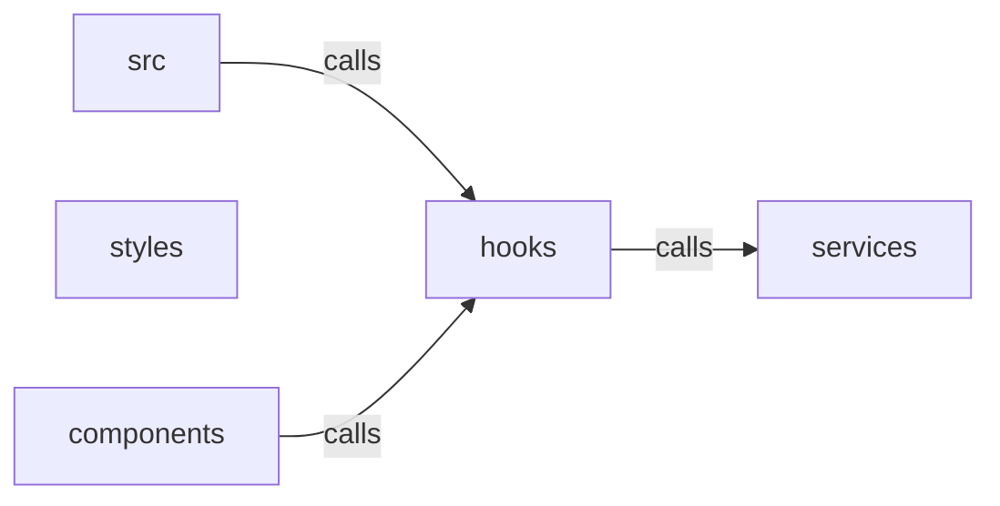

_Generated by CodeAtlas._

## Details

Owns 16 symbols across 4 file(s).

### components

Owns 35 symbols across 6 file(s).

**Related Classes/Methods:** _None_

**Source Files:**

- `frontend/src/components/AgentList.tsx`
  - `frontend.src.components.AgentList.Agent`
  - `frontend.src.components.AgentList.AgentList`
  - `frontend.src.components.AgentList.AgentListProps`
  - `frontend.src.components.AgentList.getStateColor`
  - `frontend.src.components.AgentList.handleSelectAll`
- `frontend/src/components/Controls.tsx`
  - `frontend.src.components.Controls.Controls`
  - `frontend.src.components.Controls.ControlsProps`
  - `frontend.src.components.Controls.VisibilityLayers`
- `frontend/src/components/EventLog.tsx`
  - `frontend.src.components.EventLog.Event`
  - `frontend.src.components.EventLog.EventLog`
  - `frontend.src.components.EventLog.EventLogProps`
- `frontend/src/components/PresetButtons.tsx`
  - `frontend.src.components.PresetButtons.PresetButtons`
  - `frontend.src.components.PresetButtons.PresetButtonsProps`
  - `frontend.src.components.PresetButtons.handleExportPresets`
  - `frontend.src.components.PresetButtons.handleImportPresets`
  - `frontend.src.components.PresetButtons.handleSavePreset`
- `frontend/src/components/SensorPanel.tsx`
  - `frontend.src.components.SensorPanel.DepthHeatmap`
  - `frontend.src.components.SensorPanel.DepthHeatmapProps`
  - `frontend.src.components.SensorPanel.LidarViewer`
  - `frontend.src.components.SensorPanel.LidarViewerProps`
  - `frontend.src.components.SensorPanel.SensorData`
  - `frontend.src.components.SensorPanel.SensorPanel`
  - `frontend.src.components.SensorPanel.SensorPanelProps`
  - `frontend.src.components.SensorPanel.ThermalViewer`
  - `frontend.src.components.SensorPanel.ThermalViewerProps`
- `frontend/src/components/StatsPanel.tsx`
  - `frontend.src.components.StatsPanel.AgentStateDistribution`
  - `frontend.src.components.StatsPanel.EventRates`
  - `frontend.src.components.StatsPanel.MiniChart`
  - `frontend.src.components.StatsPanel.MiniChartProps`
  - `frontend.src.components.StatsPanel.StatBox`
  - `frontend.src.components.StatsPanel.StatBoxProps`
  - `frontend.src.components.StatsPanel.StatisticsData`
  - `frontend.src.components.StatsPanel.StatsPanel`
  - `frontend.src.components.StatsPanel.StatsPanelProps`
  - `frontend.src.components.StatsPanel.formatUptime`

### hooks

Owns 27 symbols across 4 file(s).

**Related Classes/Methods:** _None_

**Source Files:**

- `frontend/src/hooks/useAgentSelection.ts`
  - `frontend.src.hooks.useAgentSelection.useAgentSelection`
- `frontend/src/hooks/useViewPresets.ts`
  - `frontend.src.hooks.useViewPresets.AnimationState`
  - `frontend.src.hooks.useViewPresets.UseViewPresetsOptions`
  - `frontend.src.hooks.useViewPresets.animate`
  - `frontend.src.hooks.useViewPresets.useViewPresets`
- `frontend/src/hooks/useWebSocket.test.ts`
  - `frontend.src.hooks.useWebSocket.test.array`
  - `frontend.src.hooks.useWebSocket.test.encode`
  - `frontend.src.hooks.useWebSocket.test.f64`
  - `frontend.src.hooks.useWebSocket.test.map`
  - `frontend.src.hooks.useWebSocket.test.pack`
  - `frontend.src.hooks.useWebSocket.test.read`
  - `frontend.src.hooks.useWebSocket.test.readArray`
  - `frontend.src.hooks.useWebSocket.test.readMap`
  - `frontend.src.hooks.useWebSocket.test.str`
  - `frontend.src.hooks.useWebSocket.test.testUnpack`
  - `frontend.src.hooks.useWebSocket.test.u16`
  - `frontend.src.hooks.useWebSocket.test.u32`
  - `frontend.src.hooks.useWebSocket.test.u8`
  - `frontend.src.hooks.useWebSocket.test.unpack`
- `frontend/src/hooks/useWebSocket.ts`
  - `frontend.src.hooks.useWebSocket.ControlCommand`
  - `frontend.src.hooks.useWebSocket.read`
  - `frontend.src.hooks.useWebSocket.readArray`
  - `frontend.src.hooks.useWebSocket.readMap`
  - `frontend.src.hooks.useWebSocket.sendCommand`
  - `frontend.src.hooks.useWebSocket.unpack`
  - `frontend.src.hooks.useWebSocket.unpackMessagePack`
  - `frontend.src.hooks.useWebSocket.useWebSocket`

### services

Owns 12 symbols across 1 file(s).

**Related Classes/Methods:** _None_

**Source Files:**

- `frontend/src/services/presetManager.ts`
  - `frontend.src.services.presetManager.CameraPreset`
  - `frontend.src.services.presetManager.PresetManager`
  - `frontend.src.services.presetManager.PresetManager.deletePreset`
  - `frontend.src.services.presetManager.PresetManager.exportPresetsAsJSON`
  - `frontend.src.services.presetManager.PresetManager.getAllPresets`
  - `frontend.src.services.presetManager.PresetManager.getPreset`
  - `frontend.src.services.presetManager.PresetManager.importPresetsFromJSON`
  - `frontend.src.services.presetManager.PresetManager.loadPresets`
  - `frontend.src.services.presetManager.PresetManager.resetToDefaults`
  - `frontend.src.services.presetManager.PresetManager.savePreset`
  - `frontend.src.services.presetManager.PresetManager.savePresets`
  - `frontend.src.services.presetManager.PresetStorage`

### styles

Owns 0 symbols across 6 file(s).

**Related Classes/Methods:** _None_
